# Đổi rác lấy quà — một chức năng thay cho Refill, nút Gomdon ở checkout và điểm nhận rời rạc

- **Ngày:** 2026-10-17
- **Trạng thái:** Bản nháp chờ chủ dự án duyệt. Chưa viết code, chưa có kế hoạch triển khai.
- **Phạm vi:** `apps/api` (module mới `waste-exchange`), `apps/miniapp` (trang khách, màn đại lý), `apps/web` (tab admin), `packages/shared-types`. Gỡ `/refill`, nút Gomdon ở checkout và danh mục quà cứng trong mã.
- **Mockup:** 16 ảnh chụp màn hình trong `docs/superpowers/specs/assets/2026-10-17-recycle-rewards/` (mini app rộng 390 px, admin rộng 1280 px; danh sách ở mục 19). Số liệu, tên cửa hàng và câu chữ trong ảnh là minh hoạ; khi ảnh và văn bản khác nhau thì văn bản thắng. Tên màn dùng trong tài liệu này: Trang Đổi rác, Chọn món, Chọn cách giao, Điểm nhận gần bạn, Mã QR, Theo dõi, Đã cộng điểm, Kho quà, Lối vào từ Vườn, Đại lý nhận hàng, Admin Hàng nhận, Admin Điểm nhận.
- **Cách đọc:** mục 1 đến 9 là phần sản phẩm (ý định, trải nghiệm khách, luật điểm, điểm nhận, ba cách giao, quà, admin). Mục 10 đến 13, 15 và 16 là phần cách làm trong code: sổ điểm, dữ liệu, thu kèm đơn qua Gomdon, việc gỡ Refill, API, giao diện. Mục 14 là pháp lý và việc phải làm với bên ngoài. Mục 17 là ra mắt và kiểm thử. Mục 18 liệt kê câu hỏi còn mở, các quyết định tôi tự đưa ra (chủ dự án đổi được) và điều chưa kiểm chứng. Mục 19 là danh sách ảnh. Mọi con số và tên khoá là đề xuất để chạy thử, trừ phần mục 3 ghi là chủ dự án đã chốt.

## 1. Ý định và lý do

Khách của Tubu Tree nhận rất nhiều bao bì: thùng carton, nilon chống sốc, vỏ hộp sữa, vỏ chai và hộp của chính Tubu. Chủ dự án muốn khách mang hoặc gửi những thứ đó lại và nhận Điểm Xanh hoặc quà. Hai việc cùng được: khách có lý do quay lại và mua tiếp, Tubu có thêm thùng carton và xốp hơi dùng lại để đóng hàng.

Trong repo đã có ba mảnh làm nửa việc này: tính năng Refill (trả vỏ chai, điểm nhận riêng), nút "thu gom" của Gomdon ở bước thanh toán, và một danh mục quà cứng trong mã (`DEFAULT_REWARD_CATALOG`). Chúng không biết nhau, mỗi mảnh có bảng, màn hình và cấu hình riêng. Chủ dự án yêu cầu gom thành MỘT chức năng đầy đủ thay vì nhiều chức năng rời rạc. Chưa có khách thật nên việc gỡ và gộp không cần di chuyển dữ liệu.

Khách ở Hà Nội, Cao Bằng và các tỉnh xa kho TP.HCM là bài toán khó nhất: gửi lẻ một gói nhỏ bằng chuyển phát thường tốn hơn giá trị điểm nhận lại (ước tính ship 30.000 đến 85.000đ, giá trị gói 2,5 kg với Tubu khoảng 30.000 đến 48.000đ; các con số này là ước tính từ bảng giá niêm yết, chưa có hợp đồng thật với Gomdon). Thiết kế phải nói thật điều đó với khách thay vì giấu.

## 2. Mục tiêu, không phải mục tiêu, điều phải tránh

**Mục tiêu**
1. Một chương trình, một trang vào, một tab admin, một bảng quy đổi, một bảng điểm nhận, một kho quà.
2. Khách đổi được trong ba bước: chọn món, chọn cách giao, nhận mã. Nhận điểm sau khi nơi nhận đếm xong.
3. Admin cấu hình được món, đơn vị, mức quy đổi, trần theo ngày và tháng, trạng thái từng món, điểm nhận, hạn mức điểm của từng đại lý, kho quà, và các ngưỡng chung, không cần sửa code.
4. Điểm chỉ do Tubu phát. Đại lý không tự phát điểm và không đặt tỉ giá.
5. Số điểm cộng luôn theo số lượng thực nhận và không vượt số khách khai.
6. Đo được từ ngày đầu: số lượng theo món và theo cách giao, chi phí ship, tỉ lệ nhận thiếu so với khai, mức dùng hạn mức của từng đại lý.

**Không phải mục tiêu của đợt này**
- Nhận pin đã dùng (chất thải nguy hại, xem mục 14). Pin chỉ hiện mờ "Sắp nhận".
- Trả tiền mặt cho rác, rút điểm ra tiền, chuyển điểm giữa người dùng.
- Trả phí tiền mặt cho đại lý. Đợt này chỉ ghi lại số lượng từng đại lý nhận để sau này tính phí theo đơn vị.
- Bản đồ trong app. Màn điểm nhận là danh sách; chỉ đường mở Google Maps bằng liên kết.
- Nhận diện ảnh bằng AI, in nhãn vận đơn, hoàn ship bằng điểm, "trạm gom" ở vùng xa (gom nhiều khách rồi ship một kiện). Bốn việc này là giả thuyết cho đợt sau, chưa có dữ liệu để kiểm.
- Đổi luật Điểm Xanh hiện có (1 điểm = 1.000đ, hạn 12 tháng, dùng tối đa 20% giá trị đơn, không trả phí ship).
- Dùng lại TubuXu (đã bỏ).

**Điều phải tránh dù kỹ thuật chạy đúng**
- Tubu chịu lỗ vì ship lẻ hoặc vì điểm nhận khai khống.
- Khách ở xa gửi gói lẻ mà không biết mình lỗ.
- Cộng điểm trước khi nơi nhận xác nhận rồi phải đảo khi khách đã tiêu.
- Mỗi đại lý một tỉ giá điểm riêng, hoặc điểm của đại lý trộn vào sổ điểm của Tubu.
- Quy trình dài hơn ba bước, hoặc đại lý mất hơn vài chục giây để xác nhận một lượt.
- Quảng cáo kiểu "tái chế 100%", "xử lý đúng chuẩn" khi chưa có hợp đồng với đơn vị tái chế đầu ra.
- Lộ số điện thoại hay địa chỉ khách cho đại lý quá mức cần thiết.

## 3. Những gì chủ dự án đã chốt (2026-10-17)

1. **Phần thưởng** là Điểm Xanh lô STANDARD, theo đúng luật hiện có (1 điểm = 1.000đ, hạn 12 tháng, dùng tối đa 20% giá trị đơn, không trả phí ship), kèm thưởng giọt nước cho vỏ Tubu (2 giọt mỗi vỏ).
2. **Quà đợt 1:** 4 voucher hiện có chuyển từ mã vào DB; thêm quà trồng cây (chủ dự án viết "trồng 1 cây thật"; trong thiết kế này quà đó tên là "Góp quỹ trồng cây", lý do và cách đổi ở mục 18.2, câu 1); thêm quà nhỏ có tồn kho, nhận bằng mã (đợt 1 chỉ tại kho Tubu TP.HCM, lệch với câu chữ này; mục 8 và 18.2, câu 9).
3. **Thu kèm đơn mua:** Tubu chịu phí như Gomdon hiện nay, ở mọi tỉnh (đợt 1 cách này mặc định tắt cho tới khi Gomdon xác nhận bằng văn bản và một đơn thử chạy được, mục 12.4 và 18.1). **Đường gửi ship:** khách tự gửi hãng nào cũng được, nhập mã vận đơn, có ngưỡng tối thiểu, xem trước phí và điểm, hàng bị từ chối không hoàn lại.
4. **Đại lý:** một bảng quy đổi trung tâm; "ưu đãi riêng" của đại lý tự chịu tiền và tách khỏi sổ điểm; Tubu đặt hạn mức điểm theo tháng cho từng đại lý; đợt 1 không trả phí tiền mặt, chỉ ghi số lượng.
5. **Pin** không nhận ở đợt 1 (hiện "Sắp nhận"). **Bỏ `/refill`**; vỏ Tubu thành một món trong danh mục chung.

Thứ tự làm do chủ dự án đặt: dọn backlog nightly (đã làm xong, PR #15 chờ chủ dự án gộp), mockup (xong), spec này, rồi kế hoạch và code.

## 4. Trải nghiệm của khách

Các màn dưới đây khớp với mockup. Số liệu trong ngoặc là ví dụ.

**4.1 Trang Đổi rác (trang vào, ảnh 01).** Thẻ đầu trang (nhãn "Điểm Xanh của bạn", không ghi "từ đổi rác", vì Điểm Xanh là một ví chung, 17.2) cho thấy số Điểm Xanh hiện có quy ra tiền mua sắm, một dòng tác động ước tính (chỉ hiện khi đủ điều kiện ở 5.7), thanh tiến độ tới quà kế tiếp (14 điểm, còn 6 điểm tới mã giảm giá miễn phí ship, "tương đương khoảng 6 thùng carton"), nút "Đổi rác ngay". Bên dưới: các yêu cầu đang xử lý (mã, cách giao, mini timeline 4 bước; biểu tượng lịch sử ở góc dẫn tới "Yêu cầu của tôi", 16.1), ba cách đổi (chỉ hiện các cách đang bật theo `/config/public` và không bị khoá đường kho, 15.6), danh sách món Tubu nhận (món chưa nhận hiện mờ), và một hàng quà. Lối vào từ app: mục menu ở trang Cá nhân, hàng ở trang Điểm Xanh và một thẻ nhỏ trong Vườn Xanh (4.9; danh sách đầy đủ ở 16.1). Không đặt thành tab riêng ở thanh điều hướng dưới. Khi chương trình tắt hoặc khách bị khoá khỏi chương trình: ẩn nút "Đổi rác ngay" và khối "ba cách đổi", hiện thẻ "Chương trình đang tạm dừng" hoặc "Tài khoản của bạn tạm không tham gia Đổi rác, liên hệ Tubu Tree"; các yêu cầu đang xử lý và đã đóng vẫn hiện (yêu cầu đã nhận ở kho của khách bị khoá ghi "Đang chờ Tubu xem lại"), vì khách cần xem bảng đã đếm và điểm đã cộng (15.1).

**4.2 Chọn món (bước 1/3, ảnh 02).** Mỗi món là một thẻ: ảnh hoặc biểu tượng, tên, quy tắc ("1 thùng = 1 điểm", "5 vỏ = 1 điểm"), mô tả ngắn cách chuẩn bị, câu trần, bộ đếm +/−. Câu trần do hệ thống dựng từ cột trần của món, không gõ vào hướng dẫn chuẩn bị: "Tối đa N mỗi tháng", thêm "Mang tới điểm nhận: tối đa M mỗi ngày" khi món có trần ngày. Bộ đếm +/− chỉ kẹp theo phần trần tháng còn lại (`GET /waste/me`); vượt trần ngày được báo ở bước 2 khi khách chọn Mang tới điểm nhận. Món chia theo nhóm (vỏ sữa 5 vỏ = 1 điểm) có thanh tiến độ "thêm 3 vỏ nữa được +1 điểm". Thanh dính đáy: số điểm ước tính, quy ra tiền mua sắm, câu so với quà kế tiếp, nút "Tiếp tục". Món trạng thái "sắp nhận" không bấm được.

**4.3 Chọn cách giao (bước 2/3, ảnh 03).** Ba thẻ, chọn một:
- *Mang tới điểm nhận:* miễn phí, nhận điểm khi người ở điểm xác nhận. Nhãn "Nhanh nhất" khi `POST /waste/points/nearby` trả về điểm gần nhất cách dưới 5 km (hằng trong mã); không có vị trí thì không hiện nhãn.
- *Gửi về kho Tubu HCM:* khách tự gửi hãng nào cũng được và tự trả phí. Thẻ mở ra bảng xem trước: điểm ước tính, phí ship ước tính từ tỉnh của khách (lấy từ địa chỉ mặc định; chưa có thì khách chọn tỉnh ngay trên thẻ), gói tối thiểu (15 điểm). Dưới ngưỡng thì nút bị khoá kèm lời nhắn "cần thêm N điểm", nhưng chỉ khi N còn đạt được trong phần trần tháng của khách; nếu không thì lời nhắn là "tháng này bạn không còn đủ trần cho một gói gửi kho" (15.2). Khi giá trị điểm nhỏ hơn phí ship ước tính thì hiện cảnh báo trung thực và hai lối thay thế (điểm nhận, thu kèm đơn), chỉ hiện lối nào đang bật và không bị khoá; không còn lối nào thì chỉ hiện cảnh báo. Dòng cuối: mỗi kiện tối đa {maxWeightKg} kg và cạnh dài tối đa {maxEdgeCm} cm (từ `parcelLimits` của `GET /waste/me`), hàng gửi về kho không hoàn lại, và kiện còn cước phải trả khi nhận bị kho từ chối ngay ở cửa. Thẻ Thu kèm đơn hiện cùng dòng giới hạn kiện.
- *Thu kèm đơn mua:* miễn phí cho khách, bưu tá lấy khi giao đơn Tubu kế tiếp. Khách vẫn tạo yêu cầu ở đây như hai cách kia (nhận mã `TR-...`), rồi ở bước thanh toán của đơn kế tiếp bật công tắc "Thu kèm rác" để gắn yêu cầu vào đơn (7.3, 12.2). Mỗi khách chỉ giữ một yêu cầu Thu kèm đơn chưa gắn đơn cùng lúc, tối thiểu 10 điểm ước tính (5.3). Thẻ này chỉ hiện khi cách này đang bật (mặc định tắt, 12.4).
Khách ở tỉnh không có điểm nhận được xem trước thẻ "Gửi về kho" (và "Thu kèm đơn" khi cách đó đang bật) lên đầu. Cuối bước, khách tích đồng ý cho Tubu xử lý yêu cầu (tách khỏi đồng ý nhận quảng cáo, 14.4); với cách Gửi về kho còn tích cam kết đóng gói không lẫn pin, hoá chất, vật nhọn, đồ ướt hoặc bẩn (14.1) và cam kết đã trả đủ cước, vì kho từ chối kiện còn cước phải trả khi nhận (7.2).

Khi `POST /waste/preview` báo `MAX_OPEN`, mọi thẻ bị khoá với lời nhắn "Bạn đang có N yêu cầu chưa xong" (N là `waste.max_open_requests`). Khi báo `PICKUP_PENDING`, thẻ Thu kèm đơn bị khoá với lời nhắn "Bạn đã có yêu cầu thu kèm TR-..., hãy gắn vào đơn kế tiếp". Khi báo `NEED_PROVINCE`, thẻ Gửi về kho hiện ô chọn tỉnh (15.2).

**4.4 Điểm nhận gần bạn (ảnh 04).** Danh sách, không bản đồ. Có ô tìm theo tên điểm, phường/xã hoặc tên đường, nhóm "Gần tôi" và các tab theo tỉnh (TP.HCM, Hà Nội, Đà Nẵng; tỉnh nào có điểm thì hiện tab). Địa chỉ điểm theo hai cấp tỉnh và phường/xã, không có quận (11.1). Sắp theo khoảng cách (nhãn "Gần nhất"). Cuối danh sách có khối "Chưa có điểm gần bạn?" nói thật rằng gửi gói nhỏ qua hãng vận chuyển thường tốn hơn giá trị điểm, và dẫn tới các cách còn lại đang bật và không bị khoá (không còn cách nào thì không có nút). Mỗi thẻ: tên, loại (Kho Tubu hoặc Đại lý), địa chỉ và khoảng cách, đang mở hay đóng, các món nhận (món không nhận gạch ngang và ghi "Không nhận"), nút "Chỉ đường" (liên kết Google Maps theo địa chỉ) và "Chọn điểm này". Điểm hết hạn mức tháng bị làm mờ, ghi "Tạm hết hạn mức tháng này", nút bị khoá. Điểm không nhận đủ các món khách đã chọn ở bước 1 vẫn hiện, xếp sau các điểm nhận đủ, nút "Chọn điểm này" bị khoá kèm dòng "Điểm này không nhận: <tên món>" (máy khách so danh sách món nhận của điểm với món đã chọn). Khoảng cách tính từ vị trí khách cho phép (quyền vị trí của Zalo, điều kiện ở 16.1); nếu khách từ chối hoặc việc lấy vị trí hỏng thì nhóm "Gần tôi" và nhãn "Gần nhất" biến mất, khách chọn tỉnh hoặc tìm bằng chữ.

**4.5 Mã QR (bước 3/3, ảnh 05).** Mã yêu cầu ngắn (`TR-8K2M9`), mã QR, điểm nhận đã chọn, hạn giữ chỗ (7 ngày), danh sách món khai, danh sách chuẩn bị ("gấp phẳng, bỏ băng keo", "vỏ sữa rửa sạch để khô"), và dòng: điểm chỉ cộng sau khi điểm nhận đếm xong theo số thực nhận, không vượt số đã khai. Nút "Theo dõi yêu cầu", liên kết "Sửa món" và "Huỷ yêu cầu". Khi khách sửa món, điểm ước tính được tính lại theo mức quy đổi hiện hành nên có thể đổi, màn nói rõ điều đó; hạn giữ chỗ không dài thêm (15.2).

**4.5b Sau khi tạo: Gửi về kho và Thu kèm đơn mua (cùng trang `/recycle/r/:id` khi `OPEN`; ảnh 05 chỉ vẽ cách Mang tới điểm nhận).** Mã `TR-` cỡ lớn kèm dòng "Ghi mã này lên kiện, mỗi kiện một yêu cầu" (Gửi về kho) hoặc "Ghi mã này lên túi" (Thu kèm đơn). Gửi về kho: khối người nhận gồm tên, số điện thoại và địa chỉ của điểm `WAREHOUSE` (lấy từ `GET /waste/requests/:id`, 15.2) với nút "Sao chép"; quy tắc đóng gói (14.1) và dòng kho từ chối kiện còn cước phải trả khi nhận (7.2); ô Hãng (chữ tự do) và ô Mã vận đơn, nút "Đã gửi" gọi `PUT /waste/requests/:id/tracking`; dòng "Nhập trước dd/mm" lấy từ `expiresAt`. Thu kèm đơn: dòng "Gắn yêu cầu này vào đơn mua kế tiếp ở bước thanh toán" kèm nút đi mua hàng. Khi đã nhập mã vận đơn, thẻ Vận chuyển ở Theo dõi có nút "Sửa" (7.4).

**4.6 Theo dõi (ảnh 06).** Danh sách yêu cầu của khách và chi tiết từng yêu cầu: trạng thái, timeline 4 bước (đường ship: Đã gửi, Vận chuyển, Đã nhận ở kho, Cộng điểm; đường điểm nhận: Đã tạo, Mang tới điểm, Điểm nhận đếm, Cộng điểm; đường thu kèm đơn: Đã tạo, Gắn vào đơn, Chờ kho nhận, Cộng điểm), mã vận đơn và hãng (đường ship), bảng "đã khai" và "đã đếm". Mọi bước do bên khác làm (kho nhận kiện, đã cộng điểm, từ chối, hết hạn, thu hồi điểm) đều có thông báo trong ứng dụng (11.6), vì bài học từ app khác: không báo thì khách hoang mang. Cuối màn có liên kết "Cần hỗ trợ? Nhắn Tubu Tree", dùng kênh hỗ trợ ứng dụng đang có.

Ánh xạ từ trạng thái sang bước đang diễn ra của timeline (các bước trước nó là đã xong). Gửi về kho: `OPEN` là bước 1 (chưa nhập mã vận đơn), `IN_TRANSIT` là bước 2, `RECEIVED` là bước 3, `COMPLETED` là mọi bước đã xong. Mang tới điểm: `OPEN` là bước 2 (bước 1 đã xong), `COMPLETED` là mọi bước đã xong. Thu kèm đơn: `OPEN` chưa gắn đơn là bước 2, `OPEN` đã gắn đơn là bước 3 (chờ đơn được giao), `IN_TRANSIT` hoặc `RECEIVED` là bước 3, `COMPLETED` là mọi bước đã xong. Trạng thái đóng không thành công thay timeline bằng một nhãn và một dòng lý do: `REJECTED` "Bị từ chối" kèm lý do; `EXPIRED` theo `closeReason` (`HOLD_EXPIRED` "Hết hạn giữ chỗ", `PICKUP_NO_SHOW` "Kho chưa nhận được rác thu kèm đơn", `LOST` "Đã đóng vì thất lạc", `LOST_AT_WAREHOUSE` "Kiện bị thất lạc tại kho Tubu, xin lỗi bạn"); `CANCELLED` "Đã huỷ" kèm nguyên nhân (bạn huỷ, đơn mua bị huỷ, đường kho tạm dừng); `REVERSED` "Đã thu hồi N điểm" (số điểm thực thu, có thể ít hơn số đã cộng) kèm lý do. Các trạng thái đó kèm liên kết hỗ trợ.

**4.7 Đã cộng điểm (ảnh 07).** Số điểm vừa cộng, bảng "kho đếm được so với bạn khai" (kèm lý do từng dòng nhận thiếu hoặc từ chối), số dư mới và tiến độ tới quà, thưởng giọt nước nếu có (số giọt thực sự vào bình, có thể ít hơn khi bình đã đầy, 10.5), và thẻ tác động. Thẻ tác động chỉ nói khối lượng ("Bạn đã gửi khoảng 1,9 kg bao bì cho Tubu", "Ước tính theo khối lượng trung bình"), không nói CO2 hay cây, và chỉ hiện khi mọi món trong lượt có trọng lượng mỗi đơn vị do admin đặt (5.7). Nếu lượt đếm cho 0 điểm (ví dụ 3 vỏ hộp sữa khi cần 5 vỏ mới được 1 điểm), màn nói thật là chưa đủ để cộng, không hiện "đã cộng điểm" (10.1). Hai nút: "Đổi quà ngay" và "Đổi thêm rác". Màn này đứng riêng, không nằm trong trình hướng dẫn ba bước.

**4.8 Kho quà (ảnh 08).** Số dư, ghi chú luật dùng điểm. Ba tab: Mã giảm giá, Cây và hạt, Quà nhỏ. Mỗi quà: tên, mô tả, giá, nút "Đổi" hoặc "Cần thêm N điểm" kèm thanh tiến độ, số còn lại nếu có tồn kho; thẻ quà nhỏ và gói hạt ghi rõ "Nhận tại kho Tubu TP.HCM" (lấy từ trường hướng dẫn nhận, 11.1). Bấm "Đổi" mở khung xác nhận (điểm còn lại sau khi đổi, và với quà nhận tại kho: nơi nhận kèm địa chỉ và giờ mở của kho, cùng hạn nhận 60 ngày), rồi hiện kết quả: mã giảm giá vào ví, mã nhận quà (quà nhỏ và gói hạt), hoặc xác nhận đã góp một cây vào quỹ trồng cây (không hứa cây cụ thể, không kèm giấy chứng nhận, mục 8). Thẻ "Góp quỹ trồng cây" dùng lời gọi góp cây hiện có của Vườn Xanh, không đi qua đường đổi quà (8); nút "Đổi" của thẻ bật theo đúng tổng điểm mà lời gọi đó tiêu được (15.2). Đầu trang Kho quà có liên kết "Quà của tôi" (route `/rewards/mine`, đọc `GET /me/loyalty/rewards/mine`): lượt `READY` hiện mã `QG-` cỡ lớn, nơi nhận (kho Tubu TP.HCM) và hạn nhận (`claimExpiresAt`); lượt `CANCELLED` hiện lý do và số điểm đã hoàn (có thể 0); lượt `FULFILLED` hiện ngày nhận; lượt mã giảm giá dẫn tới ví mã.

**4.9 Lối vào từ Vườn Xanh (ảnh 09).** Một thẻ nhỏ trong trang Vườn Xanh, có nhãn "Mới", dẫn tới trang Đổi rác, kèm một dòng: giọt nước dùng trong Vườn, Điểm Xanh dùng để mua sắm. Việc đổi rác không nằm trong game. Giọt nước thưởng cho vỏ Tubu đi vào bình nước hiện có của khách, kẹp theo sức chứa bình (10.5). Thẻ thay hàng "Đổi vỏ chai lấy nước" của Refill; các lối vào khác ở 16.1.

**4.10 Đại lý nhận hàng (ảnh 10).** Màn của người ở điểm (chủ điểm và nhân viên do admin gắn tên) trong chính mini app: hạn mức điểm tháng này (đã dùng, còn lại), ô nhập mã (quét QR bằng camera là tuỳ chọn, 15.3), thẻ yêu cầu (tên khách che bớt, số điện thoại che bớt), danh sách món với "khách khai N" và bộ đếm "số thực nhận" không vượt N, ô "Điểm Tubu sẽ cộng cho khách" tính trực tiếp, nút "Xác nhận đã nhận". Khi số thực nhận của một dòng nhỏ hơn số khai, dưới dòng đó hiện bộ chọn lý do (Ướt, Bẩn, Lẫn vật lạ, Sai loại, Hỏng, Không nhận, Khác; enum `shortfallReason` ở 11.1) và nút xác nhận bị khoá tới khi mọi dòng thiếu đều có lý do; một nút phụ "Từ chối cả yêu cầu" mở khung chọn lý do rồi gọi route `reject` (15.3). Lỗi hiện bằng snackbar: "Không tìm thấy mã" (tra mã trượt), "Điểm đã hết hạn mức tháng, còn N điểm" (15.5 bước 7), "Khách đang bị khoá, không cộng điểm được" ở kho, hoặc "Yêu cầu này đang chờ Tubu xử lý, chưa xác nhận được tại điểm" ở điểm `PARTNER` (15.5 bước 4b), "Bạn không thể xác nhận yêu cầu này" (tự xác nhận, cùng số điện thoại hoặc đồng nghiệp là người đổi), "Bạn đã chạm trần điểm xác nhận hôm nay" (15.5 bước 6). Xác nhận xong: "Tubu sẽ cộng N điểm cho khách" và hạn mức mới. Ghi chú trên màn: đại lý không tự cộng điểm. Có thẻ "Ưu đãi riêng của cửa hàng" (tự chịu, không liên quan Điểm Xanh); nút "Chỉnh sửa" chỉ hiện với vai `OWNER`; nội dung mới chờ admin duyệt (5.6) và thẻ ghi "Đang chờ Tubu duyệt" cho tới khi duyệt. Điểm `WAREHOUSE` không có thẻ hạn mức và thẻ ưu đãi; thay vào đó là dòng "Còn N điểm được xác nhận hôm nay" (trần nhân viên, 5.5). Người có nhiều điểm chọn điểm ở đầu màn.

**4.11 Admin (ảnh 11 và 12).** Một tab "Đổi rác" với năm phần (mục 9). Mockup có hai phần: Hàng nhận và Điểm nhận.

## 5. Luật điểm, món hàng và chống gian lận

### 5.1 Món hàng (do admin cấu hình)
Mỗi món có: mã, tên, đơn vị hiển thị ("thùng", "túi lớn", "vỏ"), mức quy đổi "N đơn vị = M điểm" (điểm = phần nguyên của số lượng chia N, nhân M; phần lẻ của từng yêu cầu không cộng dồn), thưởng giọt nước mỗi đơn vị (chỉ vỏ Tubu: 2), trần số lượng mỗi khách mỗi ngày và mỗi tháng (có thể để trống; trần ngày chỉ áp cho cách Mang tới điểm nhận, trần tháng áp cho mọi cách, 5.3), trạng thái (`ACTIVE`, `COMING_SOON`, `HIDDEN`), hướng dẫn chuẩn bị (không ghi số trần: câu trần do hệ thống dựng từ cột trần, 4.2), ảnh, thứ tự, trọng lượng ước tính mỗi đơn vị (gram, có thể trống) và cờ `hazardous`. Món `hazardous` không bao giờ được đặt `ACTIVE` (ràng buộc ở DB và ở API), để chặn việc nhận pin ngoài ý muốn. Mức quy đổi và thưởng giọt nước được **chụp lại** vào từng dòng yêu cầu lúc tạo và lúc khách sửa yêu cầu; sửa bảng quy đổi chỉ áp cho yêu cầu mới và cho lần sửa kế tiếp.

Mặc định đề xuất cho dữ liệu khởi tạo (admin đổi được): thùng carton cũ 1 thùng = 1 điểm, trần 10 thùng mỗi ngày (chỉ cách Mang tới điểm nhận) và 60 thùng mỗi tháng; nilon chống sốc 1 túi lớn = 1 điểm, trần 10 túi mỗi ngày (chỉ cách Mang tới điểm nhận) và 60 túi mỗi tháng; vỏ hộp sữa sạch 5 vỏ = 1 điểm, trần 50 vỏ mỗi ngày (chỉ cách Mang tới điểm nhận) và 300 vỏ mỗi tháng; vỏ chai, hộp Tubu Tree 1 vỏ = 2 điểm và 2 giọt nước mỗi vỏ, trần 20 vỏ mỗi tháng và không có trần ngày; pin đã dùng `COMING_SOON` và `hazardous`. Ba trần tháng đầu đều tương đương đúng 60 điểm, bằng trần điểm tháng của khách (5.3), để một khách chỉ có carton vẫn đạt gói gửi kho tối thiểu 15 điểm (mục 18.2, câu 19). Mockup chỉ ghi trần trên những thẻ có trần; bảng này là bản đề xuất đầy đủ. Mức này theo nguyên tắc từ nghiên cứu: tỉ lệ nguyên số dễ nhớ (5 vỏ = 1 điểm), carton trả tương đương giá ve chai (khoảng 3.000đ mỗi kg), thưởng 30 đến 40% giá trị Tubu thu lại được. Các tỉ lệ dùng lại thực tế (giả định 40% carton, 50% xốp hơi) phải đo trong 1 đến 2 tháng chạy thử rồi chỉnh.

### 5.2 Khi nào điểm được cộng
1. Khách tạo yêu cầu: chỉ lưu số khai và số điểm ước tính. Chưa cộng gì.
2. Nơi nhận (đại lý, nhân viên kho) đếm số thực nhận từng dòng, không vượt số khai, ghi lý do cho dòng nhận thiếu.
3. Hệ thống tính điểm từ số thực nhận và mức quy đổi đã chụp, kiểm trần điểm mỗi nhân viên mỗi ngày (5.5) và hạn mức của điểm nhận (đại lý), rồi cộng điểm một lần duy nhất trong cùng một giao dịch với việc chuyển trạng thái yêu cầu sang hoàn tất (10.1, 15.5). Trần của khách đã được giữ từ lúc tạo yêu cầu và ở mọi lần sửa yêu cầu (5.3, 15.2), và số thực nhận không vượt số khai, nên bước này không kiểm lại trần khách; nó chỉ kiểm điểm tính ra không vượt số điểm ước tính đã giữ. Gọi lại thao tác xác nhận không cộng lần hai.
4. Điểm vào ví là lô STANDARD (hạn 12 tháng, dùng được theo luật hiện có), dòng sổ `RECYCLE:<mã yêu cầu>`. Thưởng giọt nước đi vào bình nước của khách trong cùng giao dịch, kẹp theo sức chứa bình (10.5).
5. Điểm tiêu được ngay, không giữ chờ. Tôi đã bỏ phương án "giữ điểm N giờ" để khỏi thêm một cơ chế chạm vào bốn đường tiêu điểm (thanh toán, đổi quà, quay thưởng, góp cây). Mức thiệt hại tối đa được chặn bằng các lớp khác: xác nhận của nơi nhận, hạn mức đại lý, trần khách và trần nhân viên. Thu hồi (10.3) không phải lớp bảo vệ ở đây, vì khách có thể tiêu hết điểm trước khi gian lận bị phát hiện; con số thiệt hại tối đa nêu ở 5.5 và mục 18.2, câu 2. Yêu cầu tính ra 0 điểm vẫn hoàn tất và khách được báo đúng sự thật là chưa đủ để cộng (10.1).

### 5.3 Trần và giới hạn cho khách
- Trần theo món (5.1): trần ngày chỉ áp khi tạo hoặc sửa yêu cầu Mang tới điểm nhận, vì rủi ro thông đồng nằm ở điểm nhận; trần tháng áp cho mọi cách giao. Phép đếm trần ngày vẫn gồm yêu cầu của mọi cách giao cùng ngày (khách không gửi 60 thùng rồi mang thêm 10 thùng tới điểm nhận trong cùng ngày). Số đếm tính theo số thực nhận nếu đã đếm, theo số khai nếu chưa đếm, trên mọi yêu cầu còn hiệu lực hoặc đã hoàn tất (kể cả bị thu hồi). Huỷ, từ chối và hết hạn trả lại phần trần (11.2).
- Trần điểm mỗi khách mỗi tháng cho chương trình (mặc định đề xuất 60 điểm, `waste.customer_monthly_cap_points`).
- Số yêu cầu đang mở cùng lúc tối đa 3 (`waste.max_open_requests`); yêu cầu đang mở là yêu cầu ở trạng thái `OPEN`, `IN_TRANSIT` hoặc `RECEIVED`. Riêng cách Thu kèm đơn, mỗi khách chỉ giữ một yêu cầu chưa gắn đơn cùng lúc, để bước thanh toán luôn gắn đúng yêu cầu đó.
- Đường ship: gói tối thiểu 15 điểm ước tính (`waste.mailin_min_points`); trọng lượng tối đa `waste.mailin_max_weight_kg` (mặc định 20 kg) và cạnh dài tối đa `waste.mailin_max_edge_cm` (mặc định 50 cm) mỗi kiện (theo giới hạn của hãng chuyển phát; hệ thống không đo, khách cam kết và kho từ chối kiện vượt giới hạn với lý do `OVERSIZE`); khách phải đồng ý quy tắc đóng gói (sạch, khô, không lẫn pin, hoá chất, vật nhọn) và cam kết đã trả đủ cước. Đường thu kèm đơn: tối thiểu `waste.pickup_min_points` (mặc định 10) điểm ước tính và cùng giới hạn trọng lượng, cạnh dài như đường ship, để Tubu không trả phí lấy hàng cho một gói vài vỏ hộp sữa. Hai ngưỡng tối thiểu và trần điểm tháng được kiểm khi tạo và khi sửa yêu cầu.
- Khách phải là người dùng thật (không phải khách vãng lai) đã có số điện thoại, không bị khoá chương trình và, với đường gửi kho và thu kèm đơn, không bị khoá đường kho (5.4). Mã vận đơn chỉ là gợi ý để kho đối chiếu; căn cứ nhận hàng là mã `TR-` ghi trên kiện (7.2). Một khách không dùng cùng một mã vận đơn cho hai yêu cầu chưa đóng của chính mình. Mã trùng với yêu cầu của người khác vẫn được nhận, cả hai yêu cầu được đánh dấu `trackingConflict` để nhân viên kho thấy, và hệ thống không bao giờ cho khách biết mã đó đã có người dùng. Đợt 1 không đánh dấu "trùng thiết bị" vì chưa có dấu vết thiết bị đáng tin (mục 18.2, câu 14).

### 5.4 Nhận thiếu, từ chối, hết hạn, thất lạc
- Nhận thiếu: điểm theo số thực nhận. Hiện cho khách bảng "đã khai" và "đã đếm" kèm lý do (ướt, bẩn, lẫn vật lạ, sai loại, hỏng).
- Từ chối toàn bộ: yêu cầu chuyển `REJECTED`, thông báo kèm lý do, không cộng điểm. Hàng ship về kho không hoàn lại.
- Hết hạn: điểm nhận chưa tới trong 7 ngày kể từ lúc tạo thì `EXPIRED` và trả lại phần trần đã giữ. Đường ship chưa nhập mã vận đơn trong 7 ngày cũng `EXPIRED`. Đã nhập mã nhưng 30 ngày chưa thấy hàng về thì chuyển vào danh sách admin xem lại, không tự đóng; admin đóng yêu cầu thất lạc bằng thao tác "đóng vì thất lạc" (`EXPIRED`, 15.4). Thu kèm đơn: sau khi đơn mua đã giao, quá 14 ngày mà kho chưa nhận gì thì `EXPIRED` (mục 12.3). Các số ngày là cấu hình (11.5).
- Hàng về kho không rõ chủ: kiện không có mã `TR-` mà mã vận đơn không khớp đúng một yêu cầu, kiện có mã `TR-` và mã vận đơn trỏ về hai yêu cầu khác nhau, kiện mang mã của một yêu cầu đã `EXPIRED`, hoặc kiện mang mã của một yêu cầu không còn nhận được (đã `RECEIVED`, `COMPLETED`, `REJECTED`, `REVERSED` hay `CANCELLED`; một yêu cầu là một kiện, 7.2). Chúng vào danh sách "hàng không rõ chủ", nhân viên kho và admin cùng xử lý (15.4). Với yêu cầu đã `EXPIRED` mà kiện đến muộn, admin dùng thao tác "mở lại" (chuyển về `RECEIVED` sau khi kiểm lại trần của khách) rồi kho đếm như thường; nếu trần không còn đủ, admin từ chối kiện kèm lý do.
- Chênh lệch lặp lại: nếu N yêu cầu liền nhau gần nhất của một khách ở hai đường kho nhận (`MAIL_IN`, `PICKUP`) đều là "lần thiếu" (`waste.shortfall_lock_streak`, mặc định 3) thì khoá đường gửi kho và đường thu kèm đơn của khách đó (Tubu chịu phí ở cả hai), chỉ cho đường mang tới điểm, chờ admin mở lại; khách nhận `WASTE_SHIP_LOCKED`, lời lẽ trung tính vì với đường thu kèm đơn bưu tá có thể không lấy rác. Một yêu cầu là "lần thiếu" khi bị từ chối, bị thu hồi, hết hạn sau khi đơn đã giao mà kho không nhận gì (thu kèm đơn), hoặc hoàn tất với số điểm cộng chưa tới (100 trừ `waste.shortfall_lock_pct`) phần trăm điểm ước tính (mặc định: nhận thiếu quá một nửa). Cách đếm chính xác, các trạng thái không tính và các nơi kiểm khoá nằm ở 15.6.
- Thu hồi điểm: admin được thu hồi điểm của một yêu cầu đã hoàn tất (gian lận phát hiện sau). Cách thu hồi theo cơ chế đảo hiện có của sổ điểm (mục 10.3): thu tối đa số dư Điểm Xanh thường (lô STANDARD) khách còn trong ví, số dư không bao giờ âm; điểm quy đổi từ xu (lô CONVERTED) không bị đụng; điểm khách đã tiêu không đòi lại được; khách nhận thông báo rõ lý do, không huỷ điểm âm thầm.

### 5.5 Chống gian lận
Rủi ro lớn nhất nằm ở bên có quyền (đại lý, nhân viên điểm nhận), không phải khách lẻ. Vì vậy:
- Đại lý không tạo điểm. Chỉ Tubu cộng, và chỉ theo số lượng đại lý xác nhận.
- **Hạn mức điểm theo tháng cho từng đại lý** do Tubu đặt. Cộng điểm kiểm hạn mức và tăng bộ đếm trong cùng một câu lệnh có điều kiện, nên nhiều khách xác nhận cùng lúc không vượt hạn mức. Hết hạn mức thì điểm nhận hiện mờ và không xác nhận được.
- Người xác nhận không được là chính khách, không dùng cùng số điện thoại với khách, và, tại điểm `PARTNER`, người ở điểm không xác nhận cho yêu cầu do đồng nghiệp cùng điểm tạo. Tại kho chỉ cấm tự xác nhận và cấm cùng số điện thoại: nhân viên kho vẫn xác nhận được yêu cầu của một nhân viên khác dùng tài khoản khách, và rủi ro đó bị chặn bởi trần 60 điểm mỗi khách mỗi tháng (15.4, mục 18.2 câu 6).
- Mỗi lần xác nhận ghi: ai, lúc nào, từ máy nào (địa chỉ IP rút gọn: IPv4 bỏ octet cuối, IPv6 giữ 48 bit đầu; đầu chuỗi user agent), số khai, số nhận, số điểm. Nhật ký chỉ thêm, không sửa (11.1).
- Trần điểm mỗi nhân viên (kho hoặc điểm nhận) được xác nhận mỗi ngày (`waste.staff_daily_cap_points`, mặc định 1.000 điểm), để một người có quyền không thể cộng điểm hàng loạt trước khi bị phát hiện (15.5, bước 6). Yêu cầu bị thu hồi trong ngày vẫn tính vào trần này.
- Cảnh báo bất thường cho admin: đại lý dùng hạn mức nhanh bất thường so với trung bình các điểm khác, số lượng trung bình mỗi lượt cao bất thường, một khách lặp lại ở một điểm, tỉ lệ nhận đủ đúng bằng số khai gần như 100%, số lần tra mã không ra kết quả của một điểm trong ngày, và yêu cầu của tài khoản có vai STAFF hoặc ADMIN do một nhân viên khác xác nhận (cách xác nhận chéo ở kho, vì quy tắc đồng nghiệp không áp ở kho; mục này đánh dấu mọi trường hợp, không có ngưỡng). Tỉ lệ nhận đủ đúng số khai và số lượng trung bình mỗi lượt cũng được tính theo từng người xác nhận (`confirmedByUserId`), không chỉ theo điểm, và có thêm một cảnh báo cho kho: một người xác nhận thẳng từ `OPEN` (yêu cầu chưa từng có `inTransitAt`, tức không có mã vận đơn) từ `staffDirectCount` yêu cầu `MAIL_IN` hoặc `PICKUP` trong `staffDirectDays` ngày. Cảnh báo hiện ở đầu tab Đổi rác (`GET overview`), không vào hộp việc ở trang chủ, vì chúng tính lại mỗi lần và không có thao tác nào làm chúng biến mất. Ngưỡng của các mục còn lại là cấu hình.
- Kiểm mẫu: admin chọn lượt để yêu cầu đại lý chụp ảnh hoặc gửi lô về kho đối chiếu. Đợt 1 làm thủ công từ danh sách, chưa tự động.
- Điểm nhận `PARTNER` mà mốc muộn hơn giữa lần xác nhận cuối (`lastConfirmedAt`) và lần được kích hoạt (`activatedAt`) cách hôm nay quá `waste.point_inactive_days` (mặc định 60 ngày) bị ẩn khỏi danh sách của khách. `activatedAt` được đặt lại mỗi lần điểm chuyển sang `ACTIVE`, nên điểm mới duyệt hoặc vừa mở lại có đủ cửa sổ. Việc ẩn chỉ ảnh hưởng danh sách `GET /waste/points` và `POST /waste/points/nearby`: điểm vẫn `ACTIVE`, khách có liên kết cũ hoặc yêu cầu đang mở vẫn dùng được, và lần xác nhận kế tiếp hoặc thao tác "kích hoạt lại" của admin đưa điểm trở lại danh sách. Kho TP.HCM không bao giờ bị ẩn. Admin quyết định có thu hồi thùng hay không.
- Điểm nhận loại `PARTNER` là danh sách riêng do admin tạo và duyệt, không tự sinh từ cửa hàng đối tác. Mỗi điểm có đúng một người ở điểm vai `OWNER` đang hoạt động; người đó phải còn là chủ một cửa hàng đối tác (`isPartnerStore`) và không bị khoá, được kiểm lại ở mọi thao tác của điểm (15.1). Cờ này rộng hơn "cửa hàng thật có người đón khách" (loại cộng tác viên cũng bật được), nên admin quyết định khi duyệt (mục 18.2, câu 7).
- Mức thiệt hại tối đa chấp nhận ở đợt 1 nếu một điểm nhận thông đồng với khách bằng đúng hạn mức tháng của điểm (100 điểm cho điểm mới, 300 cho điểm đã ổn định, tức 100.000 đến 300.000đ giá trị quy đổi mỗi điểm mỗi tháng) và cần từ 2 đến 5 tài khoản khách thật, vì mỗi khách tối đa 60 điểm mỗi tháng. Kho Tubu không có hạn mức điểm nhận; nó chỉ bị giới hạn bởi trần 1.000 điểm mỗi nhân viên mỗi ngày và trần 60 điểm mỗi khách mỗi tháng. Đổi điểm này ra tiền thật khó hơn giá trị danh nghĩa: mã giảm giá cần đơn thật, thanh toán dùng tối đa 20% giá trị hàng, quà vật lý chỉ phát ở kho (8). Đây là mức tôi chọn chấp nhận (mục 18.2, câu 2).

### 5.6 Ưu đãi riêng của đại lý
Đại lý được ghi một dòng "ưu đãi riêng" (ví dụ giảm 10% hoá đơn đầu cho khách mang rác). Đó là khuyến mại của chính cửa hàng, tự chịu tiền, hiển thị riêng trong thẻ điểm nhận, không đi qua sổ Điểm Xanh và Tubu không đảm bảo. Admin duyệt nội dung trước khi hiện. Đợt 1 chỉ là văn bản hiển thị, không có luồng thanh toán hay đối soát trong hệ thống. Chủ điểm nhận thông báo `WASTE_PERK_REVIEWED` khi nội dung được duyệt hoặc bị từ chối (11.6).

### 5.7 Tác động: chỉ nói khối lượng
Chỉ có một con số: khối lượng ước tính = số thực nhận nhân trọng lượng mỗi đơn vị (`gramsPerUnit`, admin đặt). Số này hiện ở màn Đã cộng điểm và Trang Đổi rác, kèm chữ "ước tính theo khối lượng trung bình", và chỉ khi mọi món trong lượt có trọng lượng. Admin chỉ đặt trọng lượng cho món có đầu ra thật (14.7); món nào thiếu trọng lượng thì không hiện dòng này, và dữ liệu khởi tạo để trống trọng lượng cho tới khi chủ dự án cân thử (11.7).

Không có hệ số CO2e, không quy ra cây, không nói "tái chế", "hấp thụ" hay "giảm khí thải". Lý do: repo có quyết định C-010 và Q-16 cấm các cách nói đó ở mini app, web admin và dữ liệu seed, và Tubu chưa có hợp đồng nhận đầu ra cho từng món. Bản nháp trước của tài liệu này có hệ số theo EPA WARM; tôi đã bỏ (mục 18.2, câu 1). Kho có thể ghi thêm khối lượng cân thật của cả yêu cầu (`receivedWeightGrams`, 11.1) để sau này có số nếu cần.

## 6. Điểm nhận và đại lý

**Bảng điểm nhận chung** thay cho `RefillPickupLocation` và danh sách đại lý rời rạc. Loại `WAREHOUSE` (kho Tubu HCM, không hạn mức, chỉ một điểm trong cả bảng) và `PARTNER` (đại lý). Mỗi điểm: tên, địa chỉ, tỉnh và phường/xã (địa giới hai cấp của hệ thống, không có quận), toạ độ (admin nhập tay), giờ mở theo thứ trong tuần, các món nhận (bảng liên kết), trạng thái (`ACTIVE`, `PAUSED`, `PENDING`), hạn mức điểm mỗi tháng (đại lý), ưu đãi riêng, ghi chú. Đại lý đăng ký qua admin; Tubu duyệt và đặt hạn mức (mặc định đề xuất 100 điểm cho điểm mới, 300 cho điểm đã chạy ổn). Trạng thái "hết hạn mức" không lưu: hệ thống suy ra từ mức đã dùng so với hạn mức của tháng. Admin thấy nhãn "Tạm dừng, hết hạn mức" và điểm tự mở lại khi sang tháng.

**Ai được xác nhận.** Điểm `PARTNER`: người ở điểm do admin gắn tên (tối đa 5 người mỗi điểm, đúng một người vai `OWNER`, thường là chủ và nhân viên của cửa hàng; đợt 1 chủ điểm chưa tự thêm nhân viên được). Kho: mọi nhân viên Tubu (vai STAFF) và admin, không cần gắn tên vào điểm; mỗi lần thao tác hệ thống đọc lại vai trò và trạng thái khoá của người đó (15.1), nên người bị hạ vai hoặc bị khoá mất quyền ngay. Có trần điểm mỗi nhân viên mỗi ngày (5.5, 15.5 bước 6). Người ở điểm chỉ thấy tên che bớt, số điện thoại che bớt và danh sách món của yêu cầu mà chính họ đang xử lý, và chỉ tra được mã của yêu cầu có thể xử lý tại điểm của mình ở trạng thái đang chờ (15.3); nhân viên kho thấy số điện thoại che bớt ở mọi màn, admin thấy đầy đủ. Hồ sơ khách không hiện ra ngoài lượt đó.

**Trải nghiệm đại lý.** Mục tiêu một lượt xác nhận trong khoảng 10 giây là chỉ tiêu cần đo thử, chưa kiểm chứng: gõ mã (quét QR bằng camera là tuỳ chọn), màn đếm hiện sẵn đúng món điểm đó nhận, nút xác nhận lớn.

**Đối soát tháng.** Báo cáo mỗi điểm: số lượt, số đơn vị theo món, số điểm đã cộng, mức dùng hạn mức. Đợt 1 chỉ để xem và xuất; chưa trả tiền theo đơn vị. Số lượng được ghi đủ để đợt sau tính phí theo đơn vị (hướng tham khảo: phí nhỏ cố định trên mỗi đơn vị do trung tâm trả, như mô hình Áo và Oregon, mức thật phải thử).

## 7. Ba cách giao

### 7.1 Mang tới điểm nhận
Khách chọn điểm, nhận mã và QR, mang hàng tới trong 7 ngày. Người ở điểm nhập mã (hoặc quét), đếm và xác nhận. Yêu cầu đi thẳng tới hoàn tất, không có bước trung gian.

### 7.2 Gửi về kho Tubu HCM
Khách tạo yêu cầu (nhận mã), tự đóng gói theo hướng dẫn, ghi mã yêu cầu lên kiện, gửi bằng hãng bất kỳ, rồi nhập hãng và mã vận đơn trong 7 ngày. Kho nhận kiện bằng cách nhập hoặc quét mã `TR-` ghi trên kiện: mã đó là căn cứ nhận hàng, còn mã vận đơn của khách chỉ là gợi ý (khách có thể gõ nhầm, hoặc cố ý gõ mã của người khác). Kiện không có mã `TR-` mà mã vận đơn khớp đúng một yêu cầu thì kho chỉ nhận khi nhân viên tick "số điện thoại người gửi trên nhãn khớp số đã che của khách" (ghi vào nhật ký); mọi trường hợp còn lại vào hàng không rõ chủ (5.4). Kho đếm từng dòng và xác nhận. Hàng không hoàn lại. Kiện còn cước phải trả khi nhận (người nhận trả cước, thu hộ) bị từ chối ngay ở cửa; nếu nhân viên đọc được mã `TR-` trên kiện thì từ chối yêu cầu với lý do `UNPAID_POSTAGE` (khách nhận `WASTE_REQUEST_REJECTED` và đó là một lần thiếu theo 15.6), nếu không đọc được thì yêu cầu nằm ở `IN_TRANSIT` tới danh sách xem lại. Một yêu cầu là một kiện: khách có nhiều kiện thì tạo nhiều yêu cầu, mỗi kiện một mã `TR-` (kiện thứ hai mang mã đã nhận vào hàng không rõ chủ, 5.4). Khách được báo trước điều này ở cam kết đóng gói (4.3). Với khách ngoài TP.HCM đây thường là cách duy nhất, nhưng không phải cách lời nhất: màn Chọn cách giao phải hiện "ước tính phí ship" (kèm chữ "theo bảng giá niêm yết" cho tới khi có báo giá thật) và "ước tính điểm" cạnh nhau, chặn gói dưới ngưỡng, và đưa điểm nhận và thu kèm đơn lên trước. Giá cước thật phụ thuộc hợp đồng của Tubu với Gomdon hoặc hãng khác, cần xin báo giá thật; bảng giá niêm yết đã tìm được chỉ để tham khảo. Bảng ước tính phí theo tỉnh là một cấu hình admin chỉnh được (`waste.mailin_fee_table`: ban đầu theo vùng, mỗi vùng một khoảng thấp và cao), không gọi API hãng.

### 7.3 Thu kèm đơn mua
Công tắc "gửi lại vật liệu tái chế" ở bước thanh toán (kèm một ghi chú tự do, gắn vào đơn mua) được thay bằng công tắc "Thu kèm rác" gắn với một yêu cầu có cấu trúc của khách. Chi tiết kỹ thuật ở mục 12. Nguyên tắc sản phẩm: Tubu chịu phí như hiện nay. Gomdon không báo gì về vật liệu (không có sự kiện "đã nhận" hay "không thu được", mục 12.1), nên điểm chỉ được cộng sau khi kho nhận và đếm hàng thu về, không bao giờ theo trạng thái giao của đơn. Nếu quá 14 ngày sau khi đơn giao mà kho chưa nhận gì thì yêu cầu hết hạn và khách được báo. Mỗi khách giữ tối đa một yêu cầu chưa gắn đơn, nên bước thanh toán chỉ có một yêu cầu để gắn (5.3). Cách này mặc định tắt cho tới khi Gomdon trả lời bằng văn bản và đơn thử chạy được (12.4).

### 7.4 Vòng đời của một yêu cầu
Trạng thái (`WasteRequestStatus`) và ai được chuyển:

| Trạng thái | Nghĩa | Vào từ | Ai chuyển |
|---|---|---|---|
| `OPEN` | Mới tạo. Mang tới điểm: chờ khách mang tới. Gửi kho: chờ khách nhập mã vận đơn. Thu kèm đơn: chưa gắn đơn, hoặc đã gắn đơn và chờ đơn được giao | tạo mới | khách |
| `IN_TRANSIT` | Gửi kho: đã nhập mã vận đơn. Thu kèm đơn: đơn mua đã giao, chờ hàng về kho | `OPEN` | khách (nhập mã vận đơn); hệ thống (khi đơn mua thành `DELIVERED`, mục 12.2) |
| `RECEIVED` | Kho đã nhận kiện, chưa đếm xong (cho phép kho nhận theo lô rồi đếm sau) | `OPEN` (`MAIL_IN`: kiện đến trước khi khách nhập mã vận đơn; `PICKUP`: chỉ khi đơn gắn kèm đã `DELIVERED` hoặc `RETURNED` mà bước chuyển `IN_TRANSIT` chưa chạy kịp), `IN_TRANSIT`, `EXPIRED` (qua thao tác "mở lại" của admin, chỉ `MAIL_IN` và `PICKUP`) | nhân viên kho; admin (mở lại) |
| `COMPLETED` | Đã đếm, đã cộng điểm | `OPEN` (mang tới điểm: nhận và đếm cùng một thao tác; `MAIL_IN` hoặc `PICKUP`: kho nhận và đếm một lần, `PICKUP` theo điều kiện đơn đã giao như trên), `IN_TRANSIT`, `RECEIVED` | nơi nhận xác nhận; hệ thống cộng điểm trong cùng giao dịch |
| `REJECTED` | Từ chối toàn bộ, không cộng điểm | `OPEN`, `IN_TRANSIT`, `RECEIVED` (với `PICKUP`: cùng điều kiện đơn đã giao như `COMPLETED`) | nơi nhận |
| `CANCELLED` | Khách huỷ; hoặc đơn mua gắn với yêu cầu thu kèm bị huỷ (đơn chỉ huỷ được trước khi giao); hoặc khách bị khoá đường kho (5.4) | `OPEN` | khách (khi chưa gắn đơn); hệ thống (theo đơn bị huỷ, mục 12.2; theo khoá đường kho, 15.6) |
| `EXPIRED` | Quá hạn giữ chỗ, chưa nhập mã vận đơn, hoặc (thu kèm đơn) hàng không về kho sau khi đơn giao; hoặc admin đóng yêu cầu thất lạc (kiện thất lạc trên đường, hoặc kho làm mất kiện trước khi đếm) | `OPEN`, `IN_TRANSIT`, `RECEIVED` (chỉ qua admin, khi kho làm mất kiện trước khi đếm) | cron (`OPEN`, và `IN_TRANSIT` của `PICKUP`, mục 12.3); admin (`IN_TRANSIT` của `MAIL_IN`: "đóng vì thất lạc"; `RECEIVED` của `MAIL_IN` hoặc `PICKUP`: "mất tại kho") |
| `REVERSED` | Đã thu hồi điểm (gian lận phát hiện sau) | `COMPLETED` | admin |

Quy tắc kèm theo:
- Chỉ có một đường đi tới `COMPLETED`: câu lệnh xác nhận của nơi nhận (giao dịch ở 15.5). Câu lệnh đó đổi trạng thái, cộng điểm, tăng bộ đếm hạn mức và ghi nhật ký trong cùng một giao dịch. Gọi lại thì trả kết quả cũ, không cộng lần hai.
- Khách sửa món (và điểm nhận, với `DROP_OFF`) chỉ khi `OPEN`, chưa gắn đơn và chưa nhập mã vận đơn. Sửa là thay toàn bộ các dòng và chạy lại đúng các kiểm tra của lúc tạo, kể cả đếm lại mọi trần (15.2); không đổi được cách giao và không kéo dài hạn giữ chỗ. Đã nhập mã vận đơn thì số khai bị khoá. Yêu cầu thu kèm đã gắn đơn thì khách không sửa món và không huỷ, vì ghi chú của đơn đã dựng từ các dòng của yêu cầu; chỉ việc đơn bị huỷ mới đóng yêu cầu trước khi giao (mục 18.2, câu 11). Khách khai rộng tay không bị phạt, vì điểm tính theo số thực nhận kẹp trần số khai; việc khai khống lặp lại bị chặn bằng quy tắc ở 5.4.
- Mã vận đơn của khách sửa được khi còn `IN_TRANSIT` (gõ nhầm), mỗi lần sửa ghi nhật ký.
- `EXPIRED` trả lại phần trần ngày và tháng của khách đã giữ cho yêu cầu đó.
- Thời gian giữ chỗ và thời gian chờ mã vận đơn là cấu hình (mặc định 7 ngày). Yêu cầu gửi kho ở `IN_TRANSIT` quá 30 ngày không tự đóng, vào danh sách admin xem lại (5.4). Yêu cầu thu kèm đơn đã gắn đơn không có hạn giữ chỗ cho tới khi đơn giao, rồi hết hạn sau 14 ngày ở `IN_TRANSIT` (12.3).
- Mỗi lần đổi trạng thái do bên khác làm (kho nhận kiện, hoàn tất, từ chối, hết hạn, thu hồi, thu kèm đơn bắt đầu hoặc bị huỷ) gửi thông báo cho khách (mẫu ở 11.6).
- Mọi chuyển trạng thái là một câu `updateMany` có điều kiện trên trạng thái hiện tại (và, với yêu cầu thu kèm, trên `orderId`), phải trúng đúng một dòng. Sửa, huỷ, gắn đơn, xác nhận, hết hạn và thu hồi cùng khoá dòng yêu cầu hoặc cùng điều kiện nên không giẫm lên nhau (12.2, 15.2, 15.5).

## 8. Kho quà

Danh mục quà chuyển từ mã vào DB, admin quản lý. Mỗi quà có: tên, mô tả, loại (`VOUCHER`, `TREE`, `SEED_PACK`, `GIFT`), giá điểm, trạng thái, nhãn, thứ tự, ảnh, tồn kho (trống là không giới hạn), và với voucher các trường của coupon (loại giảm, giá trị, đơn tối thiểu, mức giảm tối đa, số ngày hiệu lực). Chữ hiển thị cho khách là "mã giảm giá", không phải "voucher".

Bốn voucher hiện có chuyển nguyên giá trị: miễn phí vận chuyển 20 điểm (đơn từ 99.000đ), giảm 50.000đ 50 điểm (đơn từ 300.000đ), giảm 15% tối đa 80.000đ 75 điểm (đơn từ 250.000đ), giảm 100.000đ 100 điểm (đơn từ 600.000đ), mỗi voucher hiệu lực 30 ngày (nay là trường của từng quà). Luật đổi hiện có giữ nguyên: đổi bằng một câu cập nhật có điều kiện trên số dư để tránh âm điểm khi gọi song song, và điểm của đơn còn trong thời hạn trả hàng không đổi được. Lõi đổi quà vẫn nằm ở `LoyaltyService.redeemReward` (giữ nguyên thứ tự khoá và cách kiểm điểm đang bị khoá, vốn đã được test kỹ); thay đổi chỉ là nguồn danh mục (bảng thay cho hằng trong mã), thêm loại quà, tồn kho và khoá chống đổi lặp (`Idempotency-Key`, mục 15.1). Việc kiểm lặp nằm trong giao dịch, ngay sau câu khoá `users ... FOR UPDATE` và trước `lockedOrderPoints`, trước khi trừ điểm hay tồn kho (theo mẫu `replayTreeBuy` của `GameService.buyTree`): tìm `waste_gift_redemptions` theo `(userId, idempotencyKey)`; có dòng và cùng `giftId` thì trả kết quả đã lưu mà không trừ gì, có dòng nhưng khác `giftId` thì 409. Không kiểm trước giao dịch, vì hai lần bấm song song đều qua được rồi cùng đụng khoá duy nhất. Nếu vẫn gặp `P2002` trên khoá này thì bắt ở ngoài giao dịch (10.1), đọc lại dòng và trả như trên, không trả 500. Đường đổi là hai route hiện có `GET /me/loyalty/rewards` và `POST /me/loyalty/rewards/:id/redeem` (15.2). Chúng không thuộc `/waste/*` và không bị cờ `waste.enabled` hay khoá chương trình chặn: bốn voucher hôm nay là tính năng chạy được, và phải còn đổi được ngay cả khi chương trình đổi rác chưa bật hoặc khách bị khoá khỏi đổi rác. Dòng sổ của mã giảm giá giữ nguyên `reason = LOYALTY_REDEEM_VOUCHER:<id quà>`, `refType = REWARD`, `refId = <id coupon>`; quà vật lý và gói hạt dùng `reason = GIFT_REDEEM:<id quà>`, `refType = GIFT`, `refId = <id lượt đổi>` (10.4). Quà trồng cây không đi qua đường này.

**Góp quỹ trồng cây** (`TREE`): chỉ là một thẻ hiển thị trong Kho quà; admin điều khiển tên, thứ tự, ảnh và ẩn hiện, còn giá luôn lấy từ `game.tree_points_price` (mặc định 50 điểm), không có giá riêng ở bảng quà. Nút "Đổi" của thẻ gọi lời gọi góp cây hiện có của Vườn Xanh (`POST /game/tree/buy`, có `Idempotency-Key`), vốn đã tiêu Điểm Xanh theo đúng luật lô và tạo một bản ghi `PlantedTree` ghi nhận khoản góp, không hứa cây cụ thể. Làm vậy không sửa mã `buyTree` đã được test kỹ và không cần một giao dịch chung giữa hai module. Hệ quả: lượt góp cây không có dòng ở `waste_gift_redemptions` (số lượt góp bằng Điểm Xanh admin đếm theo số `reason` khác nhau có tiền tố `GAME_BUY_TREE:` trong `points_transactions`, vì một lượt có thể có hai dòng, STANDARD và CONVERTED; số này gồm cả lượt từ nút trong Vườn Xanh vì cùng một lời gọi; tổng số cây của quỹ, gồm cả cây thu hoạch trong game không tốn điểm, đọc riêng từ `planted_trees`), và `POST /me/loyalty/rewards/:id/redeem` với quà `TREE` trả 400 kèm lời chỉ dùng nút góp cây. Chủ dự án viết "trồng 1 cây thật"; bản này nói "góp quỹ trồng cây" vì repo cấm các cách nói "cây thật", "mua cây", "CO2", "Mã chứng nhận" và Tubu chưa có hợp đồng với đơn vị trồng cây (mục 18.2, câu 1). Đợt này không có hàng đợi trồng cây cho admin.

**Gói hạt giống Tubu** và **quà nhỏ vật lý** (túi vải, bình xịt...): có tồn kho trừ nguyên tử lúc đổi (một câu `UPDATE waste_gifts SET stock = CASE WHEN stock IS NULL THEN NULL ELSE stock - 1 END WHERE id = $1 AND status = 'ACTIVE' AND (stock IS NULL OR stock >= 1)` trong giao dịch, sau khoá `users`; phải trúng 1 dòng, nếu không thì 400 hết hàng hoặc quà đã ẩn; theo tiền lệ của kho hàng, còn quà không giới hạn tồn kho đi qua mà không đổi cột). Lượt đổi vào trạng thái `READY` kèm một mã nhận quà dạng `QG-` và 8 ký tự lấy từ bảng chữ Crockford base32 bỏ `0`, `O`, `1`, `I`, `L` (đủ dài để không đoán được, và không nhầm ký tự khi đọc), hạn nhận 60 ngày (`waste.gift_claim_days`). Nhân viên kho nhập mã để chuyển sang "đã nhận" bằng một câu lệnh có điều kiện `READY` thành `FULFILLED` (trao hai lần, hoặc trao sau khi huỷ, trả 409). Lượt đổi đã `FULFILLED` không huỷ và không hoàn điểm được ở đợt 1; khách nói chưa nhận quà thì admin chỉ đối chiếu nhật ký trao (người trao, lúc nào, ở điểm nào) và xử lý ngoài hệ thống (mục 18.1, câu 4). Lượt đổi mã giảm giá vào luôn `FULFILLED`, không có mã nhận và không huỷ được vì coupon đã phát; admin muốn vô hiệu một coupon thì tắt `coupon.isActive` ngoài đường này. Quà nhận ở kho Tubu: ở đợt 1 `giftHandoverEnabled` giữ `false` cho mọi điểm `PARTNER`, để quà vật lý chỉ rời kho Tubu và một điểm thông đồng không giữ được hàng Tubu giao tới; bật cho từng điểm đã được giao quà là việc của đợt sau. Quá hạn nhận thì vào danh sách admin xem lại, không tự huỷ và vẫn trao được cho tới khi admin huỷ; admin huỷ được lượt đổi `READY` và hoàn điểm (15.4), điểm hoàn có hạn 12 tháng mới theo luật cộng thông thường (quyết định có chủ ý, cùng tiền lệ hoàn điểm khi huỷ đơn). Quà vật lý do Tubu mua nên không có sẵn dữ liệu khởi tạo; admin tạo khi có hàng (11.7). Chỉ người dùng thật (`isRealUser`) đổi được quà `SEED_PACK` và `GIFT`; khách vãng lai nhận 403 `REAL_USER_REQUIRED_MSG`, kiểm trước khi trừ tồn kho hay trừ điểm. `VOUCHER` giữ luật hiện có.

## 9. Admin

Một tab "Đổi rác" gồm năm phần (cấu trúc code ở 16.2):
1. **Hàng nhận:** bảng món và bảng sửa (như mockup), kèm xem trước thẻ khách thấy. Trạng thái món là bộ chọn ba giá trị (Đang nhận, Sắp nhận, Ẩn), không phải công tắc hai nấc; cột trần ngày ghi "Trần ngày (mang tới điểm)"; chân bảng ghi "Thay đổi áp cho yêu cầu mới và cho yêu cầu khách sửa lại sau đó; yêu cầu chưa sửa giữ mức cũ."
2. **Điểm nhận:** bảng điểm, hạn mức tháng và mức dùng, đăng ký điểm mới (địa chỉ, tỉnh và phường/xã chọn từ danh mục địa giới, toạ độ nhập tay, giờ mở), người ở điểm, món nhận, nhật ký cộng điểm, số lượng đã nhận trong tháng, cảnh báo bất thường, duyệt ưu đãi riêng.
3. **Yêu cầu:** hàng đợi theo cách giao và trạng thái; màn đếm cho kho (nhập số thực nhận, chọn lý do thiếu, từ chối); hàng không rõ chủ; yêu cầu hết hạn; và các thao tác và danh sách chỉ admin: danh sách gửi kho quá hạn xem lại, thu hồi điểm, đóng yêu cầu thất lạc, mở lại yêu cầu hết hạn, nhập phí ship.
4. **Quà:** danh mục, tồn kho, hàng đợi quà chờ nhận (quà vật lý và gói hạt).
5. **Cấu hình chung:** các ngưỡng toàn hệ thống là các khoá `waste.*` ở 11.5 (gói gửi kho tối thiểu, trần điểm mỗi khách mỗi tháng, số yêu cầu mở tối đa, số ngày giữ chỗ, ngưỡng cảnh báo, bảng ước tính phí ship theo vùng, bật tắt từng cách giao...). Các giá trị cố định của Điểm Xanh (1.000đ mỗi điểm) chỉ hiện để xem.

Mockup vẽ hai phần đầu và chỉ vẽ các trường chính (tên, đơn vị, quy đổi, trần, mô tả, ảnh); các trường còn lại ở 5.1 và 6 builder thêm theo cùng kiểu. Dải thông số ở đầu phần Hàng nhận hiện giá trị 1 điểm, hạn điểm, mức dùng tối đa và gói gửi kho tối thiểu. Đầu tab có dải số liệu tháng này (17.2). Mọi nhân viên (không phải admin, thuộc nhóm nào cũng vậy) thấy tab này với phần "Yêu cầu" (hàng đợi kho, màn đếm, hàng không rõ chủ; không có các thao tác chỉ admin ở trên) và, trong phần "Quà", chỉ hàng đợi quà chờ nhận với nút "Trao" (16.2).

Mọi route ghi của 15.3 và 15.4, và mọi lần cron đổi trạng thái, ghi đúng một dòng `waste_events` (11.1): `actorUserId`, `actorRole`, `kind` theo route, và `meta` chứa `before`, `after` cùng mã đối tượng không có cột riêng (`itemId`, `giftId`, `subjectUserId`, `staffUserId`). Quy tắc này gồm cả sửa món và mức quy đổi, điểm nhận, người ở điểm, tồn quà, cờ khách (`waste_user_flags`), đóng vì thất lạc, mở lại, nhập phí và xử lý hàng không rõ chủ. Khoá `waste.*` ghi ở `system_config_history` như mọi khoá cấu hình.

## 10. Sổ Điểm Xanh và giọt nước

Mục này nói điểm đổi rác đi vào sổ điểm hiện có như thế nào. Không đổi luật Điểm Xanh nào. Điểm RECYCLE chỉ là một nguồn cộng mới vào cùng một sổ.

### 10.1 Đường cộng điểm duy nhất
- Chỉ có một nơi ghi điểm đổi rác: bước xác nhận của nơi nhận (mục 7.4 và 15.5). Không có đường cộng thứ hai, không có công cụ cộng tay.
- Ghi bằng `RewardPointsService.grant`, lô STANDARD, nên 1 điểm = 1.000đ, hạn theo `loyalty.point_expire_months` (12 tháng), dùng tối đa 20% giá trị hàng của một đơn và không trừ được vào phí ship. Không ghi vào lô CONVERTED, vì lô đó không hết hạn và không bị trần 20%.
- Dòng sổ: `reason = RECYCLE:<mã yêu cầu>`, `refType = RECYCLE`, `refId = <id của yêu cầu>`. Mỗi yêu cầu có đúng một dòng cộng, dù có nhiều món.
- **Khoá chống cộng đôi** gồm hai lớp. Lớp chính là trạng thái của yêu cầu: câu lệnh `updateMany` chuyển sang `COMPLETED` chỉ thắng một lần. Lớp phụ là chỉ mục duy nhất từng phần `points_transactions_recycle_ref_key` trên `("refId") WHERE "refType" = 'RECYCLE'`, viết tay trong migration. Chỉ mục này không được có `userId` trong khoá, vì khi hai tài khoản của một khách được gộp, mọi dòng sổ chuyển sang tài khoản đích và một chỉ mục có `userId` sẽ đụng khoá. Chỉ mục phải viết đúng dạng ở 11.3 (một câu `CREATE UNIQUE INDEX IF NOT EXISTS` ở cấp cao nhất của migration, không bọc trong khối `DO`), nếu không bộ kiểm trong CI không thu được nó từ migration. Tên chỉ mục này cùng hai chỉ mục chống thu hồi và hoàn điểm hai lần (10.3, 10.4) được thêm vào `KNOWN_PARTIAL_UNIQUE_INDEXES`, và dòng ghim độ dài 20 trong race spec `partial-unique-indexes` tăng lên 23 (11.3), để một chỉ mục bị mất làm CI đỏ thay vì lặng lẽ bỏ lớp phụ.
- `grant` chỉ nhận số nguyên từ 1 đến 2000 và ném lỗi 500 nếu ngoài khoảng, làm hỏng cả giao dịch xác nhận. Trần điểm mỗi khách mỗi tháng (5.3) đã giữ số điểm của một yêu cầu rất xa mức đó, nhưng bước xác nhận vẫn kiểm và trả lỗi 400 rõ ràng trước khi gọi `grant`. Không nâng hằng 2000 (đó là chốt chặn nhầm đơn vị xu và điểm). Yêu cầu tính ra 0 điểm (ví dụ 3 vỏ hộp sữa khi cần 5 vỏ mới được 1 điểm) vẫn hoàn tất, không gọi `grant`, và thông báo cho khách đúng sự thật là chưa đủ để cộng.
- `grant` trả `false` không xảy ra khi bước 8 của 15.5 đã thắng: yêu cầu vừa chuyển sang `COMPLETED` dưới khoá dòng yêu cầu, và việc gọi lại hợp lệ đã bị chặn ở bước 2. Nếu vẫn xảy ra thì đó là một dòng sổ `RECYCLE` mồ côi cùng `refId`: người gọi ném lỗi bên trong giao dịch để huỷ cả bộ đếm hạn mức, trạng thái và giọt nước, trả 500 và ghi lỗi; yêu cầu đứng yên cho tới khi admin xử lý dòng mồ côi. Trạng thái này không tới được trong vận hành bình thường.
- Đọc `expiresAt` và mọi cấu hình trước khi mở giao dịch. Không bắt lỗi trùng khoá `P2002` bên trong giao dịch (Postgres huỷ cả giao dịch); bắt ở ngoài. Chỉ mục duy nhất từng phần chỉ làm `grant` trả `false` (`ON CONFLICT DO NOTHING`), không ném `P2002`; một `P2002` ở ngoài giao dịch (ví dụ từ việc tạo hồ sơ game đua nhau) nghĩa là cả giao dịch đã huỷ và chưa có gì được ghi (15.5).
- Thứ tự khoá trong giao dịch xác nhận: dòng yêu cầu, rồi khoá cố vấn của người xác nhận (bước 6 của 15.5), rồi dòng bộ đếm hạn mức của điểm nhận (11.1), rồi dòng `users` (do `grant` tăng số dư), rồi dòng hồ sơ game (giọt nước). Giao dịch thu hồi (10.3) khoá dòng yêu cầu rồi dòng `users`, cùng thứ tự; giao dịch huỷ quà (15.4) khoá dòng lượt đổi, rồi `users`, rồi dòng quà; giao dịch đổi quà khoá `users` rồi dòng quà; giao dịch sửa yêu cầu (15.2) giữ khoá cố vấn của khách rồi khoá dòng yêu cầu; giao dịch tạo đơn có gắn yêu cầu thu kèm (12.2) khoá dòng yêu cầu ngay sau khoá giỏ và trước mọi khoá khác của nó, kể cả `users`; không giao dịch nào lấy hai thứ đó theo chiều ngược. Giao dịch nhập mã vận đơn (15.2) lấy khoá cố vấn theo mã đã chuẩn hoá trước khi ghi bất kỳ dòng nào, để hai khách gõ cùng một mã không chờ nhau thành vòng. Giao dịch tạo đơn chỉ khoá được yêu cầu `PICKUP` còn `OPEN` chưa gắn đơn của chính khách (bộ lọc ở 12.2), loại yêu cầu mà xác nhận và thu hồi không bao giờ đi tiếp tới khoá `users`, nên một `wasteRequestId` sai không tạo vòng chờ với chúng. `mergeGuestInto` khoá hai dòng `users` rồi mới chuyển dòng; khách vãng lai không có yêu cầu và chỉ có lượt đổi `VOUCHER` đã `FULFILLED` (5.3, 8), nên giao dịch gộp không tạo vòng chờ với xác nhận, thu hồi hay huỷ quà. Ngoài hai giao dịch vừa nói, không giao dịch hiện có nào khoá dòng yêu cầu hoặc dòng bộ đếm, nên không tạo vòng chờ. Race spec phải chứng minh điều này cho từng cặp (17.3).
- Điểm đổi rác dùng được ngay: cơ chế khoá điểm hiện có chỉ khoá điểm của đơn hàng còn trong thời hạn trả hàng. Điểm đổi rác không tính vào xét hạng thành viên và không tính vào chi tiêu 12 tháng (hạng chỉ tính từ điểm đơn đã giao). Cả hai là hành vi mặc định của sổ điểm; spec này giữ nguyên và coi đó là quyết định của tôi (mục 18.2, câu 2).

### 10.2 Thông báo
`grant` không tự gửi thông báo. Sau khi giao dịch đã commit, ngoài giao dịch, gọi `notify(userId, 'WASTE_POINTS_CREDITED', {...}, { dedupeKey: 'waste:<id yêu cầu>:COMPLETED' })` và nuốt lỗi gửi bằng `.catch(() => undefined)`, đúng như Refill đang làm. Việc gửi thông báo hỏng không được làm hỏng việc cộng điểm. Mọi thông báo ở 11.6 theo cùng cách.

### 10.3 Thu hồi điểm
Chỉ ADMIN thu hồi được, và chỉ với yêu cầu đang `COMPLETED`. Thủ tục dưới đây theo mẫu `reverseOrderPoints` của sổ điểm, vốn đã được test đua tranh kỹ.
- Ngoài giao dịch: đọc lại quyền của admin.
- Trong một giao dịch, theo thứ tự: (a) khoá dòng yêu cầu (`SELECT ... FOR UPDATE`); nếu đã `REVERSED` thì trả kết quả đã lưu (gọi lại không lỗi), nếu không phải `COMPLETED` thì 409. (b) Khoá dòng `users` của khách (`FOR UPDATE`). Thứ tự yêu cầu rồi `users` trùng với giao dịch xác nhận nên hai bên không chờ nhau thành vòng, và thu hồi nối tiếp được với cron hết hạn điểm, đổi quà, thanh toán, quay thưởng và góp cây, vốn đều khoá `users`. (c) `updateMany` chuyển `COMPLETED` sang `REVERSED` kèm `reversedAt`, `reversedByUserId`, `reversalReason`; phải trúng đúng 1 dòng. (d) Nếu `pointsAwarded` khác 0: `recoverable = lotRecoverable(loadPointExpiryTxns(tx, userId), 'RECYCLE:' + id yêu cầu)` (trả `null` thì coi là `pointsAwarded`), rồi số thu `take = min(pointsAwarded, recoverable, max(0, số dư STANDARD hiện tại))`, trong đó số dư là `users.pointsBalance` đọc dưới khoá `users` ở bước (b); không tính `pointsConvertedBalance` và không bao giờ trừ lô CONVERTED (lô đó không hết hạn và các lô không bù cho nhau). Nếu `take > 0`: ghi dòng sổ âm `delta = -take`, lô STANDARD, `reason = RECYCLE_REVERSED:<mã yêu cầu>`, `refType = RECYCLE_REVERSED`, `refId = <id yêu cầu>`, rồi trừ số dư bằng câu lệnh có điều kiện `pointsBalance >= take` (không trúng 1 dòng thì ném lỗi). Nếu `take = 0` thì KHÔNG ghi dòng sổ nào, vì `applyPointsDelta` ném lỗi khi delta bằng 0 và một dòng 0 điểm sẽ hiện trong lịch sử của khách; trạng thái `REVERSED` đã là khoá chống lặp. Ghi `reversalShortfallPoints = pointsAwarded - take`. (e) Ghi `WasteEvent`.
- Sau commit, ngoài giao dịch: gửi `WASTE_POINTS_REVERSED` kèm số điểm thực thu. Lỗi trùng khoá ở `points_transactions_recycle_reverse_key` nghĩa là trạng thái hỏng (đã có dòng thu hồi mà yêu cầu chưa `REVERSED`): trả 500, không bao giờ trả thành công.
- Chỉ mục duy nhất từng phần thứ hai `points_transactions_recycle_reverse_key` trên `("refId") WHERE "refType" = 'RECYCLE_REVERSED'` là lớp phụ chống thu hồi hai lần (11.3).
- Thêm `RECYCLE_RULE` vào `REVERSAL_RULES` của `loyalty-expiry.service.ts`. Dòng cộng và dòng thu hồi có `refType` khác nhau, nên luật theo mẫu `ORDER_RULE`, không theo `REVIEW_RULE`: khoá lô của dòng có `refType = 'RECYCLE'` và `refId` là `'RECYCLE:' + refId`; khoá thu hồi của dòng có `refType = 'RECYCLE_REVERSED'` và `refId` là cùng chuỗi đó. Thiếu luật này, cơ chế tính hết hạn theo thứ tự vào trước ra trước coi dòng âm là một lần tiêu và trừ nhầm lô cũ nhất của khách, rồi cron hết hạn có thể trừ lần hai.
- Giới hạn phải nói thẳng. Một: điểm khách đã tiêu không đòi lại được; số thu tối đa là số dư STANDARD hiện có, kể cả điểm của đơn còn trong thời hạn trả hàng, và nếu đơn đó sau này bị trả thì dòng `ORDER_REVERSED` hụt đúng phần đã bị thu (cùng chính sách với việc xoá đánh giá hiện có). Hai: không có dòng nợ điểm, `reversalShortfallPoints` chỉ để admin thấy. Ba: khách tiêu điểm vào một đơn rồi huỷ đơn trước khi giao thì điểm hoàn (`ORDER_REFUND_POINTS`) vẫn vào ví sau thu hồi, và khoản đó không thu lại được ở đợt 1 (mục 18.2, câu 5). Bốn: giọt nước đã thưởng không thu hồi (giá trị nhỏ, chỉ dùng trong game), và hạn mức tháng của điểm nhận không được hoàn lại sau thu hồi, để thu hồi vì gian lận không mở đường cho điểm nhận đó cộng tiếp; admin nâng hạn mức bằng tay nếu muốn. Năm: không có đường sửa số đếm của yêu cầu đã `COMPLETED`; kho đếm nhầm chỉ xử lý được bằng thu hồi cả yêu cầu, và phần điểm khách bị đếm thiếu không bù được trong hệ thống (mục 18.1, câu 4).
- Quy trình admin khi thu hồi vì gian lận (ghi vào sổ tay vận hành): trước khi bấm thu hồi, huỷ các lượt đổi quà vật lý `READY` của khách (huỷ có hoàn điểm thì điểm hoàn vào ví và việc thu hồi lấy lại luôn; hoặc huỷ không hoàn điểm, 15.4; đảo thứ tự, tức thu hồi trước rồi huỷ quà có hoàn điểm, trả lại cho khách phần điểm mà lần thu hồi không thu hết được, nên với khách bị khoá hoặc đã có yêu cầu `REVERSED` thì `refundPoints` không có mặc định); vô hiệu các mã giảm giá khách đã đổi mà chưa dùng (`coupon.isActive`); đặt `waste_user_flags.blockedAt` (11.1).
- Khách nhận thông báo `WASTE_POINTS_REVERSED` kèm lý do và số điểm thực đã thu.

### 10.4 Nhãn trong sổ điểm
Sổ điểm hiện có ba bảng nhãn viết tay (miniapp, web, danh sách trong spec của web); mã lạ rơi về "Điều chỉnh Điểm Xanh". Thêm các tiền tố sau vào cả ba, cùng dòng test của hai bảng test (`account-api.spec.ts` của miniapp, `ledger-labels.spec.ts` của web):

| Tiền tố reason | Nhãn hiển thị |
|---|---|
| `RECYCLE:` | Đổi rác lấy quà |
| `RECYCLE_REVERSED:` | Thu hồi điểm đổi rác |
| `GIFT_REDEEM:` | Đổi điểm lấy quà |
| `GIFT_REFUND:` | Hoàn điểm quà |

Nhãn dùng "Điểm Xanh", không dùng "xu", không dùng "voucher". Nhãn hiện có `LOYALTY_REDEEM_VOUCHER:` (Đổi điểm lấy mã giảm giá) giữ nguyên.

Dòng sổ quà vật lý và gói hạt: `reason = GIFT_REDEEM:<id quà>`, `refType = GIFT`, `refId = <id lượt đổi>`. Dòng hoàn khi admin huỷ một lượt đổi: `reason = GIFT_REFUND:<mã nhận quà>`, `refType = GIFT_REFUND`, `refId = <id lượt đổi>`, lô STANDARD, số điểm bằng giá đã chụp trong lượt đổi (không phải giá hiện tại của quà). Chỉ mục duy nhất từng phần cho `GIFT_REFUND` ở 11.3 chống hoàn hai lần.

### 10.5 Giọt nước
- Giọt nước thưởng cho vỏ Tubu cộng vào hồ sơ game trong cùng giao dịch xác nhận, ngay sau khi chuyển trạng thái `COMPLETED` thành công. Khoá chống cộng đôi chính là câu lệnh chuyển trạng thái đó.
- Cộng xong thì kẹp theo `game.tank_capacity` như quiz, quà tặng và các nguồn giọt nước khác. Refill cũ cộng thẳng không kẹp và có thể đẩy bình vượt sức chứa (mặc định 50 giọt mỗi vỏ nhân trần 20 vỏ ra 1.000, trong khi bình chứa 500). Số giọt thực sự vào bình ghi vào `dropsAwarded` của yêu cầu và hiện cho khách ở màn Đã cộng điểm.
- Không có sổ giọt nước. Con số đã thưởng nằm trên yêu cầu để kiểm toán; đó là mọi dấu vết sẽ có.
- Điểm Xanh và giọt nước thuộc hai kho khác nhau và không đổi qua lại. Việc đổi rác không nằm trong game (4.9).

## 11. Mô hình dữ liệu, cấu hình và thông báo

Mọi thứ dưới đây là bảng và dòng mới, chỉ thêm vào, nên bản triển khai cũ vẫn chạy được trên lược đồ mới. Tên model theo quy ước Prisma của repo, tên bảng dạng `waste_*`. Builder được đổi tên trường cho khớp quy ước, nhưng không được bỏ ràng buộc nào ở 11.3.

### 11.1 Các bảng

| Bảng (model) | Giữ gì | Ghi chú quan trọng |
|---|---|---|
| `waste_items` (`WasteItem`) | Món nhận: `code` duy nhất, tên, đơn vị hiển thị, `unitsPerPoint` (N) và `pointsPerGroup` (M), `dropsPerUnit`, trần ngày và tháng theo số lượng (trống = không trần), `status` (`ACTIVE`, `COMING_SOON`, `HIDDEN`), hướng dẫn chuẩn bị, ảnh, thứ tự, `gramsPerUnit` (trống được), `hazardous` | Không có hệ số CO2e (5.7). `hazardous` đặt được nhưng API và giao diện không cho gỡ (14.1) |
| `waste_points` (`WastePoint`) | Điểm nhận: `kind` (`WAREHOUSE`, `PARTNER`), tên, địa chỉ (số nhà, đường), mã và tên tỉnh, mã và tên phường/xã, toạ độ lat/lng (admin nhập tay), điện thoại, giờ mở theo thứ trong tuần (JSON), `status` (`ACTIVE`, `PAUSED`, `PENDING`), `monthlyQuotaPoints` (bắt buộc với `PARTNER`, trống với `WAREHOUSE`), `perkText` (đã duyệt) và `perkPendingText` (chờ duyệt), `giftHandoverEnabled`, ghi chú, thứ tự, `activatedAt`, `lastConfirmedAt` | Địa chỉ nhập riêng cho điểm nhận. Không dùng lại cột `warehouse*` của gian hàng: đó là địa chỉ gửi và nhận hàng hoàn, đang công khai ở trang gian hàng và có thể là nhà riêng. Địa chỉ theo địa giới hai cấp (tỉnh và phường/xã, mã `84_VN...` của Pancake); không có quận. Chỉ một dòng `WAREHOUSE` trong cả bảng. `giftHandoverEnabled` giữ `false` cho mọi điểm `PARTNER` ở đợt 1 (8). `activatedAt` được đặt mỗi lần điểm chuyển sang `ACTIVE` (5.5). Điểm `WAREHOUSE` không có dòng `waste_point_staff`: quyền ở kho theo vai trò (15.1) |
| `waste_point_items` | Liên kết điểm với món điểm đó nhận (khoá chính gồm cả hai cột) | `WAREHOUSE` nhận mọi món đang `ACTIVE`, không cần dòng liên kết |
| `waste_point_staff` (`WastePointStaff`) | Người được xác nhận tại một điểm `PARTNER`: `pointId`, `userId`, `role` (`OWNER`, `STAFF`), `isActive` | Duy nhất theo `(pointId, userId)`. Tối đa 5 người mỗi điểm; không có dòng cho điểm `WAREHOUSE` (15.1). Mỗi điểm có đúng một dòng `OWNER` đang `isActive` (chỉ mục duy nhất từng phần ở 11.3); điểm `PARTNER` chưa có `OWNER` hợp lệ không chuyển sang `ACTIVE` được; đổi chủ điểm là bỏ `OWNER` cũ rồi mới thêm `OWNER` mới. Đợt 1 chỉ admin thêm bớt (mục 18.2, câu 7) |
| `waste_point_usage` (`WastePointUsage`) | Bộ đếm hạn mức: `pointId`, `monthKey` (tháng lịch giờ Việt Nam, `YYYY-MM`), `pointsUsed`, `confirmations` | Khoá chính `(pointId, monthKey)`. Tăng bằng một câu lệnh có điều kiện, xem 11.4 |
| `waste_requests` (`WasteRequest`) | Một yêu cầu: `code` duy nhất (`TR-` kèm 5 ký tự), `userId`, `method` (`DROP_OFF`, `MAIL_IN`, `PICKUP`), `status`, `pointId`, `orderId` (chỉ `PICKUP`, duy nhất), `carrier`, `trackingCode`, `trackingNorm` (chỉ mục thường), `trackingConflict`, `estimatedPoints`, `estimatedDrops`, `capDayKey`, `capMonthKey`, `expiresAt`, `inTransitAt`, `receivedAt`, `completedAt`, `closedAt`, `closeReason`, `confirmedByUserId`, `pointsAwarded`, `dropsAwarded`, `receivedWeightGrams` (trống được), `carrierCostVnd` (trống được), `rejectionReason` (`WET`, `DIRTY`, `FOREIGN_OBJECT`, `WRONG_TYPE`, `DAMAGED`, `NOT_ACCEPTED`, `OVERSIZE`, `HAZARDOUS`, `UNPAID_POSTAGE`, `OTHER`), `rejectionNote` (chữ tự do, tối đa 500 ký tự, bắt buộc khi `OTHER`), các trường thu hồi (`reversedAt`, `reversedByUserId`, `reversalReason`, `reversalShortfallPoints`), `idempotencyKey`, `consentAt`, `consentVersion`, `createdAt`, `updatedAt` | Duy nhất `(userId, idempotencyKey)`. Không lưu tên, số điện thoại hay địa chỉ của khách (14.4). `consentVersion` là hằng trong mã, đổi cùng lúc với câu chữ đồng ý ở màn Chọn cách giao; server ghi lúc tạo, để biết khách đã đồng ý bản nào. `capDayKey` và `capMonthKey` là ngày và tháng giờ Việt Nam lúc tạo; trần ngày, trần tháng và trần điểm tính theo hai khoá này, và lần sửa yêu cầu giữ nguyên chúng. `pointId` của `MAIL_IN` và `PICKUP` là điểm `WAREHOUSE` lúc tạo. `expiresAt` có ba nghĩa tuỳ trạng thái, xem 7.4 và 12.3. `inTransitAt` được đặt một lần khi vào `IN_TRANSIT` (lần nhập mã vận đơn đầu, hoặc lúc đơn giao với `PICKUP`); danh sách xem lại yêu cầu gửi kho quá hạn tính từ đây, không tính từ `updatedAt`. `closedAt` được đặt khi yêu cầu vào một trạng thái cuối (`COMPLETED`, `REJECTED`, `CANCELLED`, `EXPIRED`) và thu hồi không đổi nó. `closeReason` ghi lý do đóng không do khách: `HOLD_EXPIRED`, `PICKUP_NO_SHOW`, `LOST`, `LOST_AT_WAREHOUSE`, `SHIP_LOCKED`, `ORDER_CANCELLED`. Mã vận đơn không duy nhất toàn bảng (5.3) |
| `waste_request_lines` (`WasteRequestLine`) | Một dòng mỗi món trong yêu cầu: `requestId`, `itemId`, ảnh chụp lại (`itemCode`, `itemName`, `unitLabel`, `unitsPerPoint`, `pointsPerGroup`, `dropsPerUnit`, `gramsPerUnit`), `declaredQty`, `receivedQty` (trống tới khi đếm), `shortfallReason`, `pointsAwarded` | Duy nhất `(requestId, itemId)`. `shortfallReason`: `WET`, `DIRTY`, `FOREIGN_OBJECT`, `WRONG_TYPE`, `DAMAGED`, `NOT_ACCEPTED`, `OTHER` |
| `waste_events` (`WasteEvent`) | Nhật ký chỉ thêm: thời điểm, `kind`, `requestId`, `pointId`, `giftRedemptionId`, `actorUserId`, `actorRole` (`CUSTOMER`, `POINT_STAFF`, `STAFF`, `ADMIN`, `SYSTEM`), `meta` (JSON) | Không có khoá ngoại, để nhật ký không chặn việc dọn dữ liệu kiểm thử và không thêm cạnh khoá vào `users`. Không có đường sửa hay xoá trong ứng dụng. `kind` là danh sách đóng khai một lần trong mã, mỗi route ghi một giá trị. Ghi cả mọi lần tra mã không ra kết quả (`LOOKUP_MISS`, chỉ ghi chuỗi đã gõ khi nó khớp mẫu mã `^(TR-[2-9A-HJKMNP-TV-Z]{5}|QG-[2-9A-HJKMNP-TV-Z]{8})$`, nếu không thì chỉ ghi độ dài và loại ký tự, vì nhân viên hay gõ nhầm số điện thoại vào ô tra mã) và mọi lần sửa yêu cầu (`REQUEST_EDITED`, kèm các dòng trước và sau). `meta` của lần nhận hàng ghi cách đối chiếu (`matchBasis`: `TR_CODE`, `TRACKING_PHONE`, `MANUAL` khi ghép từ hàng không rõ chủ, hoặc, với `PICKUP`, `ORDER`); `meta` của lần xác nhận ghi máy gửi lệnh: địa chỉ IP rút gọn (IPv4 bỏ octet cuối, IPv6 giữ 48 bit đầu) và 200 ký tự đầu của user agent; không ghi số điện thoại |
| `waste_unmatched_parcels` | Hàng về kho không rõ chủ: thời điểm nhận, người nhập, hãng, mã vận đơn, mô tả, lý do không ghép được, trạng thái (`OPEN`, `RESOLVED`), yêu cầu được ghép, người ghép hoặc đóng, lúc ghép hoặc đóng, lý do (bắt buộc khi ghép hoặc đóng) | Màn hình ở mục 9, phần 3. `mô tả` tối đa 200 ký tự, chỉ ghi đặc điểm kiện (số thùng, loại hàng); màn nhập ghi rõ "không ghi tên hay số điện thoại người gửi" (14.4). Ghép vào yêu cầu đã `EXPIRED` phải đi qua thao tác "mở lại" của admin (15.4) |
| `waste_user_flags` | Cờ theo khách: `shipLockedAt` (khoá đường gửi kho và thu kèm đơn), `shipUnlockedAt` (lúc admin mở khoá gần nhất, để lịch sử cũ không khoá lại ngay), `blockedAt` (khoá cả chương trình), lý do, người đặt | Do hệ thống đặt khi chạm ngưỡng nhận thiếu (5.4, 15.6) hoặc do admin. `blockedAt` còn tước quyền xác nhận của chính người đó nếu họ là người ở điểm hay nhân viên (15.1) |
| `waste_gifts` (`WasteGift`) | Kho quà: `id` chuỗi cố định, `kind` (`VOUCHER`, `TREE`, `SEED_PACK`, `GIFT`), tên, mô tả, nhãn, `pointsCost`, `status` (`ACTIVE`, `HIDDEN`), thứ tự, ảnh, `stock` (trống = không giới hạn), hướng dẫn nhận, và với `VOUCHER`: kiểu giảm (theo enum coupon hiện có), giá trị, đơn tối thiểu, mức giảm tối đa, số ngày hiệu lực | Dòng `TREE` chỉ để hiển thị trong Kho quà và không có giá riêng: giá luôn lấy từ `game.tree_points_price` (8). `pointsCost` từ 1 đến 2000 với mọi loại trừ `TREE`, vì `grant` chỉ nhận khoảng đó khi hoàn điểm (11.3). Số ngày hiệu lực không còn cứng 30 |
| `waste_gift_redemptions` (`WasteGiftRedemption`) | Một lượt đổi quà (chỉ `VOUCHER`, `SEED_PACK`, `GIFT`; góp cây không có dòng ở đây): `userId`, `giftId`, `giftKind`, tên và giá chụp lại, `status` (`READY`, `FULFILLED`, `CANCELLED`), `code` duy nhất (chỉ quà nhận tại chỗ, dạng `QG-` kèm 8 ký tự), `couponId`, `idempotencyKey`, `claimExpiresAt`, `fulfilledAt`, người và điểm trao (`fulfilledByUserId`, `fulfilledPointId`), `cancelledAt`, người huỷ và lý do, `refundedPoints` | Duy nhất `(userId, idempotencyKey)`. `VOUCHER` được ghi thẳng `FULFILLED`, không mã, không hạn nhận; chỉ `SEED_PACK` và `GIFT` ở `READY` (ràng buộc ở 11.3). Mã không được bắt đầu bằng `TUBU` hay là chuỗi toàn chữ số dài từ 8 ký tự, vì màn quét thành viên của quầy thu ngân đọc hai dạng đó thành mã thành viên |

Bảng có cột `userId` đi kèm khoá ngoại tới `users` (không xoá lan) phải được thêm vào `deleteItData` của helper race spec và vào `mergeGuestInto`, theo mẫu xử lý dòng trùng trước rồi mới chuyển của `auth.service` (một `updateMany` gặp khoá duy nhất làm hỏng cả giao dịch gộp và mọi lần đăng nhập sau đó): `waste_requests` và `waste_gift_redemptions` của khách trùng `(userId, idempotencyKey)` với dòng của tài khoản đích thì đổi khoá thành `MERGED:<id khách>:<khoá>` bằng một câu SQL tập hợp rồi mới chuyển; `waste_user_flags` gộp vào dòng của tài khoản đích (giữ mốc sớm nhất khác rỗng của `shipLockedAt` và của `blockedAt`, `shipUnlockedAt` lấy mốc muộn nhất) rồi xoá dòng của khách; `waste_point_staff` chuyển các dòng không trùng `(pointId)`, còn dòng trùng thì giữ dòng của tài khoản đích (nâng lên `OWNER` sau khi xoá dòng của khách, nếu dòng của khách là `OWNER`) và xoá dòng của khách. Các cột người thao tác (`confirmedByUserId`, `reversedByUserId`, `fulfilledByUserId`, người huỷ, người đặt cờ, người nhập và người ghép hàng không rõ chủ) không có khoá ngoại, như `waste_events`, để xoá hay gộp tài khoản nhân viên không vướng. `deleteItData` xoá `waste_gift_redemptions`, `waste_requests` (trước `orders`, vì `orderId` có khoá ngoại), `waste_point_staff` và `waste_user_flags` theo `userId` trong vòng lặp bảng hiện có, `waste_request_lines` khai `onDelete: Cascade` tới `waste_requests`; và `delete-it-data.race-spec.ts` thêm một yêu cầu đã xác nhận và một lượt đổi quà đã trao. Khách đang có yêu cầu `OPEN`, `IN_TRANSIT` hoặc `RECEIVED` bị chặn xoá tài khoản bằng một "vướng mắc" mới trong `collectBlockers`; chủ một điểm nhận đang `ACTIVE` bị chặn tắt cờ đối tác và ẩn danh bằng một vướng mắc mới trong `partnerBlockers`. Cả hai nhằm tránh yêu cầu mồ côi không ai xác nhận được. Khách có `waste_user_flags.blockedAt` hoặc `shipLockedAt` khác NULL cũng bị chặn xoá tài khoản bằng một vướng mắc nữa ("Tài khoản đang được Tubu xem xét, liên hệ CSKH"): tài khoản bị ẩn danh khi xoá, đăng ký lại bằng cùng Zalo hoặc số điện thoại tạo người dùng mới không có cờ, nên xoá rồi đăng ký lại sẽ xoá sạch cờ khoá, chuỗi nhận thiếu và trần tháng. Việc chặn này cần luật sư xác nhận (14.4, mục 18.2 câu 22). Các vướng mắc trên còn một khe hở nhỏ, chấp nhận ở đợt 1: giao dịch xoá tài khoản giữ `users FOR UPDATE` còn giao dịch tạo yêu cầu chỉ giữ khoá cố vấn, nên một yêu cầu mới có thể chen vào giữa lần kiểm vướng mắc và lúc ẩn danh. Yêu cầu đó vẫn `OPEN`, không ai cộng được điểm cho nó (xác nhận trả 409 vì tài khoản đã bị khoá khi ẩn danh), có thể từ chối, và tự hết hạn sau `waste.request_hold_days`; vì vậy không thêm khoá nào vào giao dịch xoá tài khoản.

### 11.2 Công thức tính điểm và trần
- Điểm một dòng = phần nguyên của (`receivedQty` chia `unitsPerPoint`) nhân `pointsPerGroup`, tính bằng mức đã chụp lại trong dòng. Điểm một yêu cầu = tổng các dòng. Phần lẻ không cộng dồn giữa các dòng hay các yêu cầu.
- `receivedQty` không bao giờ vượt `declaredQty`. Tổng điểm một yêu cầu phải nằm từ 0 đến 2000, và điểm tính ở bước xác nhận không bao giờ vượt `estimatedPoints` của yêu cầu.
- Trần của khách tính trên mọi yêu cầu thuộc nhóm trạng thái `OPEN`, `IN_TRANSIT`, `RECEIVED`, `COMPLETED`, `REVERSED` (huỷ, từ chối và hết hạn trả lại phần trần). Mỗi dòng đếm `COALESCE(receivedQty, declaredQty)`: yêu cầu đã đếm tính theo số thực nhận, yêu cầu chưa đếm tính theo số khai. Trần điểm tháng đếm `COALESCE(pointsAwarded, estimatedPoints)` theo `capMonthKey`. Yêu cầu `REVERSED` vẫn đếm, để gian lận bị thu hồi không mở lại trần. Trần theo món mỗi ngày (theo `capDayKey`) chỉ được kiểm khi tạo hoặc sửa yêu cầu `DROP_OFF`; số đã dùng trong ngày vẫn gồm yêu cầu của mọi cách giao cùng `capDayKey`. Trần theo món mỗi tháng và trần điểm tháng được kiểm với mọi cách giao. Cách `MAIL_IN` và `PICKUP` còn phải đạt ngưỡng tối thiểu của mình (`waste.mailin_min_points`, `waste.pickup_min_points`); nếu phần trần còn lại không đủ cho ngưỡng thì bản xem trước báo "không đủ trần tháng cho gói gửi kho" thay vì bảo khách thêm điểm.
- Tạo, sửa và mở lại yêu cầu (15.2, 15.4) chạy trong một giao dịch có khoá cố vấn theo khách (`pg_advisory_xact_lock` trên băm của `waste.create:<userId>`): khoá, với sửa và mở lại thì khoá thêm dòng yêu cầu, đếm các trần và số yêu cầu đang mở, rồi ghi. Khi sửa hoặc mở lại, phép đếm loại chính yêu cầu đó ra và dùng `capDayKey`, `capMonthKey` đã lưu của nó (không dùng ngày hôm nay), rồi cộng lại phần của nó; mở lại không kiểm số yêu cầu đang mở tối đa. Cả ba đường gọi cùng một hàm kiểm (ví dụ `validateAndHold`), để luật trần chỉ có một nơi. Hai yêu cầu của một khách không thể cùng vượt trần.

### 11.3 Ràng buộc ở tầng cơ sở dữ liệu
Viết tay trong migration, vì lược đồ Prisma không khai báo được. Có hai dạng, mỗi dạng một cách viết, vì bộ kiểm chỉ mục chạy trong CI (`apps/api/prisma/check-partial-indexes.ts`) đọc migration bằng cách tách theo dấu `;` và chỉ nhận câu `CREATE UNIQUE INDEX ... WHERE` đứng ở cấp cao nhất:
- **Chỉ mục duy nhất từng phần:** một câu ở cấp cao nhất của `migration.sql`, bắt đầu ở đầu dòng, đúng dạng `CREATE UNIQUE INDEX IF NOT EXISTS "<tên>" ON "<bảng>" (<cột>) WHERE <điều kiện>;`, theo mẫu migration `pd3_points_lot_schema`. Không bọc trong khối `DO` (bộ kiểm không thấy câu đó, và chỉ mục trùng tên ném lỗi `duplicate_table` nên khối chỉ bắt `duplicate_object` cũng không chạy lại được), không dùng `CONCURRENTLY` (Prisma chạy cả tệp trong một giao dịch), và điều kiện hay chú thích trên các dòng đó không chứa dấu `;` hoặc `--`.
- **`CHECK`:** bọc trong khối `DO $$ BEGIN ALTER TABLE ... ADD CONSTRAINT "<tên rõ ràng>" CHECK (...); EXCEPTION WHEN duplicate_object THEN NULL; END $$` để chạy lại được, theo mẫu `pd3_points_lot_schema`.

Danh sách đầy đủ (mọi tên cột camelCase trong SQL viết tay phải có nháy kép, vì Postgres đổi tên không nháy thành chữ thường):
- `waste_items`: `CHECK (NOT (hazardous AND status = 'ACTIVE'))`, `CHECK ("unitsPerPoint" >= 1)`, `CHECK ("pointsPerGroup" >= 1)`, `CHECK ("dropsPerUnit" >= 0)`, và mỗi cột trần `CHECK ("<cột>" IS NULL OR "<cột>" >= 1)`.
- `waste_points`: `CHECK (kind = 'WAREHOUSE' OR "monthlyQuotaPoints" IS NOT NULL)`, `CHECK (kind <> 'WAREHOUSE' OR status = 'ACTIVE')` (kho không bao giờ tạm dừng, 15.4) và chỉ mục duy nhất từng phần `waste_points_one_warehouse_key` trên `(kind) WHERE kind = 'WAREHOUSE'`.
- `waste_point_staff`: chỉ mục duy nhất từng phần `waste_point_staff_one_owner_key` trên `("pointId") WHERE role = 'OWNER' AND "isActive"`, để mỗi điểm có nhiều nhất một chủ đang hoạt động (việc "đúng một" do quy tắc chuyển sang `ACTIVE` ở 15.4 bảo đảm).
- `waste_requests`: `CHECK (NOT (status = 'OPEN' AND "orderId" IS NOT NULL AND "expiresAt" IS NOT NULL) AND (method <> 'MAIL_IN' OR status <> 'IN_TRANSIT' OR "expiresAt" IS NULL))`. Mã nào quên đặt `expiresAt` về trống khi gắn đơn hoặc khi vào `IN_TRANSIT` (12.3) sẽ lỗi ngay, thay vì để cron đóng nhầm một yêu cầu bưu tá đang chờ lấy.
- `waste_request_lines`: `CHECK ("receivedQty" IS NULL OR ("receivedQty" >= 0 AND "receivedQty" <= "declaredQty"))`, `CHECK ("declaredQty" >= 1)`.
- `waste_point_usage`: `CHECK ("pointsUsed" >= 0)`.
- `waste_gifts`: `CHECK (stock IS NULL OR stock >= 0)`; với `VOUCHER` các trường coupon không trống; `CHECK (kind = 'TREE' OR "pointsCost" BETWEEN 1 AND 2000)` (`grant` chỉ nhận khoảng đó, nên một quà đắt hơn sẽ không hoàn điểm được; DTO của admin kiểm cùng khoảng).
- `waste_gift_redemptions`: `CHECK (status <> 'READY' OR (code IS NOT NULL AND "giftKind" IN ('SEED_PACK', 'GIFT')))`, để chỉ quà vật lý nằm ở `READY` và lượt đổi mã giảm giá không bao giờ vào hàng đợi huỷ.
- `points_transactions`: ba chỉ mục duy nhất từng phần, không có `userId` trong khoá (khi hai tài khoản được gộp, mọi dòng sổ chuyển sang tài khoản đích): `points_transactions_recycle_ref_key` trên `("refId") WHERE "refType" = 'RECYCLE'` (10.1), `points_transactions_recycle_reverse_key` trên `("refId") WHERE "refType" = 'RECYCLE_REVERSED'` (10.3) và `points_transactions_gift_refund_key` trên `("refId") WHERE "refType" = 'GIFT_REFUND'` (10.4, 15.4). Ba tên này được thêm vào `KNOWN_PARTIAL_UNIQUE_INDEXES` của `check-partial-indexes.ts`, vì chúng là khoá chống cộng điểm đôi: nếu bộ đọc migration hỏng, hoặc sau này có người bọc chỉ mục trong khối `DO`, danh sách cố định vẫn làm CI đỏ. Dòng ghim độ dài của danh sách đó trong race spec `partial-unique-indexes` đổi từ 20 sang 23. Hai chỉ mục còn lại (`waste_points_one_warehouse_key`, `waste_point_staff_one_owner_key`) để bộ kiểm tự thu từ migration. Các khoá duy nhất thường (`orderId`, `(userId, idempotencyKey)`, `code`) khai bằng `@unique` của Prisma. Lưu ý vận hành: race spec chỉ chạy qua `verify-full.sh`, không có trong CI; và bộ kiểm chạy trên một DB chưa áp migration này (ví dụ PROD trước khi triển khai) sẽ báo năm chỉ mục của migration này là thiếu (ba khoá chống cộng đôi trên `points_transactions`, cộng `waste_points_one_warehouse_key` và `waste_point_staff_one_owner_key`, vì bộ kiểm đọc cả thư mục migration của bản code đang chạy); điều đó đúng và phải ghi trong sổ tay triển khai (13.2).

### 11.4 Bộ đếm hạn mức của điểm nhận
Hạn mức tăng bằng một câu lệnh duy nhất, không đọc rồi mới ghi. Dạng gợi ý:

```sql
INSERT INTO waste_point_usage ("pointId", "monthKey", "pointsUsed", confirmations)
VALUES ($1, $2, $3, 1)
ON CONFLICT ("pointId", "monthKey") DO UPDATE
  SET "pointsUsed" = waste_point_usage."pointsUsed" + EXCLUDED."pointsUsed",
      confirmations = waste_point_usage.confirmations + 1
  WHERE waste_point_usage."pointsUsed" + EXCLUDED."pointsUsed" <= $4
RETURNING "pointsUsed";
```

Không có dòng nào trả về nghĩa là vượt hạn mức: giao dịch xác nhận dừng và trả lỗi 409 với số điểm còn lại. Trước câu lệnh đó phải kiểm riêng `$3 <= $4`, vì nhánh `INSERT` không có điều kiện `WHERE`. Điểm `WAREHOUSE` không đi qua bộ đếm này. Kiểm hạn mức và cộng điểm nằm trong cùng giao dịch: nếu `grant` thất bại thì bộ đếm cũng quay lại.

Việc kiểm khi khách chọn điểm (4.4) chỉ là gợi ý: hạn mức không được giữ chỗ khi tạo yêu cầu. Một khách có thể mang hàng tới lúc hạn mức vừa hết giữa chừng; khi đó đại lý thấy lỗi rõ ràng, khách thấy lời nhắn đổi điểm khác, và admin có thể nâng hạn mức tức thì. Đây là giới hạn đã biết của đợt 1.

### 11.5 Cấu hình `waste.*`
Mỗi khoá số cần luật biên trong `SystemConfigService.RANGES` (khoá JSON dùng `JSON_RULES`, khoá boolean dùng `assertBoolean` trong `admin-config-rules.ts`), dòng seed dạng literal với `createOnly: true`, một dòng `INSERT ... ON CONFLICT (key) DO NOTHING` trong migration (prod không chạy seed), và nơi đọc dạng chuỗi literal trong mã chạy thật. Khoá có đuôi `_points` còn phải từ chối 1.000.000.

| Khoá | Kiểu | Mặc định | Biên | Dùng cho |
|---|---|---|---|---|
| `waste.enabled` | boolean | false | | Cờ tổng của chương trình đổi rác. Tắt thì mọi route của khách trong `/waste/*` trả 403 "Tính năng Đổi rác lấy quà đang tắt. Liên hệ quản trị viên." (trừ các route đọc, và hai route nhập mã vận đơn và huỷ của yêu cầu đã có, ở 15.1); bàn của người ở điểm `PARTNER` và mọi lần xác nhận `DROP_OFF` cũng bị chặn; kho vẫn nhận, đếm và từ chối các yêu cầu `MAIL_IN` và `PICKUP` đã có, và trao quà `READY`; route admin và cron không bị ảnh hưởng. Không chặn việc đổi quà (8). Chi tiết ở 15.1 |
| `waste.lane_dropoff_enabled` | boolean | true | | Bật cách Mang tới điểm nhận |
| `waste.lane_mailin_enabled` | boolean | true | | Bật cách Gửi về kho |
| `waste.lane_pickup_enabled` | boolean | false | | Bật cách Thu kèm đơn; còn cần cờ Gomdon hiện có (mục 12) |
| `waste.mailin_min_points` | số nguyên | 15 | 1 đến 1000 | Gói gửi kho tối thiểu; không được lớn hơn `waste.customer_monthly_cap_points`, nếu không đường gửi kho đóng với mọi khách (kiểm go-live cảnh báo) |
| `waste.pickup_min_points` | số nguyên | 10 | 1 đến 1000 | Gói thu kèm đơn tối thiểu (cùng ràng buộc với ngưỡng gửi kho) |
| `waste.customer_monthly_cap_points` | số nguyên | 60 | 1 đến 2000 | Trần điểm mỗi khách mỗi tháng |
| `waste.max_open_requests` | số nguyên | 3 | 1 đến 20 | Số yêu cầu mở cùng lúc |
| `waste.request_hold_days` | số nguyên | 7 | 1 đến 60 | Giữ chỗ yêu cầu và chờ mã vận đơn |
| `waste.pickup_wait_days` | số nguyên | 14 | 1 đến 90 | Chờ hàng thu kèm về kho sau khi đơn mua đã giao |
| `waste.in_transit_review_days` | số nguyên | 30 | 7 đến 180 | Yêu cầu gửi kho quá ngần này ngày kể từ `inTransitAt` vào danh sách admin xem lại |
| `waste.mailin_max_weight_kg` | số nguyên | 20 | 1 đến 50 | Giới hạn mỗi kiện (theo hãng chuyển phát) |
| `waste.mailin_max_edge_cm` | số nguyên | 50 | 10 đến 200 | Giới hạn cạnh dài mỗi kiện |
| `waste.shortfall_lock_pct` | số nguyên | 50 | 1 đến 100 | Yêu cầu hoàn tất mà điểm cộng chưa tới (100 trừ ngần này) phần trăm điểm ước tính thì tính là một lần thiếu (15.6) |
| `waste.shortfall_lock_streak` | số nguyên | 3 | 2 đến 10 | Số lần thiếu liền nhau thì khoá đường gửi kho và thu kèm đơn |
| `waste.staff_daily_cap_points` | số nguyên | 1000 | 1 đến 20000 | Trần điểm mỗi nhân viên (kho hoặc điểm nhận) được xác nhận mỗi ngày |
| `waste.gift_claim_days` | số nguyên | 60 | 7 đến 365 | Hạn nhận quà bằng mã; quá hạn thì vào danh sách admin xem lại |
| `waste.point_inactive_days` | số nguyên | 60 | 7 đến 365 | Điểm nhận `PARTNER` không có xác nhận nào quá ngần này ngày kể từ mốc muộn hơn giữa lần xác nhận cuối và lần được kích hoạt bị ẩn khỏi danh sách khách (5.5) |
| `waste.mailin_fee_table` | JSON | một vùng mặc định 30.000 đến 85.000đ | `JSON_RULES` | Bảng ước tính phí ship: danh sách vùng, mỗi vùng có tên, danh sách mã tỉnh (lấy từ `GET /geo/provinces`), phí thấp, phí cao; cộng một vùng mặc định cho tỉnh chưa xếp. Chỉ để ước tính, không gọi API hãng |
| `waste.alert_thresholds` | JSON | xem dưới | `JSON_RULES` | Ngưỡng cảnh báo bất thường (5.5) |
| `waste.rules_text` | chuỗi | trống | tối đa 8000 ký tự | Thể lệ công khai (14.2); trống thì mục "Thể lệ" hiện ghi chú sắp có |

Giá trị khởi tạo của `waste.alert_thresholds`: `quotaPacePct` 60 và `quotaPaceDays` 10 (đại lý dùng quá 60% hạn mức trong 10 ngày đầu tháng), `fullMatchPct` 95 và `fullMatchMinSample` 10 (từ 10 lượt trở lên mà từ 95% nhận đủ đúng số khai), `repeatCustomerCount` 3 và `repeatCustomerDays` 7 (một khách từ 3 lần ở một điểm trong 7 ngày), `avgUnitsFactor` 2 (số lượng trung bình mỗi lượt gấp đôi trung bình các điểm khác), `lookupMissCount` 10 và `lookupMissDays` 1 (một điểm có từ 10 lần tra mã không ra kết quả trong một ngày), `staffDirectCount` 5 và `staffDirectDays` 7 (một người xác nhận thẳng từ `OPEN` từ 5 yêu cầu `MAIL_IN` hoặc `PICKUP` trong 7 ngày). Ba ngưỡng `fullMatchPct`, `fullMatchMinSample` và `avgUnitsFactor` áp cả theo từng người xác nhận. Tất cả chỉ để gợi ý cho admin xem, không tự khoá ai.

Tên khoá không được chứa các từ làm máy che giá trị khi admin đọc cấu hình (`pass`, `key`, `token`, `secret`...). Các khoá `waste.*` trên không vướng.

Các cờ `waste.lane_*` chỉ chặn việc tạo yêu cầu mới theo cách đó; yêu cầu đang xử lý chạy tiếp tới đích kể cả khi cờ tắt giữa chừng, để không kẹt kiện mà khách đã tự trả cước. Ngoại lệ: gắn yêu cầu `PICKUP` vào một đơn mới cũng bị chặn khi cờ `pickup` tắt (gắn đơn là cam kết một khoản phí mới của Tubu); yêu cầu `PICKUP` chưa gắn đơn khi đó chỉ còn huỷ hoặc hết hạn, và mini app nói rõ điều đó. Kiểm go-live (13.2) cảnh báo khi `waste.mailin_min_points` hoặc `waste.pickup_min_points` lớn hơn `waste.customer_monthly_cap_points`, vì khi đó cách giao tương ứng đóng với mọi khách.

Khoá công khai cho ứng dụng: `GET /config/public` thêm một trường `waste` gồm `enabled`, `dropoff`, `mailin`, `pickup`, tính ở server (mỗi cờ chỉ đúng khi `waste.enabled` cũng đúng; `pickup` còn cần `waste.lane_pickup_enabled` và `isGomdonRecyclingEnabled` cùng đúng, mục 12.4). Trường `recyclingEnabled` cũ được bỏ. Tắt cờ không tới mọi nơi cùng lúc: API giữ cấu hình trong bộ nhớ 60 giây (bản chạy vừa ghi cấu hình xoá ngay mục đó, bản chạy khác có thể còn giá trị cũ tới 60 giây); phản hồi này mang `Cache-Control: public, max-age=60, s-maxage=300` (proxy hay CDN phía trước, nếu có, giữ tới 5 phút); và mini app giữ nó 5 phút (`staleTime` của `usePublicConfig`) cộng 60 giây của `max-age`, nên một lối vào có thể còn hiện khoảng 6 phút sau khi tắt, và khách bấm vào thì gặp 403 kèm lời nói rõ chương trình đang tắt. Đường gấp: khởi động lại API (xoá bộ đệm cấu hình) và xoá bộ đệm của proxy hay CDN nếu có.

### 11.6 Mẫu thông báo
Mẫu nằm ở cả `seed.ts` lẫn một câu `INSERT ... ON CONFLICT DO NOTHING` trong migration (id dạng `nt-<kebab>`), và mã được thêm vào mảng `CODES` của `notification-templates-seed.spec.ts` để khoá giống nhau giữa hai nơi. Câu INSERT dùng đúng cột `("id", "code", "channel", "bodyTemplate")` và mỗi mẫu là một bộ giá trị `('nt-...', 'WASTE_...', 'INAPP', '...')` trên một dòng, như migration r12, vì spec đọc migration bằng đúng mẫu đó. Mã chỉ gồm chữ hoa và gạch dưới (không chữ số), lời không chứa dấu nháy đơn, không chứa "xu" đứng riêng hay "TubuXu". Kênh chỉ `INAPP` (ZNS cần mẫu được Zalo duyệt, là việc đợt sau). Mã không liệt kê ở danh mục khuyến mại nên mặc định luôn gửi.

| Mã | Gửi khi | Cho ai |
|---|---|---|
| `WASTE_PARCEL_RECEIVED` | Kho nhận kiện (`RECEIVED`), kể cả khi admin mở lại một yêu cầu đã hết hạn | Khách |
| `WASTE_POINTS_CREDITED` | Đã đếm và cộng điểm (`COMPLETED`), kể cả khi 0 điểm | Khách |
| `WASTE_REQUEST_REJECTED` | Bị từ chối, kèm lý do | Khách |
| `WASTE_REQUEST_EXPIRED` | Quá hạn (`EXPIRED`), hoặc admin đóng yêu cầu vì thất lạc, kể cả mất tại kho (lời theo `closeReason`) | Khách |
| `WASTE_PICKUP_STARTED` | Đơn mua đã giao, yêu cầu thu kèm chuyển `IN_TRANSIT` | Khách |
| `WASTE_PICKUP_CANCELLED` | Đơn mua bị huỷ, yêu cầu thu kèm đóng | Khách |
| `WASTE_POINTS_REVERSED` | Admin thu hồi điểm, kèm lý do và số điểm thực thu | Khách |
| `WASTE_SHIP_LOCKED` | Đường gửi kho và thu kèm đơn bị khoá (nhận thiếu hoặc không có hàng lặp lại); các yêu cầu thu kèm chưa gắn đơn được huỷ | Khách |
| `WASTE_GIFT_CANCELLED` | Admin huỷ lượt đổi quà, kèm số điểm đã hoàn (có thể 0) | Khách |
| `WASTE_PERK_REVIEWED` | Admin duyệt hoặc từ chối nội dung ưu đãi riêng | Chủ điểm nhận |

Khách bấm một thông báo thì `notifications.tsx` ánh xạ theo tiền tố (như `REFILL` đang làm), kèm id nằm trong nội dung thông báo: `WASTE_POINTS_CREDITED` mở `/recycle/done/:id`; `WASTE_GIFT_CANCELLED` mở `/rewards/mine`; `WASTE_PERK_REVIEWED` mở `/recycle/desk`; mã `WASTE` khác có id yêu cầu mở `/recycle/r/:id`; còn lại (và `REFILL` cũ) mở `/recycle`. Mỗi thông báo gửi sau khi commit, kèm khoá chống gửi lặp. `NotificationsService.notify` bỏ mọi thông báo cùng (người nhận, khoá) vĩnh viễn, không có cửa sổ thời gian, nên sự kiện nào có thể lặp lại thì khoá phải mang id sự kiện hoặc mốc thời gian. Thông báo theo yêu cầu dùng `waste:<id yêu cầu>:<trạng thái>`; riêng `WASTE_PARCEL_RECEIVED` thêm id `WasteEvent` của lần nhận, vì `reopen` cho nhận lần hai, và `WASTE_REQUEST_EXPIRED` thêm `closedAt` dạng ISO, vì một yêu cầu đã mở lại có thể bị đóng lần hai (mất tại kho). `WASTE_GIFT_CANCELLED` dùng `waste-gift:<id lượt đổi>:CANCELLED`. `WASTE_SHIP_LOCKED` dùng `waste-lock:<id người dùng>:<shipLockedAt dạng ISO>`, vì khách có thể bị khoá, mở khoá rồi bị khoá lại. `WASTE_PERK_REVIEWED` dùng `waste-perk:<id điểm>:<id WasteEvent của lần duyệt>`.

### 11.7 Migration
Một migration chỉ thêm, tên thư mục có dấu thời gian lớn hơn migration mới nhất tại thời điểm viết kế hoạch (lúc viết tài liệu này là `20261018000100_n1_indexes`). Dòng đầu ghi lý do bằng tiếng Việt và ghi "Chỉ THÊM", như các migration trước. Nội dung theo thứ tự: kiểu enum, bảng, chỉ mục thường, chỉ mục duy nhất từng phần và các `CHECK` (11.3), dữ liệu khởi tạo, rồi các dòng cấu hình và mẫu thông báo. Kiểu enum, bảng, khoá ngoại, chỉ mục thường (gồm chỉ mục `trackingNorm`, khai bằng `@@index`) và khoá duy nhất thường được khai trong `schema.prisma`, rồi sinh SQL bằng `prisma migrate dev --create-only` (hoặc `migrate diff --to-schema-datamodel --script`); chỉ phần ở 11.3 và dữ liệu khởi tạo viết tay nối vào sau. Bước kiểm lệch lược đồ của `verify-full.sh` phải thoát 0. Migration không được chứa chuỗi `loyalty.point_expire_months`, kể cả trong chú thích (`points-unit-guard.spec.ts`).

Dữ liệu khởi tạo (đi bằng migration vì prod không chạy seed, và có thêm bản trong `seed.ts` dùng cùng id cho môi trường dev):
- 5 món theo mặc định ở 5.1, gồm cả trần ngày và trần tháng (pin là `COMING_SOON` và `hazardous`). Trọng lượng mỗi đơn vị để trống cho tới khi chủ dự án cân thử.
- Quà: 4 voucher hiện có với id cố định `reward-freeship`, `reward-discount-50k`, `reward-discount-100k`, `reward-percent-15pct` (id là hậu tố trong reason của sổ điểm và nằm trong nhiều test, không được đổi) và một dòng `TREE` có id `gift-tree` (chỉ hiển thị, 8). Không seed quà vật lý, vì Tubu chưa mua; admin tạo khi có hàng.
- Không seed điểm nhận nào. Admin đăng ký kho TP.HCM và các đại lý trước khi bật `waste.enabled`; kiểm tra go-live chặn bật khi chưa có kho (mục 13). Tab admin luôn hiện với ADMIN để làm việc này (16.2).

## 12. Thu kèm đơn mua (Gomdon)

### 12.1 Hiện trạng, đọc từ mã
- Công tắc "gửi lại vật liệu tái chế" ở bước thanh toán (mini app và web khách) gắn vào đơn mua: khách tick và gõ một ghi chú tự do, đơn lưu `hasRecyclingPickup` và `recyclingNote`. Khi đơn có cờ này, hệ thống đẩy đơn sang Gomdon (hàng đợi `gomdon-push`) thay vì Pancake. Vận đơn Gomdon là loại 3 ("đổi hàng", chạy bằng BestExpress) và chính là vận đơn giao đơn mua: nguồn là kho Tubu, đích là khách. Theo tài liệu, bưu tá lấy hàng ở kho, giao, rồi nhận lại vật liệu trong cùng chuyến.
- Gomdon gửi về webhook đúng năm trường (`order_id`, `order_code`, `order_customer_id`, `status`, `created_time`). Trạng thái 3, 4, 5 nghĩa là bưu tá đã lấy **đơn mua** ở kho và đang giao; 7 nghĩa là giao thành công **đơn mua**. Không có sự kiện nào cho "đã nhận vật liệu", "khách không đưa rác", số lượng hay cân thực. Chính giao diện web hiện tại thừa nhận điều đó ("nếu bưu tá chưa nhận vật liệu thì nhắn Zalo OA").
- Đơn có thể được chốt `DELIVERED` bằng webhook 7 hoặc do admin bấm tay mà không ai kiểm vật liệu. Vì vậy điểm đổi rác không thể gắn vào trạng thái giao.
- Phí Gomdon không được lưu hay đối soát, và không có kiểm tra vùng phủ. Vận đơn loại 3 chưa từng chạy với Gomdon thật (tài liệu `docs/integrations/gomdon.md` ghi chưa có tài khoản): chuỗi trạng thái chiều mang vật liệu về, địa chỉ hoàn, phí, và việc BestExpress có nhận thùng carton và nilon theo thể tích hay không đều chưa được xác nhận.
- Văn bản hiện có trong giao diện mời khách gửi "pin, quần áo cũ", trái với quyết định không nhận pin.

### 12.2 Thiết kế: giữ ống dẫn Gomdon, thay khoá cho việc cộng điểm
Giữ nguyên mọi thứ làm việc với Gomdon: lớp gọi API `GomdonClient`, hàng đợi `gomdon-push` và `gomdon-events`, webhook và ánh xạ trạng thái sang đơn, cổng `WAIT_GOMDON` bên Pancake, cột `Order.hasRecyclingPickup` và các cột `gomdon*`, báo động cho kho, `RecyclingPanel` và `GomdonConfigCard` của admin, khoá `shipping.gomdon.recycling_enabled` làm công tắc kỹ thuật (kèm kiểm tra thông tin đăng nhập). Lý do: việc gỡ đó đụng 71 tệp nguồn và 115 tệp kiểm thử, không mang lại gì cho khách, và giữ ống đã có là cách ít rủi ro nhất cho đường chưa từng chạy thật. Thứ thay đổi là **cái gì quyết định có thu gom và khi nào cộng điểm**:

1. **Yêu cầu có cấu trúc thay ghi chú tự do.** Khách tạo yêu cầu cách `PICKUP` ở màn Chọn món và Chọn cách giao như mọi cách khác (4.3). Yêu cầu có món, số lượng khai, mã `TR-...`, trạng thái `OPEN`, chưa gắn đơn nào.
2. **Gắn vào đơn ở bước thanh toán.** Khách chỉ giữ tối đa một yêu cầu `PICKUP` chưa gắn đơn cùng lúc (5.3), nên không có bước chọn. Nếu khách có yêu cầu đó (còn `OPEN`, chưa gắn đơn) và cờ `pickup` của `/config/public` đang bật, bước thanh toán hiện công tắc "Thu kèm rác" kèm thẻ tóm tắt yêu cầu (món, số điểm ước tính). Chưa có yêu cầu nào thì dòng đó dẫn tới màn Chọn món. Khi khách đặt đơn với công tắc bật, `PlaceOrderDto` mang `wasteRequestId` (thay cho hai trường cũ `hasRecyclingPickup` và `recyclingNote`; DTO dùng `forbidNonWhitelisted` nên mini app và web phải đổi cùng đợt). **Trước khi mở giao dịch**, như `windowDays` đang được đọc ngoài giao dịch ở `CheckoutService` và thay chỗ kiểm `isRecyclingEnabled` hiện có: đọc `waste.enabled`, `waste.lane_pickup_enabled` và `isGomdonRecyclingEnabled`, và kiểm đơn có kiện do Tubu giao (từ `computed.shipments`); thiếu một điều kiện thì trả 400 như hôm nay. Không đọc cấu hình bên trong giao dịch: lần trượt bộ đệm cấu hình xin kết nối thứ hai của pool khi giao dịch đang giữ một kết nối và các khoá, nên đặt đơn dồn dập lúc đó có thể cạn pool (P2024). **Trong giao dịch tạo đơn**, ngay sau khoá giỏ (`lockForCheckout`, khoá mà không giao dịch nào của đổi rác lấy) và trước mọi khoá khác của giao dịch (biến thể, suất giờ vàng, `users`), server: (a) khoá dòng yêu cầu bằng `SELECT ... FOR UPDATE` với điều kiện `id`, `userId`, `method = 'PICKUP'`, `status = 'OPEN'` và `orderId IS NULL`, để cùng thứ tự yêu cầu rồi `users` với xác nhận và thu hồi (10.1), rồi đọc các dòng của yêu cầu (đã khoá nên không ai sửa được nữa); không thấy dòng thì 409 "Yêu cầu thu rác đã hết hạn hoặc đã huỷ" và không tạo đơn; (b) kiểm bằng `tx`, không đọc cấu hình, rằng khách không bị `blockedAt` hay `shipLockedAt` trong `waste_user_flags`; (c) tạo các đơn như hôm nay, riêng kiện do Tubu giao được đặt ngay trong `tx.order.create` `hasRecyclingPickup = true` và `recyclingNote` do **server tự dựng** từ các dòng đã đọc ở (a) (có mã `TR-...` để bưu tá và kho đối chiếu; không còn chữ do khách gõ). Không đặt hai cột này bằng `tx.order.update` về sau: vòng đẩy sau commit đọc `order.hasRecyclingPickup` trên chính mảng đơn mà giao dịch trả về để chọn hàng đợi `gomdon-push` hay Pancake, nên cờ đặt muộn làm đơn bị xếp vào Pancake, chỉ được cổng `WAIT_GOMDON` giữ lại rồi cron `GomdonReconcileService` cứu sau khoảng 15 đến 25 phút; (d) ngay sau khi tạo đơn, gắn yêu cầu bằng một câu `updateMany` có điều kiện, đặt `orderId` của kiện Tubu và `expiresAt = NULL` ở dòng thoả `id`, `userId`, `method = 'PICKUP'`, `status = 'OPEN'`, `orderId IS NULL`; câu lệnh phải trúng đúng 1 dòng, nếu không thì huỷ cả giao dịch với lỗi 409 như ở (a), để không bao giờ để lại một đơn đi Gomdon trong khi yêu cầu đã đóng. Sửa, huỷ và hết hạn đều khoá cùng dòng yêu cầu và dùng cùng điều kiện `orderId IS NULL`, nên không câu nào lọt vào giữa (12.3, 15.2).
3. **Yêu cầu theo đời của đơn, không theo Gomdon.** Hai sự kiện của đơn mua tác động lên yêu cầu, chạy sau khi đơn đã commit và ngoài chuỗi `runDeliveredEffects` (không được làm hỏng `deliveredEffectsAt` hay chặn điểm đơn, hoa hồng CTV, thưởng giới thiệu của đơn mua): (a) đơn bị huỷ (luôn xảy ra trước khi giao, vì đơn đã `DELIVERED` không bao giờ thành `CANCELLED`): yêu cầu thành `CANCELLED` (hệ thống, `closeReason = ORDER_CANCELLED`, đặt `closedAt`), khách nhận `WASTE_PICKUP_CANCELLED`; (b) đơn thành `DELIVERED`: yêu cầu từ `OPEN` thành `IN_TRANSIT`, `expiresAt` đặt bằng `Order.deliveredAt` cộng `waste.pickup_wait_days` (lấy từ `deliveredAt`, không lấy "bây giờ", để đường quét bù không kéo dài thời gian chờ), `inTransitAt` đặt bằng lúc đó, khách nhận `WASTE_PICKUP_STARTED`. Cả hai dùng câu lệnh `updateMany` có điều kiện trạng thái. Điểm gọi hook (sau commit, mỗi chỗ một `try/catch` riêng; lỗi hook không được làm hỏng đường huỷ hay đường giao): `OrderStatusService.setStatus`, cho cả `CANCELLED` và `DELIVERED`, ngay sau nhánh thua đua `if (!won)` và trước `runDeliveredEffects` (đặt sau đó thì một lỗi ném từ `runDeliveredEffects`, vốn không có `catch` ở đường lật thường, làm bỏ qua hook); và `OrdersService.cancelOrder`, sau nhánh `won`, vì khách tự huỷ không đi qua `setStatus` và là đường huỷ đông nhất. Đường trả hàng (`DELIVERED` thành `RETURNED`, `OrderReturnsService`) không cần hook. Cron quét bù dưới đây chỉ là lưới an toàn, không thay hook. Không trúng dòng nào thì đọc lại yêu cầu: nếu nó đã ở trạng thái đích hoặc sau đó (với (a): `CANCELLED`; với (b): `IN_TRANSIT`, `RECEIVED`, `COMPLETED`, `REJECTED` hoặc `REVERSED`) thì bỏ qua, vì hook chạy lại, quét bù chạy trước, hoặc hàng về kho trước hook đều hợp lệ; chỉ trạng thái mâu thuẫn với đơn (đơn huỷ mà yêu cầu không phải `CANCELLED`; đơn đã giao mà yêu cầu `CANCELLED` hoặc `EXPIRED`) mới ghi một `WasteEvent` (`HOOK_ANOMALY`) và vào hộp việc `wasteOrderMismatch` (13.2), đếm bằng chính điều kiện mâu thuẫn đó trên bảng yêu cầu và bảng đơn. Một cron quét bù mỗi vài phút (chỉ dùng lại cách chạy một bản của `DeliveredEffectsResyncCron`: cờ `running` trong tiến trình và `pg_try_advisory_xact_lock(hashtext(...))` giữ trong một giao dịch; `@Cron` có `timeZone: CRON_TZ`, `cron-timezone.spec.ts`. Bộ lọc thì không dùng lại: cron quét từ phía yêu cầu, `waste_requests.status = 'OPEN' AND "orderId" IS NOT NULL` nối với `orders.status IN ('CANCELLED', 'DELIVERED', 'RETURNED')`, không lọc theo `deliveredEffectsAt`, không giới hạn cửa sổ ngày và không sửa `deliveredEffectsResyncWhere`, vì bộ lọc đó chỉ chọn đơn `DELIVERED` chưa có `deliveredEffectsAt` trong 14 ngày, nên bỏ sót đơn huỷ và đơn đã có `deliveredEffectsAt` mà hook hỏng) xử lý những yêu cầu còn `OPEN` trong khi đơn của chúng đã `CANCELLED` (yêu cầu thành `CANCELLED` như ở (a)) hoặc đã `DELIVERED` hay `RETURNED` (yêu cầu thành `IN_TRANSIT` như ở (b); đơn chỉ thành `RETURNED` sau khi đã giao, nên đơn bị trả không bao giờ đóng yêu cầu). Đơn bị trả sau khi yêu cầu đã `IN_TRANSIT` không ảnh hưởng yêu cầu.
4. **Điểm chỉ cộng khi kho nhận và đếm.** Hàng thu về kho thì nhân viên kho tra theo mã đơn hoặc mã vận đơn Gomdon (do hệ thống gắn, khách không gõ được) hay mã `TR-` ghi trên túi, rồi xác nhận như đường gửi kho (`RECEIVED`, rồi `COMPLETED` với số thực nhận kẹp về số khai). Kho chỉ nhận, đếm hay từ chối yêu cầu `PICKUP` khi đơn gắn kèm đã `DELIVERED` hoặc `RETURNED`, đọc trong giao dịch (15.5, bước 3): bưu tá chỉ lấy rác lúc giao đơn nên không thể có hàng ở kho trước đó, và đơn đã giao thì không bao giờ bị huỷ, nên một yêu cầu đã hoàn tất không thể nằm cạnh một đơn đã huỷ. Nếu quá `waste.pickup_wait_days` kể từ lúc đơn giao mà kho chưa nhận gì, cron chuyển yêu cầu thành `EXPIRED` (khách ghi là không đưa hoặc hàng không về), khách nhận `WASTE_REQUEST_EXPIRED`. Không có điểm cộng tự động từ bất kỳ sự kiện Gomdon nào.
5. **Phí.** Khách không trả thêm, giống hiện nay. Gomdon không báo phí qua webhook, nên đợt 1 admin nhập tay `carrierCostVnd` trên yêu cầu khi có hoá đơn Gomdon để báo cáo tháng (17.2) cộng được. Cam kết "Tubu chịu phí ở mọi tỉnh" chưa có số liệu hay kiểm tra vùng phủ phía sau; đó là lý do cờ `waste.lane_pickup_enabled` mặc định tắt (12.4).

Quy tắc kèm theo:
- Mỗi yêu cầu gắn nhiều nhất một đơn và mỗi đơn nhiều nhất một yêu cầu (`orderId` duy nhất). Khi đơn bị tách thành nhiều kiện, yêu cầu gắn vào đơn có kiện do Tubu giao (đúng như cờ cũ chỉ ghi cho kiện Tubu).
- Quy tắc nhận thiếu lặp lại (5.4, 15.6) áp cho cả hai đường kho nhận, `MAIL_IN` và `PICKUP`, vì Tubu chịu phí ở đường thu kèm đơn. Khách bị khoá đường kho hoặc khoá cả chương trình không gắn được yêu cầu vào đơn mới (bước 2).
- `isSameRequest` của luồng đặt đơn (chống đặt trùng) phải tính `wasteRequestId`. Đổi hay thêm phụ thuộc vào hàm dựng của `CheckoutService` thì spec dựng đối tượng theo vị trí (`checkout.service.spec.ts`, đối số thứ tám là Gomdon) phải sửa theo.
- Cột `Order` nào mới (nếu builder thêm) và không bắt đầu bằng `pancake` hay `gomdon` sẽ mặc định hiện cho người mua; cột nội bộ phải thêm vào `BUYER_HIDDEN_ORDER_FIELDS`. Thiết kế này không cần cột mới trên `Order`: liên kết nằm ở `waste_requests.orderId`.
- Màn chi tiết đơn của mini app thay khối trạng thái thu gom và mã vận đơn cũ bằng một dòng "Yêu cầu thu rác TR-..." dẫn tới trang theo dõi (`GET /waste/requests/by-order/:orderId`). Mã vận đơn Gomdon của đơn vẫn hiện như mọi đơn.
- Bản sao logic trạng thái Gomdon phía khách (`apps/web/src/lib/recycling.ts`, `apps/miniapp/src/utils/format.ts` và `order-status.ts`, `OrderDTO`) rải ở nhiều nơi và sắp thành dư thừa vì trang theo dõi của yêu cầu là nguồn duy nhất. Kế hoạch phải liệt kê và gỡ các bản sao này cùng lúc, cùng với khối công tắc ở thanh toán web (đợt 1 chỉ làm trong mini app: khách web không còn công tắc, kèm cập nhật spec đối chiếu `checkout-parity`).

### 12.3 `expiresAt` của yêu cầu
Một cột, ba nghĩa. Cron chạy mỗi ngày theo giờ Việt Nam, chỉ chạm các dòng thoả đúng điều kiện `expiresAt < now AND ((status = 'OPEN' AND "orderId" IS NULL) OR (status = 'IN_TRANSIT' AND method = 'PICKUP'))` và đổi từng dòng bằng một câu cập nhật có đủ điều kiện (cách chạy ở đoạn "Cách chạy" bên dưới), nên không giẫm lên việc gắn đơn hay đổi trạng thái chạy cùng lúc:
- Cách `DROP_OFF` hoặc `MAIL_IN` đang `OPEN`, hoặc `PICKUP` đang `OPEN` mà chưa gắn đơn: hạn giữ chỗ, bằng lúc tạo cộng `waste.request_hold_days`. Sửa yêu cầu không kéo dài hạn này. Quá hạn thì `EXPIRED`.
- `MAIL_IN` khi vào `IN_TRANSIT` (lần nhập mã vận đơn đầu): `expiresAt` đặt về trống trong cùng câu lệnh đổi trạng thái, và `inTransitAt` đặt bằng lúc đó. Không tự đóng; sau `waste.in_transit_review_days` kể từ `inTransitAt` thì vào danh sách admin xem lại (5.4), và admin có thao tác "đóng vì thất lạc" (15.4).
- `PICKUP` đã gắn đơn: `expiresAt` đặt về trống ngay trong câu lệnh gắn (12.2, bước 2) và để trống khi `OPEN` (đời của yêu cầu theo đơn). Khi `IN_TRANSIT` (đơn đã giao): hạn chờ hàng về kho, bằng `Order.deliveredAt` cộng `waste.pickup_wait_days`. Quá hạn thì `EXPIRED`.
Ràng buộc `CHECK` ở 11.3 bắt buộc hai chỗ để trống ở trên. Cron dùng khoá cố vấn và chạy trên một bản chạy duy nhất theo cơ chế cron hiện có, có `timeZone` (theo `CRON_TZ`).

Cách chạy: Prisma 5.22 không có `updateManyAndReturn` (`updateMany` chỉ trả số dòng), và hai nhánh cần hai `closeReason` khác nhau (`HOLD_EXPIRED` cho nhánh `OPEN`, `PICKUP_NO_SHOW` cho nhánh `IN_TRANSIT`), nên cron không dùng một câu `updateMany` chung cho cả hai. Cron chọn ứng viên bằng `findMany` theo điều kiện trên; với từng dòng chạy một `updateMany` có đủ điều kiện (`id` cộng toàn bộ điều kiện của nhánh dòng đó), đặt `status = 'EXPIRED'`, `closedAt` và `closeReason`. Cách tương đương là hai câu `$queryRaw` `UPDATE ... RETURNING id, "userId", method`, mỗi nhánh một câu. Chỉ dòng mà câu cập nhật trúng (count bằng 1, hoặc có trong `RETURNING`) mới được ghi `WasteEvent`, gửi `WASTE_REQUEST_EXPIRED` sau commit và, với `PICKUP`, được đánh giá ở 15.6; dòng đã được gắn đơn, nhận hay đóng giữa lúc chọn và lúc cập nhật thì bị bỏ qua, không thông báo.

Cron chạy mỗi ngày nên hạn giữ chỗ được kiểm trễ tới dưới 24 giờ: một yêu cầu đã quá `expiresAt` nhưng chưa bị quét vẫn gắn đơn hoặc nhập mã vận đơn lần đầu được, hai thao tác đặt `expiresAt` về trống. Đây là chủ ý, để khách đã tự gửi hàng không bị từ chối vì chênh vài giờ.

### 12.4 Điều kiện bật cách này
`GET /config/public.waste.pickup` chỉ đúng khi cả ba điều kiện cùng thoả: `waste.enabled`, `waste.lane_pickup_enabled`, và `isGomdonRecyclingEnabled` (cờ `shipping.gomdon.recycling_enabled`, thông tin đăng nhập Gomdon đủ, sức khoẻ kết nối chưa bị từ chối). Mặc định đường này tắt. Chỉ bật khi đã có đủ điều kiện ở 14.8: Gomdon trả lời bằng văn bản về hàng không nhận, lấy hàng thể tích lớn, địa chỉ hoàn và phí, và một đơn thử loại 3 (Phần 3 của sổ tay thử đơn) đã chạy thật với đủ chuỗi trạng thái. Các câu hỏi chỉ chủ dự án trả lời được nằm ở 18.1.

## 13. Gỡ Refill, nút Gomdon cũ và kho quà cứng trong mã

### 13.1 Nguyên tắc
- Chủ dự án muốn một chức năng, không hai cái chạy song song. Chương trình mới được xây sau cờ `waste.enabled` tắt; Refill và các mảnh cũ bị gỡ **trong cùng đợt phát hành**, nên không có lúc nào khách thấy cả hai.
- Chưa có khách thật và ứng dụng chưa triển khai, nên không có dữ liệu khách cần di chuyển. Điểm nhận vỏ có thể còn trên máy thử (kể cả dòng `rpl-seed-default` do migration r8 sinh và hai điểm thử theo sổ tay) không được sao chép sang bảng mới: admin nhập lại tay các điểm thật, vì bảng cũ không có toạ độ, mã địa giới hay hạn mức (đây là quyết định của tôi, mục 18.2, câu 10).
- **Không DROP bảng, kiểu hay cột nào.** Repo chưa từng có migration DROP; tiền lệ gỡ tính năng (BetaTester, BetaFeedback) là giữ bảng, gắn `/// @deprecated ... KHÔNG DROP` và ghi vào bảng `DEPRECATED` của `schema-deprecated.spec.ts` kèm cách chứng minh không còn mã nào đọc. Năm migration của Refill giữ nguyên (bất biến, là dữ liệu cho nhiều spec; một trong số đó thêm cột `missions.goal` đang được dùng). Giữ bảng cũng giúp bản triển khai cũ không lỗi khi quay lại.

### 13.2 Việc phải làm

| Nơi | Việc | Gate sẽ đỏ nếu bỏ sót |
|---|---|---|
| `apps/api/src/modules/refill/` | Xoá cả module (dịch vụ, controller, dịch vụ điểm nhận, controller admin điểm nhận, DTO, 3 file spec) và bốn race spec `refill-approval`, `refill-idempotency`, `refill-locations`, `refill-locations-create` trong `apps/api/test/integration-race/`, sau khi chuyển các ca test đáng giữ sang module mới: duyệt song song chỉ thành công một lần, idempotency, trần, kẹp số thực nhận, cấm tự duyệt (các ca duyệt song song và idempotency nằm chính trong bốn race spec đó). Bỏ khỏi `app.module.ts`. Thêm các route đã gỡ vào `REMOVED` của `endpoint-inventory.spec.ts` (chỉ để chặn đăng ký lại, kèm sửa chú thích của `REMOVED` cho đúng nghĩa) | `patch-null-contract.spec.ts` (ghim cứng `PATCH /admin/refill-locations/:id` ở dòng 164; thay bằng route PATCH mới của điểm nhận); race suite trong `verify-full.sh` (không có trong CI; ts-jest báo không tìm thấy module refill nếu còn race spec nào import nó). `endpoint-inventory` không đỏ khi gỡ route |
| `schema.prisma` | Thêm các model `waste_*` ở 11.1 (kèm enum, `@@index` và khoá ngoại). Giữ `BottleReturn`, `RefillPickupLocation`, `RefillStatus` và quan hệ `User.bottleReturns`; thêm `/// @deprecated` cho hai model và hai dòng `DEPRECATED` là `BottleReturn: { delegate: 'bottleReturn', writes: [] }` và `RefillPickupLocation: { delegate: 'refillPickupLocation', writes: [] }` (spec đó chỉ đọc model và trường, nên `RefillStatus` chỉ có chú thích thường và không có dòng; không đánh dấu `User.bottleReturns`). Trước khi thêm dấu, gỡ mọi chỗ còn đọc hai bảng (`collect.ts`, `ops-inbox.service.ts` với `p.bottleReturn.count`), rồi thêm `bottle_returns` và `refill_pickup_locations` vào danh sách SQL thô của ca "bảng chết không còn bị gọi bằng SQL thô". Giữ `Mission.goal` | `schema-deprecated.spec.ts`, kiểm tra drift lược đồ trong `verify-full.sh` |
| Cấu hình | Đưa 5 khoá `refill.*` vào `DEAD_CONFIG_KEYS` (dòng DB còn nguyên); bỏ khỏi `seed.ts`, khỏi `RANGES` và `JSON_RULES` của `system-config.service.ts` cùng các ca test của chúng; bỏ `PICKUP_PHONE_PATTERN`; gỡ mọi chỗ đọc chúng cùng lúc (dịch vụ Refill, dịch vụ điểm nhận, chuỗi `refill.pickup_address` trong `go-live/db-checks.ts`) | `dead-config-keys.spec.ts` đòi khoá chết không còn mã đọc và seed không gieo khoá chết |
| Chỉ mục duy nhất từng phần | Thêm ba tên `points_transactions_recycle_ref_key`, `points_transactions_recycle_reverse_key`, `points_transactions_gift_refund_key` vào `KNOWN_PARTIAL_UNIQUE_INDEXES` của `apps/api/prisma/check-partial-indexes.ts` và đổi dòng ghim độ dài 20 thành 23 trong `partial-unique-indexes.race-spec.ts` (11.3). Ghi vào sổ tay triển khai: bộ kiểm báo năm chỉ mục của migration này thiếu (ba khoá trên `points_transactions`, cộng `waste_points_one_warehouse_key` và `waste_point_staff_one_owner_key` do bộ kiểm đọc từ thư mục migration của bản code đang chạy) trên DB chưa áp migration, ví dụ PROD trước khi triển khai | Bộ kiểm trong CI (`check-partial-indexes.ts` sau `migrate deploy`) đỏ nếu chỉ mục viết sai dạng hoặc thiếu; race spec `partial-unique-indexes` chỉ chạy qua `verify-full.sh`, không có trong CI |
| Thông báo | Bỏ `REFILL_APPROVED`, `REFILL_REJECTED` khỏi `seed.ts` và khỏi mảng `CODES` của `notification-templates-seed.spec.ts` (dòng mẫu trong DB còn nguyên). Thêm 10 mã `WASTE_*` (11.6) | `notification-templates-seed.spec.ts` |
| Hộp việc vận hành | Thay khoá `refillPending` bằng các khoá mới, mỗi khoá đếm đúng một hàng đợi bằng chính hàm `where` của bộ lọc tương ứng ở 15.4, theo quy ước hiện có của `OpsInboxService` (số ở trang chủ khớp số dòng khi bấm vào). Đối tượng `STAFF`: `wasteToCount` (yêu cầu `MAIL_IN` hoặc `PICKUP` ở `RECEIVED`, tức bộ lọc "kho cần đếm") và `wasteUnmatched` (hàng không rõ chủ ở `OPEN`). Đối tượng `ADMIN`: `wasteBlockedPending` (yêu cầu `OPEN`, `IN_TRANSIT` hoặc `RECEIVED` của khách bị khoá), `wastePointsPending` (điểm nhận `PENDING`), `wastePerksPending` (ưu đãi riêng chờ duyệt), `wasteTransitOverdue` (yêu cầu gửi kho quá hạn xem lại), `wasteGiftOverdue` (quà `READY` quá hạn nhận) và `wasteOrderMismatch` (yêu cầu thu kèm có trạng thái mâu thuẫn với đơn gắn kèm, 12.2 bước 3). Các cảnh báo bất thường (5.5) không vào hộp việc. Khoá nằm ở bốn nơi phải sửa cùng nhau (`InboxKey` ở API, `defs()`, `InboxKey` ở `admin-client.ts`, `INBOX_LABELS` và bản đồ mở tab ở web) | `ops-inbox.service.spec.ts`, `ops-health.race-spec.ts` (so danh sách khoá chính xác theo vai; race spec không chạy trong CI nên dễ bị bỏ sót) |
| Web admin | Thay tab `refill` ("Đổi vỏ chai", nhóm "Khách hàng") bằng tab `waste` ("Đổi rác") cùng nhóm; thay `STAFF_TABS.BASE = ['refill']` bằng `['waste']` (`BASE` áp cho mọi nhân viên, thuộc nhóm nào cũng vậy); xoá `refill-tab.tsx`, `refill-locations-panel.tsx` và spec; thay các hàm refill trong `admin-client.ts`; sửa câu "nhân viên chỉ dùng quầy thu ngân, đổi vỏ chai và chấm công" ở `user-detail-drawer.tsx`; sửa hai khoá `refill.*` trong fixture cấu hình. Thêm mọi tệp admin mới vào danh sách `MIGRATED` của `ds-palette-pc11.spec.ts` **trước khi viết** | `page.spec.tsx` (đúng 9 nhóm menu, nút "Đổi vỏ chai" mở `?tab=refill`, danh sách tab theo thứ tự tiêu đề, hành vi nhân viên không nhóm), `ops-tabs.spec.tsx`, `ds-palette-pc11.spec.ts` |
| Mini app, khách | Xoá `pages/refill.tsx`, `services/refill-api.ts`, `refill-location-picker.tsx` (tổng quát hoá thành bộ chọn điểm nhận, 16) và các spec; `/refill` thành `Navigate replace` tới `/recycle` (tiền lệ `/subscriptions`) để thông báo cũ không dẫn tới trang chết; trỏ lại bốn lối vào (thẻ ở Vườn Xanh, mục menu ở Cá nhân, hàng ở trang Điểm Xanh, ánh xạ thông báo); thay khối chuỗi `refill` ở `i18n/vi.ts`; bỏ `src/pages/refill.tsx` khỏi `FILES` của `ds-c076-pc10c1.spec.ts` | `ds-c076-pc10c1.spec.ts` (đọc tệp, `ENOENT` nếu xoá), `session-unavailable.spec.tsx`, `game-behavior.spec.tsx`, `loyalty-behavior.spec.tsx`, `profile.spec.ts` |
| Mini app, nhân viên | Xoá tab "Duyệt đổi vỏ" (`RefillAdminSection`, xuất CSV) khỏi `pages/admin.tsx` và spec (danh sách tab ghim ở `admin.spec.tsx:243`) | `admin.spec.tsx` |
| Công tắc Gomdon ở thanh toán | Theo mục 12: bỏ `hasRecyclingPickup` và `recyclingNote` khỏi `PlaceOrderDto`, thêm `wasteRequestId`; thay khối công tắc và ghi chú tự do ở thanh toán mini app và web; bỏ `recyclingCheckoutFields`, `recyclingMaxKg` và bản sao logic trạng thái Gomdon phía khách; bỏ trường `recyclingEnabled` khỏi `/config/public` và `PublicConfig`; sửa văn bản mời gửi "pin, quần áo cũ". Giữ nguyên ống dẫn Gomdon và các cột `Order` | `checkout-parity.spec.tsx`, `checkout.service.spec.ts`, e2e `recycling-pickup.miniapp.spec.ts` và `checkout.miniapp.spec.ts`, `buyer-order-fields.spec.ts`, `system-config.controller.spec.ts`, `checkout.dto.spec.ts`, `use-public-config.spec.ts` (mini app), `admin-components.spec.tsx` (import `RecyclingCheckoutSection`), `lib/recycling.spec.ts` (web), `utils/format-recycling.spec.ts` (mini app); và các tệp hỗ trợ e2e `support/mock-api.ts` (`publicConfig()`), `support/checkout-mocks.ts` (`mockCheckout`), `web-checkout.web.spec.ts`, vì kiểu `PublicConfig` được kiểm ở bước Typecheck của CI qua `@tubutree/e2e` |
| Kho quà cứng | Thay `DEFAULT_REWARD_CATALOG` và kiểu `RewardCatalogItem` bằng bảng `waste_gifts` (mục 8 và 11). `getRewardCatalog` và `redeemReward` đọc DB ngoài giao dịch, tra id không có thì `NotFound` trước khi đọc cấu hình hay mở giao dịch (spec đang khoá hành vi này), từ chối quà `TREE` bằng 400 (quà đó đi qua nút góp cây của Vườn Xanh), rẽ nhánh theo ba loại còn lại (`VOUCHER`, `SEED_PACK`, `GIFT`), thêm tồn kho, khoá `Idempotency-Key` (chữ ký `redeemReward` thêm tham số khoá, nên `loyalty.controller.ts` truyền header xuống, và mọi spec kể cả race spec đang gọi `redeemReward(userId, id)` phải truyền một khoá riêng cho mỗi lần gọi) và số ngày hiệu lực theo từng quà (hiện cứng 30). Hai route `GET /me/loyalty/rewards` và `POST /me/loyalty/rewards/:id/redeem` giữ nguyên đường dẫn, là đường đổi quà duy nhất và không bị cờ `waste.enabled` chặn; thêm `GET /me/loyalty/rewards/mine` (các lượt đổi của khách). Admin đọc số lượt đổi quà từ `waste_gift_redemptions` (riêng `TREE`: lượt góp bằng điểm đếm theo số `reason` khác nhau có tiền tố `GAME_BUY_TREE:` trong `points_transactions`, tổng số cây của quỹ đọc từ `planted_trees`) thay vì suy từ sổ. Bỏ danh sách quà chỉ xem và ghi chú "cố định trong mã nguồn" ở `engagement-tab.tsx` | `loyalty-features.spec.ts`, `loyalty-locked-window.spec.ts`, `admin-engagement.controller.spec.ts`, năm race spec dùng hằng này hoặc các id quà (`loyalty`, `pd3-points-lots`, `pd3-checkout-points`, `pf6-locked-window-outside-tx`, `admin-engagement-price-history`), `engagement-tab.spec.tsx` (web) |
| Mini app, kho quà | Trang Điểm Xanh (`loyalty.tsx`, tệp ghim ở PC-10a) bỏ phần liệt kê và đổi quà, thay bằng một hàng dẫn tới trang Kho quà mới; sửa kiểu `RewardItem`, `RedeemRewardResult` ở `account-api.ts` (không còn giả định quà luôn là coupon và hạn 30 ngày); thẻ `TREE` gọi `POST /game/tree/buy` (lời gọi hiện có của `game-api.ts`) và cần mock riêng trong e2e | `loyalty-behavior.spec.tsx`, `loyalty-layout.spec.tsx`, e2e `loyalty.miniapp.spec.ts` |
| Go-live | Thay `refillCheck` (`db.refill_location`) bằng `db.waste_point`: lỗi khi `waste.enabled` bật mà chưa có điểm `WAREHOUSE` đang `ACTIVE`; cảnh báo khi `waste.lane_pickup_enabled` bật nhưng cờ Gomdon tắt, và khi `waste.mailin_min_points` hoặc `waste.pickup_min_points` lớn hơn `waste.customer_monthly_cap_points`. Sửa `DbSnapshot.refill`, `collect.ts` (đếm `waste_points` thay `refill_pickup_locations`), `go-live.fixtures.ts`, `CONFIG_KEYS_OF_INTEREST`; `REQUIRED_MIGRATIONS` giữ nguyên ba migration r6, r8, r8 (chúng vẫn nằm trong thư mục migration và đã áp trên mọi DB cần kiểm; chỉ sửa chữ "refill_locations" trong câu chi tiết của kiểm tra `db.required_migrations` nếu muốn); thêm migration mới vào `IMAGE_COMPATIBLE_MIGRATIONS` (chỉ thêm nên quay lại ảnh cũ được) và sửa các số ghim trong `db-checks.spec.ts` (hai migration ngoài ba cái chính thành ba, chuỗi "(5)" thành "(6)", "6 migration chờ áp" thành "7") | `db-checks.spec.ts`, `collect.spec.ts`, `run.spec.ts`; để nguyên thì `go-live:check` đỏ vĩnh viễn |
| Tài liệu vận hành | Cập nhật `docs/launch/deploy-rollback-runbook.md` (dòng đếm `bottle_returns` và `refill_pickup_locations`, hướng xử lý FAIL `db.refill_location`, bảng 7.0), `docs/launch/pilot-order-playbook.md` (Phần 7 "Đổi vỏ chai nhiều điểm nhận", các truy vấn SQL, dòng "hai điểm nhận vỏ thử"), `docs/integrations/gomdon.md`, `docs/GO-LIVE-KEYS.md`, `README.md` | Không có gate; chỉ dẫn sai là rủi ro |
| Công cụ kiểm tra giao diện | `scripts/audit/seed-audit-personas.ts` (xoá và tạo dòng `bottleReturn`, khuyến mại `fuwa-refill`, huy hiệu `REFILL_HERO`, mẫu route `/refill`), `scripts/uiux/routes.mjs`, `scripts/uiux/scorecard.mjs`; sinh lại `scripts/audit/routes.json` và `scripts/uiux/generated/miniapp-endpoints.json` bằng lệnh có sẵn thay vì sửa tay; thêm các route mới vào `routes.mjs` | Không có gate |
| e2e | Thay `refill.miniapp.spec.ts` bằng spec mới của luồng đổi rác (nhập kiểu từ dịch vụ mới); sửa `offline-states.miniapp.spec.ts` (mục "Đổi vỏ"); mọi `GET` dùng chung mới phải được khai trong `mockSession` | Playwright fail với `E2E_UNMOCKED` |

### 13.3 Thứ tự làm đề xuất
1. Migration và module `waste-exchange` (backend) sau cờ tắt, kèm test; chưa đụng Refill.
2. Trang miniapp và tab admin mới; trỏ lối vào cũ sang trang mới.
3. Gỡ Refill và công tắc Gomdon cũ cùng go-live, ops-inbox, spec, tài liệu (bảng trên), trong cùng loạt thay đổi với bước 2, trước khi phát hành.
4. Bộ kiểm đầy đủ `verify-full.sh` (gồm race suite, không nằm trong CI) xanh trước khi gộp, và bộ kiểm chỉ mục từng phần không báo chỉ mục nào thiếu trên DB đã migrate. Reviewer Opus xem điểm, quà, thông báo.

## 14. Pháp lý, an toàn và việc phải làm với bên ngoài

Phần này không phải tư vấn pháp lý. Nguồn tôi tìm được chủ yếu là báo chí và blog luật, có chỗ mâu thuẫn nhau; số điều, mức phạt và hiệu lực cần đối chiếu văn bản gốc trước khi dựa vào. Phần này chỉ nói hệ quả của chúng lên thiết kế, và liệt kê những việc chỉ chủ dự án làm được.

### 14.1 Pin: không nhận ở đợt 1
Pin đã qua sử dụng là chất thải nguy hại (theo Luật Bảo vệ môi trường 2020 và Nghị định 45/2022, qua nguồn thứ cấp). Bên gom và lưu giữ chất thải nguy hại phải có điều kiện (đăng ký chủ nguồn thải hoặc giấy phép môi trường, nơi lưu giữ đạt chuẩn, giao cho đơn vị có phép). Tôi không tìm thấy nguồn nào cho phép một cửa hàng thương mại nhận pin từ hộ gia đình mà không cần các điều kiện đó. Hãng chuyển phát nhiều khả năng từ chối pin đã qua sử dụng, và pin lithium có nguy cơ cháy khi gom và vận chuyển. Vì vậy:
- Món pin tồn tại trong danh mục với `hazardous = true` và trạng thái `COMING_SOON`. API và ràng buộc DB không cho đặt một món `hazardous` sang `ACTIVE`.
- Cờ `hazardous` chỉ đặt được, không gỡ được qua giao diện admin. Gỡ cần migration có người duyệt.
- Thẻ pin ở màn Chọn món hiện mờ, ghi "Sắp nhận", kèm một dòng hướng dẫn do admin soạn (ví dụ chỉ khách tới điểm thu pin của địa phương). Spec không nêu tên chương trình cụ thể để khỏi sai khi địa phương đổi.
- Đường gửi về kho bắt khách tích đồng ý "không lẫn pin, hoá chất, vật nhọn, đồ ướt hoặc bẩn" trước khi tạo yêu cầu. Nơi nhận thấy pin lẫn trong hàng thì từ chối dòng đó (lý do `FOREIGN_OBJECT`) hoặc cả yêu cầu (lý do `HAZARDOUS`, hiện cho khách là "có vật không nhận"), ghi nhật ký.
- Điều khoản với đại lý ghi rõ: không nhận pin và chất thải nguy hại.
- Chỉ mở lại pin khi có hợp đồng bằng văn bản với đơn vị có giấy phép xử lý chất thải nguy hại và có văn bản trả lời của Sở Nông nghiệp và Môi trường TP.HCM.

### 14.2 Điểm và quà: ưu đãi cho khách hàng, không phải mua phế liệu
Chủ dự án đã chốt điểm chỉ để trừ vào đơn Tubu hoặc đổi quà Tubu. Thiết kế giữ đúng điều đó để chương trình rơi vào nhóm "ưu đãi cho khách hàng thường xuyên" thay vì "thu mua phế liệu" (loại này kéo theo bảng kê thu mua, giấy tờ nhân thân người bán và thuế thu nhập cá nhân):
- Không trả tiền mặt, không rút điểm ra tiền, không chuyển điểm giữa người dùng.
- Giá trị mỗi lần đổi nhỏ và có trần theo ngày, theo tháng (5.3).
- Thể lệ công khai trong ứng dụng: thời gian, phạm vi, món nhận, mức quy đổi, trần, hạn điểm 12 tháng, điều kiện, quyền từ chối và thu hồi khi có gian lận. Nội dung thể lệ do admin soạn; builder làm một trang "Thể lệ" đọc nội dung đó.
- "Ưu đãi riêng" của đại lý là khuyến mại của chính đại lý; điều khoản đại lý ghi rõ đại lý tự chịu trách nhiệm pháp lý của phần đó.
Điều tôi chưa biết, và nguồn mâu thuẫn nhau: tặng điểm đổi lấy rác có được xem là khuyến mại theo Luật Thương mại hay không, và có phải thông báo Sở Công Thương hay không sau Nghị định 128/2024. Việc đó phải hỏi Sở Công Thương TP.HCM trước khi mở cho khách thật.

### 14.3 Thuế
Đợt 1 Tubu không trả tiền cho ai, nên không phát sinh bảng kê thu mua. Việc cần kế toán chốt trước khi mở: cách hạch toán điểm đã phát và điểm đã dùng (điểm là một khoản phải trả; hàng khuyến mại đúng luật có thể có giá tính thuế bằng 0 nhưng vẫn lập hoá đơn, qua nguồn thứ cấp chưa xác nhận hiệu lực mới nhất). Yêu cầu với hệ thống: ghi đủ dữ liệu cho kế toán (số đơn vị theo món theo tháng, số điểm phát và thu hồi qua đổi rác theo tháng (17.2; điểm đã dùng chỉ tính được cho cả ví Điểm Xanh, không tách riêng cho đổi rác), số lượng theo từng đại lý). Mục 5, 6 và 17.2 đã đủ. Nếu sau này Tubu trả tiền cho đại lý hoặc mua vật liệu từ cá nhân thì phải xét lại phần này.

### 14.4 Dữ liệu cá nhân
Luật Bảo vệ dữ liệu cá nhân 2025 có hiệu lực từ 1/1/2026 (nghị định hướng dẫn chưa xác nhận được). Thiết kế giữ ít dữ liệu nhất:
- Yêu cầu đổi không lưu địa chỉ: khách tự mang hoặc tự gửi, Tubu không gửi gì lại cho khách (quà nhỏ và gói hạt nhận bằng mã, chỉ tại kho Tubu TP.HCM ở đợt 1, mục 8). Không thu giấy tờ nhân thân. Đợt 1 không bắt ảnh.
- Bảng yêu cầu chỉ giữ mã người dùng, không sao chép tên và số điện thoại. Màn đại lý hiện tên che bớt và số điện thoại che bớt, tính ở server lúc xem; đại lý không có API trả số đầy đủ.
- Khách tích đồng ý riêng cho việc xử lý yêu cầu đổi (tách khỏi đồng ý nhận quảng cáo) ở bước Chọn cách giao.
- Vị trí của khách chỉ dùng để sắp xếp điểm nhận lúc đang xem, không lưu.
- Thời hạn lưu chi tiết yêu cầu và nhật ký do chủ dự án và luật sư dữ liệu chốt. Đại lý cần được ghi là bên xử lý dữ liệu trong điều khoản.
- Khách đang bị khoá chương trình hoặc khoá đường kho (`blockedAt`, `shipLockedAt`) không xoá được tài khoản (11.1), vì xoá rồi đăng ký lại sẽ xoá sạch cờ khoá. Tính hợp pháp của việc chặn xoá để chống gian lận do luật sư chốt (14.8, mục 18.2 câu 22).
- Rút lại đồng ý: khách huỷ các yêu cầu đang `OPEN` (15.2); yêu cầu đã tới kho vẫn được xử lý tới đích vì Tubu còn nghĩa vụ cộng điểm; yêu cầu xoá dữ liệu đi qua luồng xoá tài khoản hiện có. Câu chữ đồng ý có phiên bản (`consentVersion`, 11.1) để biết khách đã đồng ý bản nào khi luật sư sửa câu chữ.
- Hàng không rõ chủ không lưu tên hay số điện thoại đầy đủ của người gửi (11.1).

### 14.5 Vận chuyển
Khách gửi về kho bằng hãng nào cũng được, nên rủi ro hàng cấm nằm ở quy tắc đóng gói (14.1). Việc cần xin bằng văn bản từ Gomdon (hãng đang dùng cho đường thu kèm đơn): danh mục hàng không nhận, có lấy được thùng carton và nilon theo thể tích không, và báo giá cước chiều về kho cho khách. Bảng ước tính phí ship ở màn Chọn cách giao (7.2) phải chỉnh theo báo giá thật khi có. Trước đó màn này ghi rõ "ước tính theo bảng giá niêm yết" và chỉ cho một khoảng (thấp đến cao), không cho một con số chắc chắn. Quy trình ở cửa kho (SOP) phải ghi ba điều: từ chối kiện còn cước phải trả khi nhận và từ chối yêu cầu tương ứng nếu đọc được mã `TR-` (7.2); nhận kiện theo mã `TR-` chứ không theo mã vận đơn của khách; và kiện có pin hay vật nguy hại thì tách riêng khỏi hàng, không để chung, chuyển cho nơi thu gom pin có phép gần nhất, từ chối với lý do `HAZARDOUS` và ghi nhật ký (14.1).

### 14.6 EPR (trách nhiệm tái chế của nhà sản xuất)
EPR là nghĩa vụ của nhà sản xuất và nhập khẩu bao bì, không phải điều kiện để làm chương trình này. Tôi không tìm thấy nguồn cho thấy bao bì thu lại từ người tiêu dùng được cấn trừ nghĩa vụ. Tubu có thể được loại trừ nếu doanh thu nhóm bao bì dưới 30 tỷ đồng mỗi năm, nhưng việc Tubu có thuộc diện không cần kiểm tra. Hệ quả: không nói "được tính EPR" trong truyền thông. Kho nên ghi riêng khối lượng thực nhận (trường tuỳ chọn `receivedWeightGrams`, 11.1) để có số nếu sau này thuộc diện.

### 14.7 Cách nói với khách
- Không dùng "tái chế 100%", "xử lý đúng chuẩn" khi chưa có hợp đồng với đơn vị tái chế đầu ra.
- Thẻ tác động chỉ nói khối lượng ("ước tính theo khối lượng trung bình"), không nói CO2 hay cây, và chỉ hiện khi mọi món trong lượt có trọng lượng. Admin chỉ đặt trọng lượng cho món có đầu ra thật: Tubu dùng lại để đóng hàng, hoặc giao cho đơn vị thu mua có hợp đồng (5.7).
- Chữ trong mockup như "đưa đi tái sinh" chỉ để minh hoạ. Câu chữ thật phải khớp đầu ra thật của từng món, chốt sau khi chủ dự án trả lời câu 1 ở mục 18.1.
- Thùng carton và nilon chống sốc nói là "dùng lại để đóng hàng". Vỏ hộp sữa và vỏ chai Tubu chưa biết sẽ đi đâu (mục 18.1, câu 1).

### 14.8 Việc phải xong trước khi mở cho khách thật
Không việc nào chặn việc viết code. Các việc trong bảng chặn việc bật chức năng cho khách thật, trừ dòng Gomdon (chỉ chặn đường Thu kèm đơn, 12.4) và dòng cuối (vị trí, thiếu thì nhóm "Gần tôi" tự ẩn và không có gì hỏng). Cấu hình `waste.enabled` mặc định tắt cho tới khi các việc chặn xong hoặc chủ dự án quyết định chấp nhận rủi ro.

| Việc | Hỏi ai | Kết quả cần có |
|---|---|---|
| Điểm đổi rác có phải khuyến mại, có phải thông báo | Sở Công Thương TP.HCM | Trả lời bằng văn bản hoặc ghi nhận cuộc gọi; thể lệ công khai |
| Hạch toán điểm và quà | Kế toán thuế | Cách ghi sổ, có cần hoá đơn không |
| Nhận carton, nilon, vỏ hộp có cần đăng ký không; điều kiện nhận pin | Sở Nông nghiệp và Môi trường TP.HCM | Xác nhận phạm vi đợt 1 là hợp lệ; điều kiện để mở pin sau này |
| Danh mục hàng không nhận, báo giá cước chiều về kho, lấy hàng thể tích lớn khi giao | Gomdon | Văn bản. Cần cho đường Thu kèm đơn (12.4). Bảng ước tính phí ship ở màn Chọn cách giao chỉnh theo báo giá thật khi có (14.5); trước đó màn ghi rõ "ước tính theo bảng giá niêm yết" và vẫn mở được |
| Đồng ý của khách, vai trò đại lý, thời hạn lưu | Luật sư dữ liệu | Câu chữ đồng ý; điều khoản đại lý; việc chặn xoá tài khoản của khách bị khoá (11.1); thời hạn giữ địa chỉ IP rút gọn và user agent trong nhật ký (11.1) |
| Đầu ra của vỏ hộp sữa và vỏ chai Tubu | Chủ dự án | Một nơi nhận có tên, hoặc bỏ món khỏi đợt 1 |
| Điều khoản đại lý | Chủ dự án và luật sư | Không nhận pin, không tự cộng điểm, hạn mức, quyền kiểm tra và thu hồi, ưu đãi riêng tự chịu, bảo mật dữ liệu khách |
| Quyền vị trí của Mini App (`scope.userLocation`) ở trang Quản lý ứng dụng Zalo, biến môi trường `ZALO_APP_SECRET` có giá trị, thử trên thiết bị Zalo thật | Chủ dự án (trang quản lý Zalo) | "Gần tôi" chạy được trên máy thật; nếu chưa có thì chỉ dùng tab tỉnh và tìm bằng chữ (16.1). Không chặn |

## 15. API và phân quyền

Module mới `waste-exchange` trong `apps/api/src/modules/`, đăng ký ở `AppModule`. Module import `WalletModule` để dùng `RewardPointsService` (module này không toàn cục; `LoyaltyModule` thì toàn cục nên dùng được `LoyaltyService` mà không import). Các route dưới đây là đề xuất đủ để lập kế hoạch; builder được đổi đường dẫn nhưng không được đổi quyền, tính idempotent hay thứ tự kiểm tra. Riêng ba route `/me/loyalty/rewards*` (hai route hiện có và một route mới cùng tiền tố) giữ đúng đường dẫn.

### 15.1 Quy ước chung
- **Khách** (các route `/waste/*`) là người dùng thật (không phải khách vãng lai), đã có số điện thoại, không bị `waste_user_flags.blockedAt`, và `waste.enabled` đang bật; ngược lại route trả 403 với câu tiếng Việt nêu rõ lý do (trừ các route đọc ở "Ngoại lệ đọc" bên dưới). Quy tắc này không áp cho ba route kho quà `/me/loyalty/rewards*` (15.2): chúng giữ luật của sổ điểm hiện có và không bị cờ `waste.enabled` hay khoá chương trình chặn (8).
- **Quyền ở một điểm.** Mọi route của 15.3 và mọi lần nhận, xác nhận hay từ chối (15.5) đọc lại quyền từ cơ sở dữ liệu ở mỗi lần gọi, không tin JWT cũ; riêng nhận, xác nhận và từ chối còn đọc lại một lần nữa trong giao dịch, sau khi khoá dòng yêu cầu. Người gọi chỉ thao tác được tại một điểm khi đủ bốn điều kiện: (a) điểm đang `ACTIVE`; (b) người gọi có `users.isBlocked = false`, `users.mergedIntoId IS NULL` và không có `waste_user_flags.blockedAt` (admin được miễn `blockedAt`, để còn mở khoá cho người khác); (c) với điểm `WAREHOUSE`: `users.role` là `STAFF` hoặc `ADMIN`, kiểm bằng hàm dùng chung tách từ `assertPosStaff` của quầy thu ngân (hiện là hàm private), không cần dòng `waste_point_staff` (điểm `WAREHOUSE` không có dòng nào, `POST points/:id/staff` từ chối điểm này, còn `GET /waste/me` và `GET /waste/desk/points` liệt kê kho cho mọi STAFF và ADMIN còn hiệu lực); (d) với điểm `PARTNER`: người gọi có dòng `waste_point_staff` đang `isActive` tại điểm đó, và điểm có đúng một dòng `OWNER` đang `isActive` mà người đó không bị khoá và vẫn là chủ một gian hàng đối tác (`PARTNER_STORE_WHERE`: loại `MERCHANT` hoặc cờ `isPartner`, cùng nguồn với `isPartnerStore`). Thiếu điều kiện nào thì route trả 403 với lý do bằng tiếng Việt. Vì điều kiện (d) kiểm ở mọi lần gọi của mọi người ở điểm, chủ điểm mất tư cách (bị khoá, gian hàng không còn là đối tác) thì cả điểm ngừng nhận ngay cho tới khi admin xử lý.
- **Nhân viên** là `@Roles('STAFF','ADMIN')`, thuộc nhóm nhân viên nào cũng vậy (kể cả CSKH); service đọc lại role và `isBlocked` từ DB bằng hàm dùng chung nói trên. **Admin** là `@Roles('ADMIN')`. Mọi phản hồi của `/admin/waste/...` có thông tin khách đều che `maskPhoneOrNull` và `maskFullName` trừ khi vai trò đọc lại là `ADMIN`, và không kèm `userId` của khách trừ khi thao tác cần đến nó; mỗi route có một test hợp đồng kiểm điều này. `blockedAt` áp cho mọi vai trừ admin: người bị khoá chương trình không xác nhận được, kể cả khi là người ở điểm hay nhân viên.
- **Quyền sở hữu yêu cầu.** Mọi route khách có `:id` hoặc `:orderId` (`GET /waste/requests/:id`, `PATCH`, `PUT .../tracking`, `POST .../cancel`, `GET .../by-order/:orderId`) chỉ tìm, khoá (`SELECT ... FOR UPDATE`) và ghi (`updateMany`) với điều kiện `userId` bằng người gọi; yêu cầu của người khác trả cùng lỗi 404 như id không tồn tại.
- **Phản hồi của route khách** (kể cả kết quả của `POST`, `PATCH`, `PUT .../tracking` và `cancel`) là một DTO có danh sách trường cho phép (dùng `select` của Prisma hoặc một hàm map riêng), không bao giờ trả nguyên dòng `WasteRequest`. Không có các trường `trackingConflict`, `trackingNorm`, `confirmedByUserId`, `reversedByUserId`, `carrierCostVnd`, `reversalShortfallPoints`, `idempotencyKey`, `capDayKey`, `capMonthKey`; người xác nhận chỉ hiện là tên điểm nhận. Một test hợp đồng kiểm: khi `trackingConflict` đúng, khoá này không có trong phản hồi của `GET` danh sách, `GET` chi tiết và `PUT .../tracking`.
- **Cờ tổng.** Khi `waste.enabled` tắt: mọi route của khách trong `/waste/*` (trừ các route đọc ở "Ngoại lệ đọc" bên dưới và hai route `PUT /waste/requests/:id/tracking` và `POST /waste/requests/:id/cancel` của yêu cầu đã có, để khách đã gửi kiện vẫn nhập được mã vận đơn) và mọi route `desk/*` của điểm `PARTNER` trả 403; không ai xác nhận được yêu cầu `DROP_OFF`; còn kho (bàn `WAREHOUSE` và `/admin/waste/...`) vẫn nhận, đếm và từ chối các yêu cầu `MAIL_IN` và `PICKUP` đang `OPEN`, `IN_TRANSIT` hoặc `RECEIVED`, và vẫn trao quà `READY`, để kiện khách đã tự trả cước không bị kẹt. Route admin và các cron không phụ thuộc cờ. Các cờ `waste.lane_*` chỉ chặn việc tạo yêu cầu mới và việc gắn yêu cầu `PICKUP` vào đơn mới (11.5).
- **Ngoại lệ đọc.** `GET /waste/me`, `GET /waste/requests`, `GET /waste/requests/:id`, `GET /waste/requests/by-order/:orderId` và `GET /waste/desk/points` vẫn trả dữ liệu của chính người gọi, và `GET /waste/rules` vẫn trả nội dung thể lệ, khi `waste.enabled` tắt hoặc khi khách bị `blockedAt`, để khách còn xem bảng đã đếm, điểm đã cộng và trạng thái yêu cầu của mình, và để kho còn vào được bàn nhận hàng. `GET /waste/me` thêm hai trường `programmeEnabled` và `blocked`. `GET /waste/desk/points` chỉ trả điểm mà người gọi thao tác được theo điều kiện (a) đến (d) ở trên, nên khi chương trình tắt chỉ còn kho. Mọi route ghi vẫn bị chặn như đã nói.
- Mọi route ghi có `@Throttle`: tạo yêu cầu, sửa yêu cầu và đổi quà 10 mỗi phút, xác nhận 30 mỗi phút; hai route tra mã (`desk/lookup`, `requests/lookup`) và `POST /waste/points/nearby` 30 mỗi phút theo người gọi. Thông điệp lỗi viết tiếng Việt đầy đủ.
- Header `Idempotency-Key` bắt buộc với tạo yêu cầu và đổi quà, dài 8 đến 128 ký tự thuộc `[A-Za-z0-9_-]` (cùng luật `parseTreeBuyKey` của góp cây); khoá sai dạng trả 400, không cắt bớt. Gọi lại cùng khoá và cùng nội dung trả đúng kết quả cũ; cùng khoá khác nội dung trả 409.
- Body PATCH và PUT: trường không được null phải dùng `@OptionalNotNull()` hoặc `@ValidateIf(present)` để `null` trả 400 thay vì 500 (`patch-null-contract.spec.ts` quét mọi route PATCH và PUT; DTO phải khai báo trong tệp controller hoặc import tương đối để spec đọc được).
- Thời gian theo lịch Việt Nam dùng `common/vn-time.ts` (`startOfVnMonth`, `startOfVnDay`, `vnMonthKey`, `vnDateKey`), không dùng `setHours`/`getMonth` của `Date` cục bộ.

### 15.2 Khách

| Route | Việc | Ghi chú |
|---|---|---|
| `GET /waste/me` | Tóm tắt cho trang vào: số dư theo lô cùng `redeemablePoints` (phần STANDARD dùng được, nguồn của thanh tiến độ tới quà kế tiếp ở 4.1, 4.2 và 4.7), yêu cầu đang mở, mức dùng trần tháng, các món kèm phần trần tháng còn lại và phần trần ngày còn lại (trần ngày chỉ áp cho Mang tới điểm nhận), hai trường `programmeEnabled` và `blocked` (15.1), giới hạn kiện `parcelLimits` (`maxWeightKg`, `maxEdgeCm`, đọc từ `waste.mailin_max_weight_kg` và `waste.mailin_max_edge_cm`), cờ bật tắt từng cách giao, tình trạng khoá đường kho (`shipLockedAt`), và danh sách điểm mà người này được xác nhận (rỗng với khách thường; kho với mọi STAFF và ADMIN còn hiệu lực) | Lối vào màn đại lý (16) dựa vào trường này, để không thêm lời gọi mạng ở Trang chủ, Vườn Xanh hay Cá nhân |
| `GET /waste/items` | Món đang `ACTIVE` và `COMING_SOON` (món `HIDDEN` không trả) | |
| `GET /waste/points?provinceCode=` | Điểm nhận đang hoạt động, kể cả điểm đã hết hạn mức tháng (màn 4.4 làm mờ chúng), không bị ẩn do không hoạt động (5.5); tối đa 200 điểm; mỗi điểm kèm các món nhận, giờ mở, ưu đãi riêng đã duyệt, trạng thái "hết hạn mức tháng" suy ra. Route này không nhận token nào; khoảng cách tính ở `POST /waste/points/nearby` | Việc lọc theo chữ (tên điểm, phường/xã, tên đường) làm ở máy khách trên danh sách này |
| `POST /waste/points/nearby` | Cùng danh sách như `GET /waste/points` kèm khoảng cách. Body: `provinceCode` (tuỳ chọn), `locationToken`, `zaloAccessToken` | Vị trí đổi từ token bằng hàm `resolveZaloLocation` hiện có, không lưu; lỗi hay thiếu quyền thì trả danh sách không có khoảng cách. Token không bao giờ nằm trên URL, vì URL bị ghi vào log truy cập của Apache (định dạng `combined`) và log lỗi của Prisma |
| `POST /waste/preview` | Không ghi gì. Nhận món, số lượng, `method` (tuỳ chọn: thiếu `method` là bước Chọn món, server chỉ kiểm trần tháng theo món và trần điểm tháng, còn trần ngày và ngưỡng tối thiểu kiểm ở bước Chọn cách giao), `pointId` (tuỳ chọn, cho `DROP_OFF`) và `provinceCode` (tuỳ chọn, cho `MAIL_IN`; thiếu thì lấy tỉnh của địa chỉ mặc định; không có cả hai thì không có ước tính phí và lý do là `NEED_PROVINCE`); trả điểm ước tính, giọt nước, các trần đã chạm, các lý do bị chặn, phí ship ước tính (cách `MAIL_IN`, theo tỉnh) và điểm so với phí | Nguồn duy nhất cho thanh sticky và thẻ xem trước của màn Chọn món và Chọn cách giao. Lý do bị chặn nêu riêng từng loại: dưới ngưỡng của cách giao (chỉ nói "thêm N điểm nữa" khi N còn nằm trong phần trần tháng còn lại, nếu không thì báo "không đủ trần tháng cho gói gửi kho"), quá trần theo món, quá trần điểm tháng, điểm nhận hết hạn mức hoặc không nhận đủ các món đã chọn, cách giao đang tắt, đường kho đang bị khoá, đã đủ số yêu cầu đang mở tối đa (`MAX_OPEN`, 5.3) và đã có một yêu cầu `PICKUP` chưa gắn đơn (`PICKUP_PENDING`, kèm mã `TR-` của yêu cầu đó) |
| `POST /waste/requests` | Tạo yêu cầu (11.2: khoá cố vấn, đếm trần, ghi). Kiểm các điều kiện ở 5.3, điểm nhận nhận đủ các món đã chọn và còn hạn mức, cách giao đang bật, khách đã tích đồng ý. `MAIL_IN` và `PICKUP` bị từ chối khi khách bị khoá đường kho; `PICKUP` còn bị từ chối khi khách đã có một yêu cầu `PICKUP` chưa gắn đơn | `Idempotency-Key` |
| `GET /waste/requests`, `GET /waste/requests/:id` | Danh sách và chi tiết (kèm bảng đã khai và đã đếm, mốc thời gian; chi tiết kèm `point` gồm tên, địa chỉ, phường/xã, tỉnh, điện thoại và giờ mở của điểm nhận, để màn 4.5b hiện địa chỉ kho; và `available`, đúng khi điểm đang `ACTIVE` và, với điểm `PARTNER`, còn một `OWNER` hợp lệ theo 15.1, điều kiện d) | Yêu cầu `DROP_OFF` đang `OPEN` mà `available` sai thì màn theo dõi và màn mã QR hiện "Điểm nhận đang tạm ngừng, hãy chọn điểm khác" kèm nút sửa điểm (khách đổi điểm bằng `PATCH`). Đợt 1 không gửi thông báo đẩy cho việc này, vì khách phải mở màn mã QR mới đưa được mã cho điểm |
| `PATCH /waste/requests/:id` | Sửa yêu cầu theo kiểu thay toàn bộ: body là danh sách dòng mới (và điểm nhận mới với `DROP_OFF`); không đổi được cách giao | Chỉ khi `OPEN`, chưa gắn đơn và chưa có mã vận đơn, ngược lại 409; `MAIL_IN` và `PICKUP` của khách bị khoá đường kho không sửa được. Một giao dịch: khoá cố vấn `waste.create:<userId>`, rồi khoá dòng yêu cầu; chạy lại cùng hàm kiểm với lúc tạo (`validateAndHold`), loại chính yêu cầu khỏi phép đếm và dùng `capDayKey`, `capMonthKey` đã lưu của nó, kiểm lại ngưỡng tối thiểu; chụp lại mức quy đổi hiện hành vào các dòng, tính lại `estimatedPoints` và `estimatedDrops`; giữ nguyên `code`, `expiresAt`, `consentAt`; ghi bằng `updateMany` có điều kiện `userId` của người gọi, trạng thái và `orderId IS NULL`; ghi `WasteEvent` `REQUEST_EDITED`. Màn sửa nói rõ điểm ước tính có thể đổi |
| `PUT /waste/requests/:id/tracking` | Nhập hoặc sửa hãng và mã vận đơn (`MAIL_IN`); lần đầu chuyển `OPEN` sang `IN_TRANSIT` bằng `updateMany` có điều kiện `userId` của người gọi và `status = 'OPEN'`, đặt `inTransitAt` và đặt `expiresAt` về trống (12.3); mỗi lần sửa ghi nhật ký. Mã được chuẩn hoá (chữ hoa, bỏ khoảng trắng) | Sửa được khi còn `IN_TRANSIT`. Khách không dùng một mã cho hai yêu cầu chưa đóng của chính mình (409). Mã trùng với yêu cầu của người khác vẫn được nhận, không bao giờ báo cho khách biết, và cả hai yêu cầu được đặt `trackingConflict` (5.3). Trong giao dịch, trước khi ghi dòng nào, lấy `pg_advisory_xact_lock(hashtext('waste.tracking:' || trackingNorm))`; rồi mới cập nhật dòng của mình và đặt `trackingConflict` cho các yêu cầu chưa đóng có cùng `trackingNorm` bằng một câu `updateMany`. Thiếu khoá này, hai khách gõ cùng một mã cùng lúc mỗi bên giữ dòng của mình và chờ dòng của bên kia, Postgres huỷ một bên với lỗi deadlock và khách thấy lỗi 500 |
| `POST /waste/requests/:id/cancel` | Khách huỷ, chỉ khi `OPEN` và chưa gắn đơn: `updateMany` có điều kiện `"userId" = người gọi AND status = 'OPEN' AND "orderId" IS NULL` dưới khoá dòng yêu cầu, đặt `closedAt`. Gọi lại khi đã huỷ trả kết quả cũ | Trả lại phần trần |
| `GET /waste/requests/by-order/:orderId` | Yêu cầu thu kèm gắn với một đơn của chính khách | Cho màn chi tiết đơn (12.2) |
| `GET /me/loyalty/rewards` | Kho quà đọc từ `waste_gifts` (kèm `canRedeem`, số còn lại, và giá của `TREE` lấy từ `game.tree_points_price`). Với dòng `TREE`, `canRedeem` là `max(0, pointsBalance − điểm đang khoá) + pointsConvertedBalance >= game.tree_points_price`, đúng luật chia lô của `GameService.buyTree`, và số "Cần thêm N điểm" của thẻ đó tính theo cùng tổng; các loại khác giữ luật cũ (chỉ điểm STANDARD dùng được) | Route hiện có, chỉ đổi nguồn danh mục. Không bị cờ `waste.enabled` hay khoá chương trình chặn (8) |
| `GET /me/loyalty/rewards/mine` | Các lượt đổi quà của khách, kèm mã `QG-` của lượt còn `READY` | Route mới, cùng quy tắc không bị chặn |
| `POST /me/loyalty/rewards/:id/redeem` | Đổi quà (8); quà `TREE` trả 400 kèm lời chỉ dùng nút góp cây | Route hiện có, thêm `Idempotency-Key`; id không có thì 404 trước khi đọc cấu hình hay mở giao dịch; quà `SEED_PACK` và `GIFT` đòi người dùng thật (8) |
| `GET /waste/rules` | Nội dung `waste.rules_text` | Trang Thể lệ |

### 15.3 Người ở điểm (màn đại lý trên mini app)

Quyền ở một điểm theo 15.1. Kho thao tác ở tab admin bằng các route nhân viên của 15.4; mọi STAFF và ADMIN còn hiệu lực cũng dùng được các route dưới đây ở điểm `WAREHOUSE` mà không cần gắn tên.

| Route | Việc | Ghi chú |
|---|---|---|
| `GET /waste/desk/points` | Các điểm của người này (điểm `PARTNER` theo dòng người ở điểm, kho theo vai trò), kèm hạn mức tháng (đã dùng, còn lại; `null` với kho), `giftHandoverEnabled`, vai của người gọi ở điểm (`myRole`: `OWNER` hoặc `STAFF`; kho thì `STAFF`), `perkText`, `perkPendingText` và phần trần nhân viên còn lại hôm nay (`staffDailyCapRemaining`) | |
| `GET /waste/desk/lookup?code=` | Tra theo mã. `TR-...` trả yêu cầu; `QG-...` trả lượt đổi quà chờ nhận | Chỉ trả tên che bớt, số điện thoại che bớt (`maskFullName`, `maskPhoneOrNull`) và danh sách món của yêu cầu đó. Không trả mã người dùng, không trả số đầy đủ. `TR-` chỉ ra kết quả khi `pointId` của yêu cầu là một điểm của người gọi và yêu cầu đang chờ xử lý tại đó (`DROP_OFF` ở `OPEN`; `MAIL_IN` hoặc `PICKUP` ở `OPEN`, `IN_TRANSIT` hoặc `RECEIVED`; hoặc chính người gọi vừa xác nhận hay từ chối trong 24 giờ qua). `QG-` chỉ ra kết quả khi người gọi có một điểm đang `ACTIVE` được trao quà và lượt đổi đang `READY`. Mọi trường hợp còn lại trả cùng một lỗi 404 như mã không tồn tại, để không dò được mã của điểm khác; mỗi lần trượt ghi `WasteEvent` `LOOKUP_MISS` |
| `POST /waste/desk/requests/:id/confirm` | Xác nhận số thực nhận từng dòng (và lý do thiếu); chạy giao dịch ở 15.5 | Gọi lại với cùng kết quả thì trả kết quả cũ; khác kết quả thì 409. Ở kho có thể kèm `receivedWeightGrams` (từ 1 đến 100000, không tính vào phép so sánh gọi lại) và, với `MAIL_IN` hoặc `PICKUP` chưa `RECEIVED`, căn cứ đối chiếu như route `receive` ở 15.4 |
| `POST /waste/desk/requests/:id/reject` | Từ chối toàn bộ kèm lý do `rejectionReason` (liệt kê ở 11.1; ghi chú tự do bắt buộc khi `OTHER`) | Cùng căn cứ đối chiếu như `confirm` với `MAIL_IN` và `PICKUP` chưa `RECEIVED` |
| `POST /waste/desk/gifts/:code/fulfil` | Đánh dấu quà đã trao; body có `pointId` | Điểm đó phải đang `ACTIVE`, người gọi đủ quyền ở đó (15.1) và điểm trao được quà (kho luôn được; điểm `PARTNER` cần `giftHandoverEnabled`, tắt ở đợt 1, mục 8). Một câu `updateMany` duy nhất, điều kiện `code` và `status = 'READY'`, đặt `status = 'FULFILLED'`, `fulfilledAt`, `fulfilledByUserId` và `fulfilledPointId`; không trúng đúng 1 dòng thì 409 và không ghi gì thêm. Ghi `WasteEvent` kèm người trao |
| `GET /waste/desk/points/:pointId/report?month=` | Báo cáo tháng của điểm `pointId` (6: đối soát), quyền ở điểm theo 15.1 | Chỉ gồm các số tổng hợp ở mục 6 (số lượt, số đơn vị theo món, số điểm đã cộng, mức dùng hạn mức); không có dòng theo khách, không tên, không số điện thoại, không mã yêu cầu |
| `PUT /waste/desk/points/:pointId/perk` | Chủ điểm gửi nội dung "ưu đãi riêng" mới, vào `perkPendingText` chờ admin duyệt | Chỉ vai `OWNER` |

Quét QR bằng camera trong mini app là phần tuỳ chọn, chỉ bật sau khi đã thử trên thiết bị Zalo thật: `scanQRCode` có kiểu trong SDK nhưng chưa nơi nào trong repo dùng và chưa kiểm trên bản Zalo thật. Ô nhập mã luôn có mặt và là đường chính.

### 15.4 Nhân viên và admin

| Route (`/admin/waste/...`) | Quyền | Việc |
|---|---|---|
| `GET overview` | Admin | Dải số liệu tháng (17.2), cảnh báo bất thường |
| `GET/POST/PATCH items`, `PUT items/order` | Admin | Quản lý món. Không cho gỡ `hazardous`, không cho đặt món `hazardous` sang `ACTIVE`. Mọi thay đổi mức quy đổi ghi nhật ký (trước, sau) |
| `GET/POST/PATCH points`, `PUT points/order` | Admin | Quản lý điểm nhận: đăng ký, đặt hạn mức tháng, món nhận, tạm dừng, kích hoạt. Không xoá cứng (tắt bằng `status`). Số điểm tối đa 200, kiểm dưới khoá cố vấn khi tạo. Mỗi lần điểm chuyển sang `ACTIVE` (kể cả "kích hoạt lại" điểm bị ẩn do không hoạt động, 5.5) đặt lại `activatedAt`; điểm `PARTNER` chỉ sang `ACTIVE` được khi có đúng một `OWNER` hợp lệ (15.1, điều kiện d). `giftHandoverEnabled = true` bị từ chối cho điểm `PARTNER` ở đợt 1 (8). Điểm `WAREHOUSE` luôn `ACTIVE`: tạo ở `ACTIVE` và API từ chối đặt `PAUSED` hay `PENDING` (400, kèm lời chỉ dùng `waste.enabled` hoặc cờ `waste.lane_*` để dừng nhận mới), vì mọi kiện gửi kho, kiện thu kèm đơn và quà `READY` đều đi qua điểm này và không được kẹt vì một công tắc (15.1, 15.5) |
| `POST/DELETE points/:id/staff` | Admin | Gắn hoặc bỏ người ở điểm `PARTNER` (tối đa 5, đúng một `OWNER`); từ chối điểm `WAREHOUSE` (quyền ở kho theo vai trò). Đổi chủ điểm: bỏ `OWNER` cũ trước khi thêm `OWNER` mới |
| `POST points/:id/perk/approve`, `.../reject` | Admin | Duyệt hoặc từ chối nội dung ưu đãi riêng; gửi `WASTE_PERK_REVIEWED` |
| `GET requests` | Nhân viên, Admin | Hàng đợi theo cách giao và trạng thái (cursor theo thời gian tạo tăng dần); lọc "kho cần đếm" (yêu cầu `MAIL_IN` hoặc `PICKUP` ở `RECEIVED`), "hết hạn", "đang chờ vì khách bị khoá", "đang chờ vì đơn chưa giao" (kèm lý do) và, chỉ admin, "gửi kho quá hạn xem lại", "mâu thuẫn với đơn" và theo `userId` (từ ngăn chi tiết người dùng hiện có, để hỗ trợ tìm các yêu cầu của một khách đang khiếu nại) |
| `GET requests/lookup?code=` | Nhân viên, Admin | Tra theo mã yêu cầu `TR-`, mã đơn hoặc mã vận đơn; kho dùng để đối chiếu kiện. Có thể trả nhiều dòng (một mã vận đơn có thể gắn với nhiều yêu cầu, kèm cờ `trackingConflict`) và màn hình không bao giờ tự chọn một dòng. Nhân viên thấy số điện thoại che bớt; admin thấy đầy đủ |
| `GET requests/:id` | Nhân viên, Admin | Chi tiết một yêu cầu cho màn đếm và hỗ trợ: các dòng khai và đếm, trạng thái, mốc thời gian, mã vận đơn, nơi nhận. Nhân viên thấy tên và số điện thoại che bớt; chỉ admin thấy thêm `userId` của khách và các dòng `WasteEvent` của yêu cầu (ai làm gì, lúc nào, số khai, số nhận, `matchBasis`) để trả lời khiếu nại |
| `POST requests/:id/receive` | Nhân viên, Admin | Kho nhận kiện (`RECEIVED`), đếm sau. Căn cứ đối chiếu trong body: `parcelCode` là mã `TR-` đọc trên kiện và phải bằng mã của yêu cầu (mã vận đơn lệch chỉ ghi nhật ký, `matchBasis = TR_CODE`); không có `parcelCode` thì yêu cầu `PICKUP` được nhận theo mã đơn hoặc mã vận đơn Gomdon do hệ thống gắn (`matchBasis = ORDER`), còn yêu cầu `MAIL_IN` cần cờ `phoneMatchConfirmed` (nhân viên đã tick "không có mã TR-, số điện thoại người gửi trên nhãn khớp số đã che") và mã vận đơn của yêu cầu phải khớp đúng một yêu cầu (`matchBasis = TRACKING_PHONE`). Mã `TR-` trỏ yêu cầu khác với yêu cầu tìm bằng mã vận đơn, mã vận đơn khớp nhiều yêu cầu, yêu cầu khớp đang `EXPIRED` (ghi kèm id yêu cầu để admin `reopen`), yêu cầu khớp đã `RECEIVED`, `COMPLETED`, `REJECTED`, `REVERSED` hay `CANCELLED` (kiện thứ hai mang cùng một mã: mỗi kiện một yêu cầu, 7.2), hoặc không khớp gì: không nhận, ghi vào `waste_unmatched_parcels`. Có thể kèm `receivedWeightGrams`. Yêu cầu `PICKUP` chỉ nhận được khi đơn gắn kèm đã `DELIVERED` hoặc `RETURNED` (15.5, bước 3). Một giao dịch: khoá dòng yêu cầu, rồi `updateMany` có điều kiện `method` và trạng thái chuyển sang `RECEIVED`; chỉ nhận yêu cầu `MAIL_IN` hoặc `PICKUP` đang `OPEN` hoặc `IN_TRANSIT` (7.4); yêu cầu `DROP_OFF` trả 409, còn kiện của yêu cầu `MAIL_IN` hoặc `PICKUP` ở trạng thái khác vào `waste_unmatched_parcels` như đã nói ở trên |
| `POST requests/:id/confirm`, `.../reject` | Nhân viên, Admin | Xác nhận hoặc từ chối ở kho (cùng giao dịch ở 15.5, điểm nhận là kho). Với `MAIL_IN` và `PICKUP` chưa `RECEIVED`, body mang cùng căn cứ đối chiếu như `receive`; `confirm` có thể kèm `receivedWeightGrams` (không tính vào phép so sánh gọi lại) |
| `POST requests/:id/reverse` | Admin | Thu hồi điểm (10.3), kèm lý do bắt buộc; gọi lại khi đã `REVERSED` trả kết quả đã lưu |
| `PATCH requests/:id/cost` | Admin | Nhập `carrierCostVnd` (khoản duy nhất do admin nhập tay) và sửa `receivedWeightGrams` nếu nhập sai |
| `POST requests/:id/close-lost` | Admin | Đóng yêu cầu vì thất lạc: `MAIL_IN` đang `IN_TRANSIT` (`closeReason = LOST`), hoặc `MAIL_IN` hay `PICKUP` đang `RECEIVED` mà kho làm mất kiện trước khi đếm (`closeReason = LOST_AT_WAREHOUSE`, lý do bắt buộc, ghi `WasteEvent`). `updateMany` có điều kiện trạng thái sang `EXPIRED`, đặt `closedAt`, trả lại phần trần, gửi `WASTE_REQUEST_EXPIRED` với lời theo `closeReason` (`LOST_AT_WAREHOUSE`: nói rõ lỗi thuộc Tubu và dẫn tới hỗ trợ). Không tính vào quy tắc nhận thiếu lặp lại (15.6) |
| `POST requests/:id/reopen` | Admin | Mở lại yêu cầu `MAIL_IN` hoặc `PICKUP` (đã gắn đơn) đang `EXPIRED` khi kiện đến muộn: sang `RECEIVED`, xoá `closedAt` và `closeReason`, lý do bắt buộc, gửi `WASTE_PARCEL_RECEIVED`, ghi `WasteEvent`. Body có thể kèm `unmatchedId`: khi có, cùng giao dịch đó đặt dòng `waste_unmatched_parcels` sang `RESOLVED`, gắn yêu cầu được mở lại và ghi người ghép (dòng phải đang `OPEN`, nếu không thì 409). Chạy dưới khoá cố vấn `waste.create:<userId>` rồi khoá dòng yêu cầu, và đếm lại các trần (11.2) có cộng lại phần của yêu cầu này, không kiểm số yêu cầu đang mở tối đa. Trần không còn đủ thì 409; mặc định không mở cửa sau cho việc vượt trần, và admin đóng dòng hàng không rõ chủ bằng `resolve` kèm lý do (yêu cầu vẫn `EXPIRED`), báo khách qua CSKH |
| `GET/POST unmatched`, `POST unmatched/:id/resolve` | Nhân viên, Admin | Hàng về kho không rõ chủ. `resolve` ghép dòng vào một yêu cầu `MAIL_IN` đang `OPEN` hoặc `IN_TRANSIT`, hoặc một yêu cầu `PICKUP` đã gắn đơn đang `OPEN` hoặc `IN_TRANSIT` mà đơn đang `DELIVERED` hoặc `RETURNED` (đọc trong giao dịch sau khi khoá dòng yêu cầu, như 15.5 bước 3). Trong cùng một giao dịch: `updateMany` có điều kiện `method` và trạng thái chuyển yêu cầu sang `RECEIVED` (`matchBasis = MANUAL`), rồi `updateMany` có điều kiện `OPEN` chuyển dòng hàng không rõ chủ sang `RESOLVED` kèm yêu cầu, người ghép, lúc ghép và lý do; mỗi câu phải trúng đúng 1 dòng, nếu không thì 409, nên hai nhân viên không ghép được cùng một kiện hai lần. Lý do ghép là bắt buộc và ghi vào `WasteEvent`, vì `resolve` không có căn cứ đối chiếu nào ngoài nhận định của nhân viên. Kiện vào hàng không rõ chủ vì mã `TR-` và mã vận đơn trỏ hai yêu cầu khác nhau (5.4) chỉ admin ghép được; dòng đó mang lý do không ghép được tương ứng. Yêu cầu `DROP_OFF` và yêu cầu `PICKUP` chưa gắn đơn bị từ chối (409), vì không đường nào đưa chúng ra khỏi `RECEIVED`. Hoặc đóng dòng kèm lý do khi không ghép được. Yêu cầu đã `EXPIRED` không ghép bằng `resolve`: admin gọi `reopen` kèm `unmatchedId`, và dòng hàng không rõ chủ được gắn vào yêu cầu rồi đóng trong cùng giao dịch |
| `GET/POST/PATCH gifts`, `PUT gifts/order` | Admin | Quản lý kho quà và tồn kho (kèm ghi nhật ký thay đổi tồn). Dòng `TREE` chỉ sửa tên, thứ tự, ảnh và hiện ẩn; `pointsCost` từ 1 đến 2000 với mọi loại trừ `TREE` |
| `GET gift-redemptions` | Nhân viên, Admin | Hàng đợi quà chờ nhận (`READY`), kể cả quà quá `waste.gift_claim_days`. Phản hồi cho nhân viên che tên và số điện thoại như mọi route nhân viên và không chứa mã `QG-` đầy đủ (chỉ 2 ký tự cuối); admin thấy đủ |
| `POST gift-redemptions/:id/fulfil` | Nhân viên, Admin | Trao quà tại kho: body bắt buộc có `code` (mã `QG-` khách đưa); mã không khớp lượt đổi thì trả cùng lỗi 404 như mã không tồn tại và ghi `WasteEvent` `LOOKUP_MISS`; khớp thì một câu `updateMany` duy nhất, điều kiện `id` và `status = 'READY'`, đặt `status = 'FULFILLED'`, `fulfilledAt`, `fulfilledByUserId` và `fulfilledPointId` (là kho); không trúng đúng 1 dòng thì 409. Ghi `WasteEvent` kèm người trao |
| `POST gift-redemptions/:id/cancel` | Admin | Huỷ lượt đổi chưa nhận; body có lý do và `refundPoints` (mặc định `true`, đặt `false` khi huỷ vì gian lận; khi khách có `waste_user_flags.blockedAt` hoặc có yêu cầu `REVERSED` thì không có mặc định, thiếu `refundPoints` trả 400 để admin chọn có chủ ý). Một giao dịch khoá theo thứ tự lượt đổi, rồi `users` (qua `grant`), rồi dòng quà (10.1): `updateMany` có điều kiện `READY` thành `CANCELLED` phải trúng 1 dòng, nếu không thì 409. Nếu hoàn điểm: `grant(userId, giá đã chụp, 'GIFT_REFUND:<mã nhận quà>', 'GIFT_REFUND', id lượt đổi, tx, expiresAt)` với `expiresAt` đọc trước giao dịch; `grant` trả `false` là trạng thái bất thường (ném lỗi, 500). Trả lại tồn kho bằng `UPDATE waste_gifts SET stock = stock + 1 WHERE id = $1 AND stock IS NOT NULL` (quà không giới hạn tồn kho thì không đổi gì), gửi `WASTE_GIFT_CANCELLED` kèm số điểm đã hoàn (có thể 0). Chỉ mục `points_transactions_gift_refund_key` chống hoàn hai lần (11.3) |
| `GET/PUT users/:userId/flags` | Admin | Khoá hoặc mở khoá đường gửi kho và thu kèm đơn (`shipLockedAt`; mở khoá đặt `shipLockedAt` về NULL và `shipUnlockedAt` bằng lúc đó, 15.6) và cả chương trình (`blockedAt`, lý do bắt buộc) |
| `GET reports/monthly?month=` | Admin | Báo cáo CSV theo tháng (17.2) |

Cấu hình `waste.*` sửa qua `PUT /admin/config` hiện có; admin thêm một thẻ cấu hình (theo mẫu `GomdonConfigCard`) cho khoá thường dùng. Tiền tố `waste.` được thêm vào `MONEY_PREFIXES` của `config-item.tsx` để sửa khoá có hộp xác nhận, như `loyalty.` và `shipping.`.

Các route nhân viên dùng `@Roles('STAFF','ADMIN')` chứ không dùng `@AllowStaff('KHO')`, nên không đổi ma trận quyền ở `staff-permissions.matrix.spec.ts`. Đây là một quyết định về rủi ro: bất kỳ nhân viên nào, kể cả nhóm CSKH, nhận và xác nhận được hàng ở kho, như Refill hiện làm; nhân viên chỉ thấy tên và số điện thoại che bớt (15.1). Bù lại: không tự xác nhận yêu cầu của mình hay của người cùng số điện thoại, trần điểm mỗi nhân viên mỗi ngày (`waste.staff_daily_cap_points`), nhật ký chỉ thêm, cảnh báo bất thường cả với nhân viên, và các thao tác nặng (thu hồi điểm, sửa quy đổi, hạn mức, kho quà, khoá khách, đóng vì thất lạc, mở lại, nhập phí, cấu hình) chỉ admin. Nếu muốn siết thêm, đổi thành `@AllowStaff('KHO')` kèm sửa ma trận là việc nhỏ (mục 18.2, câu 6).

### 15.5 Giao dịch xác nhận (đường duy nhất tới `COMPLETED`)
Dùng chung cho điểm nhận và kho. Thứ tự:

Trước giao dịch (đọc ngoài giao dịch, để không cạn kết nối): đọc cấu hình cần dùng (`waste.staff_daily_cap_points`, các ngưỡng nhận thiếu cho bước sau commit), `expiresAt` của điểm theo `loyalty.point_expire_months`, `game.tank_capacity`; đọc lại quyền người gọi (15.1). Mọi trường hợp dừng bên dưới là một `throw` ngay trong hàm của `$transaction`, không `return` sớm, để mọi thứ đã ghi quay lại; từ bước 7 trở đi đây là điều bắt buộc, vì bộ đếm hạn mức hoặc trạng thái đã đổi.

Trong một giao dịch:
1. Khoá dòng yêu cầu (`SELECT ... FOR UPDATE`).
2. Nếu yêu cầu đã `COMPLETED`: cùng người xác nhận và cùng số liệu thì trả kết quả đã lưu; khác thì 409.
3. Kiểm trạng thái cho phép: cách `DROP_OFF` chỉ từ `OPEN` và chỉ tại đúng `pointId` đã chọn; cách `MAIL_IN` và `PICKUP` từ `OPEN`, `IN_TRANSIT` hoặc `RECEIVED`, chỉ tại kho (kho được "nhận và đếm một lần", và khi yêu cầu chưa `RECEIVED` thì phải có căn cứ đối chiếu như route `receive` ở 15.4). Yêu cầu `PICKUP` phải đã gắn đơn và đơn đó phải đang `DELIVERED` hoặc `RETURNED`, đọc trong giao dịch (không khoá đơn); ở trạng thái `OPEN`, `PICKUP` chỉ qua được khi hook "đơn đã giao" chạy chậm hơn việc hàng về kho (7.4). Yêu cầu `EXPIRED` không phải nguồn hợp lệ: phải qua `reopen` (15.4).
4a. Kiểm quyền và các cấm, đọc lại dưới khoá: quyền người gọi (15.1); người gọi không phải chính khách; số điện thoại khác số của khách; không phải người ở điểm đang là chủ yêu cầu (một người ở điểm không xác nhận cho đồng nghiệp cùng điểm khi đồng nghiệp là người đổi; quy tắc này chỉ áp cho điểm `PARTNER`, vì điểm `WAREHOUSE` không có dòng `waste_point_staff`).
4b. Chỉ với `confirm`: khách vẫn có `users.isBlocked = false` và không có `blockedAt`, nếu không thì 409: với STAFF và ADMIN ở kho là câu "Khách đang bị khoá, không cộng điểm được", với người ở điểm `PARTNER` là câu trung tính "Yêu cầu này đang chờ Tubu xử lý, chưa xác nhận được tại điểm", để đại lý không biết Tubu đã khoá một người cụ thể. Yêu cầu đứng yên cho tới khi admin mở khoá hoặc từ chối, và hiện trong danh sách "đang chờ" ở 15.4. `reject` bỏ qua 4b: từ chối là lối ra của yêu cầu thuộc khách bị khoá, nên không được chặn vì khách bị khoá.
5. Body phải liệt kê đúng tập `itemId` của các dòng hiện có của yêu cầu, đọc dưới khoá ở bước 1, mỗi dòng đúng một lần; thiếu, thừa hoặc trùng dòng thì 409 "Khách vừa sửa yêu cầu, vui lòng tra lại mã" và không ghi gì (khách sửa được yêu cầu `DROP_OFF` còn `OPEN` ngay lúc nhân viên đang đếm, 15.2). Kiểm từng dòng: số nguyên từ 0 đến `declaredQty`; thiếu thì phải có lý do. Dòng của món đã `HIDDEN` hay `COMING_SOON`, hoặc món mà điểm nhận không còn nhận, vẫn được đếm theo mức đã chụp (khách đã khai đúng điều hệ thống cho phép lúc tạo); riêng món `hazardous` không bao giờ được cộng điểm: dòng của nó chỉ được đếm 0, lý do `WRONG_TYPE`. Tính điểm theo 11.2; nếu quá 2000 thì 400. Điểm tính ra không được vượt `estimatedPoints` của yêu cầu; vượt là lỗi của chính hệ thống (việc sửa yêu cầu đã tính lại mọi thứ, 15.2), nên `throw` và ghi lỗi chứ không cộng.
6. Khoá cố vấn theo người gọi (`waste.staff:<id>`) rồi cộng `pointsAwarded` mà người này đã xác nhận trong ngày giờ Việt Nam (tổng `pointsAwarded` của các yêu cầu có `confirmedByUserId` là người gọi, `completedAt` trong ngày, trạng thái `COMPLETED` hoặc `REVERSED`); cộng điểm này vào không được vượt `waste.staff_daily_cap_points`, nếu không thì `throw` 409 "Bạn đã chạm trần điểm xác nhận hôm nay".
7. Nếu điểm `PARTNER` và điểm khác 0: câu lệnh bộ đếm hạn mức có điều kiện (11.4); không có dòng trả về thì `throw` với 409 kèm số điểm còn lại.
8. `UPDATE waste_requests ... WHERE id AND status IN (các trạng thái cho phép)` qua `updateMany`; phải trúng đúng 1 dòng. Ghi `receivedQty`, `shortfallReason`, `pointsAwarded` từng dòng (mọi dòng của yêu cầu `COMPLETED` đều có `receivedQty` không trống) và các cột của yêu cầu (`status`, `completedAt`, `closedAt`, `confirmedByUserId`, `pointsAwarded`, `receivedWeightGrams` nếu có).
9. Nếu điểm khác 0: `grant(userId, points, 'RECYCLE:<code>', 'RECYCLE', requestId, tx, expiresAt)`. Trả `false` là trạng thái bất thường: `throw`.
10. Giọt nước: đọc hồ sơ game dưới khoá (chưa có thì tạo bằng `upsert` của Prisma, không `create` rồi bắt lỗi), tính `dropsAwarded = max(0, min(giọt thưởng, sức chứa bình - số giọt hiện có))` từ giá trị vừa đọc (10.5), cộng vào hồ sơ và ghi `dropsAwarded` của yêu cầu.
11. Cập nhật `lastConfirmedAt` của điểm; ghi dòng `WasteEvent` (người, lúc nào, máy nào, số khai, số nhận, số điểm, `matchBasis` nếu có).

Sau khi commit, ngoài giao dịch: nếu có lỗi trùng khoá `P2002` (ví dụ hai lần tạo hồ sơ game đua nhau; cả giao dịch đã huỷ và chưa có gì được ghi) thì đọc lại yêu cầu: đã `COMPLETED` thì trả kết quả như ở bước 2, nếu không thì 409 "Vui lòng thử lại". Rồi đánh giá quy tắc nhận thiếu lặp lại cho khách (15.6) và gửi `WASTE_POINTS_CREDITED`. Từ chối (`reject`) theo cùng khuôn: khoá, kiểm trạng thái (bước 3) và quyền (bước 4a, không có 4b), `updateMany` có điều kiện, ghi nhật ký, thông báo sau commit; không có điểm, không có bộ đếm; với `MAIL_IN` và `PICKUP` thì đánh giá quy tắc 15.6 sau commit.

### 15.6 Quy tắc khoá nhận thiếu lặp lại
Tubu chịu phí ở đường gửi kho (hàng không hoàn lại) và ở đường thu kèm đơn, nên một khách liên tục gửi kiện thiếu hoặc rỗng bị khoá hai đường đó (5.4). Các con số lấy từ cấu hình ở 11.5.
- **Yêu cầu được xét:** `method` là `MAIL_IN` hoặc `PICKUP` và `status` là `COMPLETED`, `REVERSED` hoặc `REJECTED`, hoặc `EXPIRED` với `closeReason = PICKUP_NO_SHOW` (`PICKUP` đã gắn đơn, đơn đã giao mà kho không nhận gì). Không bao giờ xét: yêu cầu `CANCELLED`; `MAIL_IN` hết hạn, đóng vì thất lạc hay còn kẹt `IN_TRANSIT` (khách có thể đã gửi mà kiện chưa tới); yêu cầu đóng vì kho làm mất kiện (`LOST_AT_WAREHOUSE`); `PICKUP` hết hạn khi chưa gắn đơn; mọi yêu cầu `DROP_OFF`.
- **Lần thiếu:** yêu cầu `REJECTED`, `REVERSED` và `EXPIRED` được xét tính là thiếu 100%. Yêu cầu `COMPLETED` là lần thiếu khi `pointsAwarded * 100 < estimatedPoints * (100 - waste.shortfall_lock_pct)`.
- **Khoá khi** `waste.shortfall_lock_streak` (N) yêu cầu được xét gần nhất, xếp theo `closedAt` giảm dần rồi `id` giảm dần và chỉ tính những yêu cầu đóng sau lần admin mở khoá gần nhất (`waste_user_flags.shipUnlockedAt`), đều là lần thiếu. Chưa đủ N yêu cầu thì không khoá. `closedAt` được đặt mỗi lần yêu cầu vào trạng thái cuối, và thu hồi giữ nguyên `closedAt` của lúc hoàn tất (11.1).

```sql
WITH recent AS (
  SELECT r.id,
         (r.status IN ('REJECTED', 'REVERSED', 'EXPIRED')
          OR COALESCE(r."pointsAwarded", 0) * 100 < r."estimatedPoints" * (100 - $2)) AS strike
  FROM waste_requests r
  WHERE r."userId" = $1
    AND r.method IN ('MAIL_IN', 'PICKUP')
    AND (r.status IN ('COMPLETED', 'REVERSED', 'REJECTED')
         OR (r.status = 'EXPIRED' AND r."closeReason" = 'PICKUP_NO_SHOW'))
    AND r."closedAt" > COALESCE((SELECT f."shipUnlockedAt" FROM waste_user_flags f WHERE f."userId" = $1), '-infinity')
  ORDER BY r."closedAt" DESC, r.id DESC
  LIMIT $3
)
SELECT count(*) = $3 AND bool_and(strike) AS should_lock FROM recent;
```

Truy vấn này là dạng gợi ý; đã chạy thử trên một Postgres tạm với các tình huống nêu ở 18.3, chưa chạy qua Prisma; builder viết bằng `$queryRaw` hoặc cách tương đương và kiểm bằng test ở 17.3.
- **Khi nào đánh giá:** sau commit (ngoài giao dịch) của `confirm`, của `reject` với `MAIL_IN` hoặc `PICKUP`, của `reverse`, và sau khi cron chuyển yêu cầu `PICKUP` từ `IN_TRANSIT` sang `EXPIRED` (cho từng khách bị ảnh hưởng). Kết quả đúng thì tạo dòng `waste_user_flags` nếu chưa có (`createMany` với `skipDuplicates`), rồi `updateMany` đặt `shipLockedAt` với điều kiện `shipLockedAt IS NULL`. Chỉ khi câu lệnh trúng 1 dòng mới gửi `WASTE_SHIP_LOCKED` và huỷ các yêu cầu `PICKUP` còn `OPEN` chưa gắn đơn của khách (thành `CANCELLED` do hệ thống, `closeReason = SHIP_LOCKED`, trả lại phần trần). Lời thông báo trung tính (đường gửi kho và thu kèm đơn tạm dừng, liên hệ CSKH), vì với đường thu kèm đơn có thể bưu tá không lấy rác chứ không phải khách khai khống.
- **Khoá có tác dụng gì:** tạo và sửa yêu cầu `MAIL_IN` và `PICKUP` bị từ chối (403 kèm lý do); bước gắn yêu cầu vào đơn ở thanh toán bị từ chối (12.2, bước 2); `GET /waste/me` hiện tình trạng khoá để mini app ẩn hai cách giao đó và nói rõ lý do; `preview` báo "đường kho đang bị khoá". Yêu cầu `MAIL_IN` đang có và yêu cầu đã gắn đơn vẫn chạy tới đích, vì khách đã tự trả cước hoặc đơn đã đi; hàng về kho vẫn được kho nhận và đếm.
- **Mở khoá:** admin dùng `PUT users/:userId/flags` (15.4), đặt `shipLockedAt` về NULL và `shipUnlockedAt` bằng lúc đó để các yêu cầu cũ không khoá lại ngay. Khoá cả chương trình (`blockedAt`) là một cờ riêng.

## 16. Cấu trúc giao diện: mini app và web admin

Mockup (16 ảnh, mini app rộng 390 px và admin rộng 1280 px, mục 19) là nguồn của bố cục và câu chữ; mục này chỉ nói code đặt ở đâu và gate nào chi phối. Mọi con số trong mockup là minh hoạ.

### 16.1 Mini app

**Route** (đăng ký bằng một dòng `lazy` và một `Route` ở `components/app.tsx`; route ngoài năm tab gốc tự ẩn thanh điều hướng dưới và hiện nút Quay lại):

| Route | Màn (mockup) | Ghi chú |
|---|---|---|
| `/recycle` | Trang Đổi rác (4.1) | Gồm khối yêu cầu đang xử lý, biểu tượng lịch sử dẫn tới `/recycle/requests`, danh sách món, lối vào đại lý nếu `GET /waste/me` trả điểm; thẻ trạng thái khi chương trình tắt hoặc khách bị khoá (4.1) |
| `/recycle/new` | Chọn món rồi Chọn cách giao (4.2, 4.3) | Hai bước trong một trang với trạng thái bước; nút Quay lại của hệ thống đi lùi một bước |
| `/recycle/points` | Điểm nhận gần bạn (4.4) | Trả lựa chọn về `/recycle/new` qua `location.state` |
| `/recycle/r/:id` | Theo dõi, Mã QR và Gửi về kho (4.5, 4.5b, 4.6) | Luôn hiện timeline và bảng đã khai; khi `OPEN`, yêu cầu `DROP_OFF` có nút "Xem mã QR" (mở mã QR và hướng dẫn, ảnh 05 và 14), còn `MAIL_IN` và `PICKUP` hiện khối 4.5b ngay trên timeline. Mở được cả khi chương trình tắt hoặc khách bị khoá (ngoại lệ đọc ở 15.1); khi chương trình tắt vẫn nhập được mã vận đơn và huỷ |
| `/recycle/r/:id/edit` | Sửa món (4.5) | Dùng lại bước Chọn món (và bộ chọn điểm với `DROP_OFF`) với dữ liệu của yêu cầu, gửi `PATCH /waste/requests/:id`; chỉ khi yêu cầu còn sửa được (7.4) |
| `/recycle/requests` | Yêu cầu của tôi (4.6, ảnh 06 và 14) | `GET /waste/requests`; tab đang xử lý và đã đóng |
| `/recycle/done/:id` | Đã cộng điểm (4.7) | Đứng riêng, không nằm trong bước hướng dẫn; mở từ thông báo `WASTE_POINTS_CREDITED` và từ yêu cầu `COMPLETED` trong Yêu cầu của tôi; chỉ hiện khi yêu cầu `COMPLETED`, trạng thái khác chuyển về `/recycle/r/:id` |
| `/recycle/rules` | Thể lệ (14.2) | Đọc `GET /waste/rules` |
| `/recycle/desk` | Đại lý nhận hàng (4.10) | Chỉ vào được khi `GET /waste/desk/points` không rỗng (nhân viên Tubu luôn có kho trong danh sách, 15.1) |
| `/rewards` | Kho quà (4.8) | Thay phần đổi quà trong trang Điểm Xanh; không phụ thuộc `waste.enabled` (8). Thẻ `TREE` gọi `POST /game/tree/buy`, các loại khác gọi `POST /me/loyalty/rewards/:id/redeem` (15.2) |
| `/rewards/mine` | Quà của tôi (4.8) | Đọc `GET /me/loyalty/rewards/mine`; không phụ thuộc `waste.enabled` (8) |
| `/refill` | | `Navigate replace` tới `/recycle` (13) |

**Lối vào** (không thêm lời gọi mạng ở Trang chủ, Vườn Xanh hay Cá nhân; các thẻ này tĩnh và chỉ hiện khi `config/public.waste.enabled`, một trường của lời gọi cấu hình công khai đã có ở mọi trang; khách bị khoá chương trình vẫn thấy các thẻ và vào được trang Đổi rác, nơi thẻ trạng thái ở 4.1 giải thích):
- Vườn Xanh: `GameLinkRow` có nhãn "Mới", dòng phụ về giọt nước và Điểm Xanh (4.9), thay hàng "Đổi vỏ chai lấy nước".
- Cá nhân: mục menu "Đổi rác lấy quà" thay "Trạm Refill & Đổi vỏ" (spec `profile.spec.ts` đòi đích menu không trùng nhau).
- Trang Điểm Xanh: hàng dẫn tới `/recycle` (chỉ hiện khi `waste.enabled`) và hàng dẫn tới `/rewards`. Hàng Kho quà luôn hiện, không phụ thuộc cờ, vì bốn mã giảm giá vốn đổi được từ trước và kho quà không thuộc chương trình đổi rác (8).
- Thông báo: ánh xạ theo tiền tố, kèm id trong nội dung thông báo (11.6): `WASTE_POINTS_CREDITED` tới `/recycle/done/:id`, `WASTE_GIFT_CANCELLED` tới `/rewards/mine`, `WASTE_PERK_REVIEWED` tới `/recycle/desk`, mã `WASTE` khác có id yêu cầu tới `/recycle/r/:id`, còn lại (và `REFILL` cũ) tới `/recycle`.
- Thanh toán: công tắc "Thu kèm rác" (12.2). Chi tiết đơn: dòng dẫn tới yêu cầu (12.2).

**Component mới.** Hệ thiết kế v2 đủ Button, Card, Badge, ProgressBar, BottomSheet, SegmentedTabs, StickyActionBar, EmptyState, Skeleton, QuantitySelector, Field, ListRow, KeyValueRow, nhưng không có timeline hay stepper. Thêm `Timeline` vào `components/ui/` (4 bước, có trạng thái xong, hiện tại, chưa tới; vai trò và nhãn cho trình đọc màn hình). Bộ chọn điểm tổng quát hoá từ `RefillLocationPicker` (nhóm radio, nút gọi và nút chỉ đường **nằm ngoài** nút radio để qua `findNestedInteractive`). Thẻ bấm được dựa trên `ListRow` hoặc `GameLinkRow`, không dùng `Card` có `onPress` (không có bàn phím).

**Gate giao diện phải qua** (mọi thứ dưới đây đã có test quét mã nguồn):
- Thêm trang và component mới vào danh sách `FILES` của `ds-c076-pc10c1.spec.ts` **trước khi viết** (mỗi trang đúng một `h1` qua `PageHeader`, chỉ dùng các thành phần zmp-ui đã được phép như `Page`, `Input`, `useSnackbar`, `useNavigate`, `useLocation`, `useParams`, không alias legacy, không màu thô). Không đặt tệp mới trong `components/game/` (tự vào guard PC-10a: không có `Input`, emoji theo danh sách).
- Trong `src/pages/**` không import `Button` từ zmp-ui; dùng `components/ui/button`. Số và ngày qua `utils/format` (`formatPoints`, `formatDate`, `formatDateTime`); kiểm cả khi chạy với `TZ=UTC`.
- Câu chữ: "Điểm Xanh", "giọt nước", "mã giảm giá". Cấm "xu" đứng riêng, "TubuXu", "voucher" hiển thị (không viết "Voucher" ở bất kỳ dạng nào trong luồng mới), "Mã ưu đãi", "điểm Xanh" viết thường, "cây thật", "mua cây", "CO2", "hấp thụ", "Mã chứng nhận", "PanNature", "Rừng Xanh Lên", `/merchant`, "Cổng đối tác", "Kênh Đối Tác". Chữ do máy chủ trả (tên quà) không bị quét, nhưng `seed.ts` và migration thì bị; nên dòng `TREE` có tên "Góp quỹ trồng cây".
- Biểu tượng giọt nước và các biểu tượng khác dùng icon, không dùng emoji (chỉ tệp trong danh sách emoji được phép mới có emoji).
- Số dư Điểm Xanh hiện cho khách dùng `pointsSummary(x).total` (`utils/points-lots`); không đọc `.pointsBalance` ngoài các tệp trong `READS_STANDARD_LOT_ON_PURPOSE` của `points-lots-guard.spec.ts`. Thanh tiến độ tới quà (4.1, 4.2, 4.7) và nhãn "Cần thêm N điểm" (4.8) dùng số máy chủ trả (`redeemablePoints`, `canRedeem`), không tự tính từ số dư.
- Luồng đổi rác và luồng đổi quà (`POST /me/loyalty/rewards/:id/redeem`, hiện mini app chưa gửi khoá nào) dùng Idempotency-Key giữ trong `useRef` gắn với nội dung (mẫu `pages/refill.tsx` cũ): giữ khi lỗi mạng, đổi khi đổi món, điểm nhận hay quà. Sau thành công làm mới các khoá truy vấn `['waste']`, `['loyalty']`, `['points-txn']`, `['game']`; sau khi đổi quà thêm `['loyalty-rewards']` (tồn kho và `canRedeem`) và `['coupons']` (mã giảm giá vừa phát). React Query so khoá theo từng phần tử đầu nên `['loyalty']` không làm mới `['loyalty-rewards']`, `['points-txn']` hay `['coupons']`; `pages/loyalty.tsx` hiện làm mới từng khoá một.
- Kiểm tràn ngang bằng `scrollWidth` và với chữ lớn (`html[data-font-scale='large']`), như spec e2e Refill cũ đang làm.
- e2e: lời gọi API chưa mock làm test fail (`E2E_UNMOCKED`). `publicConfig()` trong `support/mock-api.ts` bỏ `recyclingEnabled` và thêm trường `waste` (`enabled`, `dropoff`, `mailin`, `pickup`), còn `mockCheckout` bỏ tuỳ chọn `recyclingEnabled` (kiểu `PublicConfig` được kiểm ở bước Typecheck của CI qua `@tubutree/e2e`); mọi lời gọi `/waste/*` được mock trong spec riêng của luồng. Trang mới được thêm vào `scripts/uiux/routes.mjs`. Kho quà dùng `GET /me/loyalty/rewards` (`loyalty.miniapp.spec.ts` đã mock) và thẻ `TREE` gọi `POST /game/tree/buy`, nên spec của Kho quà phải mock lời gọi thứ hai.

**Lấy vị trí khách ("Gần tôi").** Dùng `getLocation` của SDK để lấy token (dùng một lần, hết hạn sau 2 phút) kèm token truy cập Zalo và gửi trong body của `POST /waste/points/nearby` (không bao giờ đặt token lên URL); máy chủ đổi ra toạ độ bằng `resolveZaloLocation` và tính khoảng cách, không lưu. Điều này chỉ chạy khi Mini App ID đã được cấp quyền `scope.userLocation` ở trang Quản lý ứng dụng Zalo (thiếu thì người dùng thường gặp lỗi dù tài khoản developer không), khi biến môi trường `ZALO_APP_SECRET` có giá trị, và cần kiểm trên thiết bị thật vì dạng phản hồi của Zalo chưa được kiểm chứng. Khách từ chối quyền hoặc việc lấy vị trí hỏng thì danh sách vẫn hiện theo tỉnh (tab) và tìm theo chữ; mọi nhãn "Gần nhất" biến mất, không có lỗi (14.8).

### 16.2 Web admin
Một tab `waste` ("Đổi rác") trong nhóm "Khách hàng", đăng ký ở bốn chỗ của `app/admin/page.tsx` (kiểu `Tab`, `NAV_GROUPS`, `STAFF_TABS`, khối render). Giữ đúng 9 nhóm menu. Tab luôn hiện với admin, không phụ thuộc cờ `waste.enabled`, vì admin cần nó để đăng ký kho và điểm trước khi bật (11.7); chỉ các lối vào của khách phụ thuộc cờ đó. Chuyển giữa các phần bằng chip như `refill-tab.tsx` cũ (`role="group"`):

1. **Hàng nhận:** bảng món và bảng sửa, kèm xem trước thẻ khách thấy. Không có trường CO2e.
2. **Điểm nhận:** bảng điểm kèm hạn mức tháng và mức dùng, đăng ký điểm mới (nhập địa chỉ, tỉnh, phường/xã chọn từ `GET /geo/provinces` và `GET /geo/communes`, toạ độ nhập tay, giờ mở theo thứ), món nhận, người ở điểm, duyệt ưu đãi riêng, nhật ký cộng điểm, cảnh báo bất thường. Địa chỉ điểm không dùng chuỗi quận.
3. **Yêu cầu:** hàng đợi, màn đếm cho kho (số thực nhận, lý do thiếu, từ chối), tra theo mã yêu cầu, mã đơn hoặc mã vận đơn, hàng không rõ chủ, yêu cầu đang chờ vì khách bị khoá hoặc đơn chưa giao. Các thao tác chỉ admin: danh sách gửi kho quá hạn xem lại, thu hồi điểm, đóng vì thất lạc, mở lại yêu cầu hết hạn, nhập `carrierCostVnd`.
4. **Quà:** danh mục (thay phần chỉ xem ở `engagement-tab.tsx`), tồn kho, hàng đợi quà chờ nhận (nút "Trao" mở ô nhập mã nhận quà `QG-`, cho nhân viên và admin; nút "Huỷ" chỉ admin).
5. **Cấu hình chung:** thẻ cấu hình `waste.*` (11.5); các giá trị cố định của Điểm Xanh (1.000đ mỗi điểm) chỉ để xem.

Nhân viên (thuộc nhóm nào cũng vậy, nhờ `STAFF_TABS.BASE`) luôn thấy tab `waste`, kể cả khi `waste.enabled` tắt, để kho còn xử lý hàng đang trên đường. Họ thấy phần "Yêu cầu" trừ các thao tác chỉ admin ở trên và, trong phần "Quà", chỉ hàng đợi quà chờ nhận với nút "Trao"; ba phần còn lại và dải số liệu tháng chỉ admin. Số điện thoại hiện che bớt với nhân viên (15.1). Dải số liệu tháng (17.2) hiện ở đầu tab cho admin.

Gate web: thêm mọi tệp admin mới vào `MIGRATED` của `ds-palette-pc11.spec.ts` trước khi viết (không palette cũ, không màu cứng, không emoji làm icon; dùng icon `lucide-react`); ngày giờ qua `lib/format-date.ts` và mỗi `.toLocaleString(` mới phải khai trong `no-raw-date-format.spec.ts`; Điểm Xanh hiển thị bằng `pointsSummary(x).total`, không đọc `.pointsBalance`; test thành phần dùng bộ dựng `test-utils/dom.tsx` tự viết của repo (không có testing-library); thẻ `h2` sau `h1` "Quản trị Tubu Tree" và thêm tab vào danh sách kiểm tiêu đề của `page.spec.tsx`.

## 17. Ra mắt, đo lường và kiểm thử

### 17.1 Các giai đoạn
Chưa có khách thật và ứng dụng chưa triển khai, nên không có dữ liệu cũ phải giữ hay di chuyển. Thứ tự đề xuất:
1. **Xây sau cờ tắt.** Các lối vào của khách (thẻ ở Vườn Xanh, mục menu ở Cá nhân, hàng dẫn tới Đổi rác ở trang Điểm Xanh, trang Đổi rác) chỉ hiện khi `waste.enabled` bật. Tab admin luôn hiện với admin để đăng ký kho và điểm trước khi bật (16.2), và Kho quà không phụ thuộc cờ (8). Xoá Refill và nút Gomdon cũ xảy ra cùng lúc (mục 13), vì giữ hai thứ chạy song song là điều chủ dự án muốn tránh.
2. **Chạy nội bộ** (khoảng 2 đến 4 tuần): nhân viên Tubu, kho TP.HCM và một hoặc hai đại lý thân quen, trên bản dựng chưa mở cho khách thật. Lý do: `waste.enabled` là một cờ chung, bật nó trên ứng dụng đã mở cho khách thì mọi khách thấy chương trình. Muốn chạy thử ngay trên ứng dụng thật thì phải thêm danh sách số điện thoại được phép (`waste.pilot_phones`) kèm lối vào chỉ hiện cho họ; bản này không có việc đó (mục 18.1, câu 3). Chỉ có đường mang tới điểm nhận và đường gửi về kho. Hạn mức đại lý nhỏ. Mục đích: đo thời gian xác nhận một lượt ở quầy, tỉ lệ nhận đủ so với số khai, tỉ lệ dùng lại thật của carton và xốp hơi (kho ghi ngoài hệ thống, 17.2), và xem hàng về kho có giống điều đã giả định không.
3. **Mở cho khách TP.HCM** khi các việc ở 14.8 đã xong (trừ việc Gomdon, chỉ chặn bước 4) hoặc chủ dự án chấp nhận rủi ro bằng văn bản.
4. **Mở đường thu kèm đơn** (`waste.lane_pickup_enabled`) khi đã có báo giá cước thật và văn bản trả lời của Gomdon (14.8), và chỉnh bảng ước tính phí gửi kho theo báo giá đó để khách tỉnh xa thấy con số đúng. Từ đây mới xét các việc để đợt sau: trạm gom ở vùng xa, phí tiền mặt cho đại lý theo đơn vị, ảnh làm bằng chứng, pin.

### 17.2 Số liệu phải xem được từ ngày đầu
Admin xem được ở đầu tab "Đổi rác" (số của tháng này, so với tháng trước) và xuất được CSV theo tháng:
- Số yêu cầu theo cách giao và theo trạng thái; thời gian từ tạo tới hoàn tất (trung vị và phân vị 90).
- Số đơn vị theo món và theo điểm nhận; số điểm đã phát qua đổi rác trừ số điểm đã thu hồi (dòng sổ `RECYCLE` trừ `RECYCLE_REVERSED`), tức khoản phải trả danh nghĩa của chương trình. Điểm đã tiêu hay còn lại không quy riêng cho đổi rác được, vì Điểm Xanh là một ví chung với điểm mua hàng và điểm danh; báo cáo không tách và không giả vờ tách.
- Tỉ lệ thực nhận so với số khai, theo cách giao và theo điểm nhận; tỉ lệ từ chối, chia theo `rejectionReason` (để thấy số lần gặp vật nguy hại); số yêu cầu hết hạn.
- Mức dùng hạn mức của từng đại lý; số lượt xác nhận mỗi đại lý.
- Số lượt thu kèm đơn và chi phí Gomdon tương ứng (số tiền admin nhập tay vào `carrierCostVnd`, mục 12.2).
- Khối lượng thực nhận (khi kho nhập) so với khối lượng ước tính từ số lượng.
- Khách quay lại đổi lần hai trong 60 ngày; đơn mua của khách có đổi rác so với khách không đổi (chỉ để xem, không có kết luận nhân quả).
Tỉ lệ dùng lại thật của carton và xốp hơi (giả định 40% và 50%, chưa có nguồn) là con số quyết định cho các lần chỉnh sau, nhưng hệ thống không đo được ở đợt 1: kho ghi bảng tính ngoài hệ thống (số kiện nhận, số kiện dùng lại để đóng hàng) và chủ dự án đối chiếu hằng tháng (mục 18.2, câu 18). Con số quyết định còn lại, chi phí Tubu bỏ ra cho mỗi điểm phát, hệ thống tính được: tổng `carrierCostVnd` của tháng chia cho số điểm đã phát qua đổi rác trong tháng (chỉ đường thu kèm đơn có khoản phí này; ở đường gửi kho khách tự trả cước).

**Quy ước tháng của mọi báo cáo** (17.2, `desk/report` ở 15.3, `reports/monthly` ở 15.4): số yêu cầu tạo mới tính theo tháng giờ Việt Nam của `createdAt`; số lượt, số đơn vị và số điểm đã cộng tính theo tháng của `completedAt` (gồm cả yêu cầu nay đã `REVERSED`); điểm thu hồi tính theo tháng của `reversedAt`; mức dùng hạn mức đọc thẳng `waste_point_usage` của tháng đó, có `monthKey` là tháng giờ Việt Nam lúc xác nhận (11.4) và gồm cả điểm đã thu hồi, vì hạn mức không hoàn lại (10.3). Báo cáo của điểm và CSV của admin dùng chung một hàm, có các cột riêng "đã cộng", "đã thu hồi" và "hạn mức đã dùng", nên hai nơi không lệch nhau.

### 17.3 Kiểm thử
Theo cách repo đang làm (xem mục 11 và 13 về cổng CI). Các trường hợp bắt buộc:
- **Đơn vị:** tính điểm (phần nguyên, chụp mức quy đổi, kẹp số thực nhận về số khai, tổng nhiều dòng), trần ngày, tháng và điểm, xác thực đầu vào, từng bước trạng thái hợp lệ và không hợp lệ, và thẻ `TREE` có `canRedeem` đúng khi khách có 28 điểm STANDARD cộng 30 điểm CONVERTED so với giá 50 (đúng luật của `buyTree`), và việc đặt đơn kèm `wasteRequestId` xếp đơn vào hàng đợi `gomdon-push`, không phải Pancake, ngay lúc đặt (12.2).
- **Đua tranh trên Postgres thật** (mỗi cặp dưới đây là một ca, kể cả chiều ngược lại): hai xác nhận cùng một yêu cầu chỉ cộng điểm một lần; nhiều khách xác nhận cùng lúc ở sát hạn mức đại lý không vượt hạn mức; hai yêu cầu tạo song song không vượt trần ngày, trần tháng và trần mở cùng lúc; hai lần sửa yêu cầu song song, và sửa đua với tạo, với xác nhận (sửa thắng trước thì xác nhận mang danh sách dòng cũ nhận 409 và không ghi gì; xác nhận thắng trước thì sửa nhận 409 vì yêu cầu không còn `OPEN`), với gắn đơn ở thanh toán; huỷ đua với gắn đơn và với xác nhận; hai khách nhập cùng một mã vận đơn cùng lúc (không deadlock, cả hai yêu cầu có `trackingConflict`); đổi quà có tồn kho còn 1 với nhiều người cùng đổi; đổi quà khi số dư vừa đủ; huỷ quà hai lần chỉ hoàn điểm một lần, huỷ quà đua với trao quà và với đổi quà (không lấy khoá theo chiều ngược); thu hồi điểm đua với xác nhận, với cron hết hạn và với tạo đơn có tiêu điểm gắn một yêu cầu (đã `COMPLETED` hoặc đang chờ xác nhận; không được deadlock); thu hồi sau khi khách đã tiêu một phần điểm (số thu bằng phần còn lại, `reversalShortfallPoints` đúng).
- **Ràng buộc DB:** ba chỉ mục duy nhất từng phần trên `points_transactions` (cộng điểm, thu hồi, hoàn quà) nằm trong `KNOWN_PARTIAL_UNIQUE_INDEXES` và bộ kiểm chỉ mục chạy sau `migrate deploy` trong CI không báo chỉ mục nào thiếu (hai chỉ mục còn lại do bộ kiểm tự thu từ migration, vì viết đúng dạng ở 11.3); race spec ghim độ dài 23 và chỉ chạy qua `verify-full.sh`, không có trong CI. Các `CHECK`: món `hazardous` không thể `ACTIVE`; điểm `WAREHOUSE` không thể `PAUSED` hay `PENDING`; `expiresAt` để trống đúng những chỗ ở 11.3; lượt đổi quà `READY` luôn có mã và chỉ thuộc `SEED_PACK` hoặc `GIFT`; `pointsCost` từ 1 đến 2000.
- **Phân quyền, trạng thái và thông báo:** nhân viên bị hạ vai hoặc bị khoá mất quyền ngay ở lần gọi kế tiếp; điểm `PARTNER` không có `OWNER` hợp lệ thì mọi người ở điểm bị 403, và không tạo được hai `OWNER` đang hoạt động; `waste.enabled` tắt thì bàn `PARTNER` trả 403 còn kho vẫn nhận kiện đang đi và trao quà `READY`, và xác nhận `DROP_OFF` bị chặn; khách bị khoá thì xác nhận trả 409 và yêu cầu đứng yên, còn từ chối yêu cầu đó vẫn thành công; xác nhận `PICKUP` khi đơn còn `CONFIRMED` bị từ chối; `receive` và `unmatched/:id/resolve` trên yêu cầu `DROP_OFF`, hoặc `PICKUP` chưa gắn đơn hay có đơn chưa giao, trả 409 và không đổi gì, và hai nhân viên cùng `resolve` một kiện chỉ ghép được một lần; gắn yêu cầu vào đơn ở ngày thứ 5 thì cron ngày thứ 7 không đóng yêu cầu; khách tự huỷ đơn có yêu cầu thu kèm (`OrdersService.cancelOrder`) và admin huỷ đơn đó (`setStatus`) đều đóng yêu cầu thành `CANCELLED` ngay trong cùng request, không chờ cron quét bù, đơn giao thì yêu cầu sang `IN_TRANSIT` với `expiresAt` tính từ `deliveredAt`, và khi hook bị làm lỗi thì cron quét bù làm nốt, kể cả với đơn đã có `deliveredEffectsAt`; cron hết hạn ghi `closeReason` đúng từng nhánh (`HOLD_EXPIRED`, `PICKUP_NO_SHOW`) và chỉ gửi thông báo cho dòng nó thật sự đóng; kiện đến muộn đi qua `reopen` và bị từ chối khi trần không còn đủ; kiện có mã `TR-` khác kết quả tìm theo mã vận đơn, mã vận đơn trùng giữa hai khách và kiện không mã đều vào hàng không rõ chủ hoặc đúng đường nhận (15.4); quy tắc khoá nhận thiếu lặp lại (15.6) với từng trạng thái được xét và không xét, và việc mở khoá không khoá lại ngay; khách chỉ có carton vẫn đạt gói gửi kho tối thiểu; mọi route nhân viên che tên và số điện thoại; mọi route ghi của 15.3 và 15.4 tạo đúng một `WasteEvent` mỗi lần gọi thành công; tra mã không ra kết quả chỉ trả một lỗi 404 duy nhất; `Idempotency-Key` sai dạng trả 400; khách B gọi `GET`, `PATCH`, nhập mã vận đơn và huỷ trên yêu cầu của khách A đều nhận 404 và yêu cầu không đổi; phản hồi của route khách không lộ `trackingConflict` hay trường nội bộ; tài khoản khách vãng lai đổi `SEED_PACK` hay `GIFT` nhận 403, không trừ điểm, không trừ tồn kho; người ở điểm `PARTNER` xác nhận yêu cầu của khách bị khoá chỉ thấy câu trung tính; `POST gift-redemptions/:id/fulfil` với mã sai trả 404 và ghi `LOOKUP_MISS`; trao đua với trao và với huỷ chỉ một bên thắng, và `fulfilledPointId` không bao giờ bị ghi trên dòng đã `FULFILLED` hay `CANCELLED`.
- **Di chuyển:** `migrate deploy` trên DB trống, không lệch lược đồ, seed và các thông báo có ở cả `seed.ts` lẫn migration.
- **Miniapp (vitest):** trạng thái trình hướng dẫn ba bước, bộ đếm, ngưỡng đường gửi kho và cảnh báo phí lớn hơn điểm, thanh tiến độ tới quà, định dạng ngày giờ (chạy cả với `TZ=UTC`).
- **Playwright:** luồng vàng khách tạo yêu cầu, đại lý đếm và xác nhận, khách thấy điểm, khách đổi quà; luồng ship với mã vận đơn; luồng thu kèm đơn gắn yêu cầu ở thanh toán (cờ bật trong mock); điểm hết hạn mức bị khoá; khách từ chối quyền vị trí.
- **Mắt người:** so từng màn với mockup ở bề rộng 390 và với bản có chữ lớn của hệ điều hành; màn đại lý đo thời gian một lượt xác nhận.
- Cổng đầy đủ của repo (`docs/2026-10-review/handoff/verify-full.sh`) xanh trước khi gộp, và xem xét bởi người ngoài khi đụng điểm, tiền, quà, thông báo.

## 18. Câu hỏi còn mở, quyết định của tôi và điều chưa kiểm chứng

### 18.1 Chỉ chủ dự án trả lời được
Không câu nào chặn việc viết code. Câu 1 chặn việc bật cho khách thật (14.8); câu 2 chỉ chặn việc bật đường Thu kèm đơn (12.4); câu 3 chỉ quyết định cách chạy thử; câu 4 chỉ quyết định có xây công cụ sửa sau khi hoàn tất hay không. Mỗi câu có mặc định tôi sẽ dùng nếu chưa có câu trả lời.

1. **Vỏ hộp sữa và vỏ chai, hộp của Tubu sau khi thu về thì Tubu làm gì?** Dùng lại, bán cho đơn vị thu mua, hay chưa có nơi nhận. Câu trả lời quyết định câu chữ nói với khách (14.7) và có nên nhận hai món này ở đợt 1. Mặc định khi viết code: vẫn nhận cả hai, không hiện dòng tác động, không nói "tái chế"; trước khi mở cho khách thật, chủ dự án phải chốt một nơi nhận có tên hoặc bỏ hai món khỏi đợt 1 (14.8).
2. **Gomdon (BestExpress) đã chạy thử đơn loại 3 thật chưa, có nhận thùng carton và nilon theo thể tích, có phục vụ tỉnh xa, địa chỉ hoàn là kho Tubu không, và phí mỗi đơn là bao nhiêu?** Mã chưa có dấu vết nào là đã chạy thật (12.1). Mặc định: cách Thu kèm đơn tắt (`waste.lane_pickup_enabled` = false) cho tới khi có văn bản của Gomdon và một đơn thử chạy hết chuỗi trạng thái.
3. **Giai đoạn chạy thử nội bộ có cần chạy ngay trên ứng dụng đã mở cho khách thật không?** Cờ `waste.enabled` là cờ chung: bật nó trên ứng dụng thật thì mọi khách thấy chương trình, kể cả khi bạn chỉ muốn nhân viên và vài đại lý dùng thử. Mặc định: chạy thử trên bản dựng chưa mở cho khách thật, nên bản này không thêm gì. Nếu bạn muốn chạy thử ngay trên ứng dụng thật, builder thêm danh sách số điện thoại được phép (`waste.pilot_phones`) và các lối vào chỉ hiện cho họ (việc nhỏ nhưng chạm vào mọi lối vào ở 16.1).
4. **Khi kho đếm nhầm hoặc trao nhầm sau khi đã hoàn tất, đợt 1 có cần công cụ sửa không?** Đợt 1 chỉ có một đường cộng điểm và không có đường sửa: yêu cầu `COMPLETED` không sửa được số đếm (admin chỉ thu hồi được cả yêu cầu, 10.3, và `REVERSED` là trạng thái cuối); lượt đổi `FULFILLED` không huỷ được (8); hệ thống không có công cụ cộng điểm tay. Hậu quả: kho đếm thấp hơn thực tế thì khách mất phần điểm chưa cộng; kho đếm cao hơn thực tế thì admin chỉ có thể thu hồi cả yêu cầu; khách nói chưa nhận quà thì admin chỉ đối chiếu nhật ký. Mặc định: không xây công cụ sửa, vì một đường cộng thứ hai là nơi gian lận và lỗi chen vào, và ngoại lệ hiếm xử lý thủ công qua CSKH. Nếu bạn muốn có, builder thêm một thao tác admin "sửa số đếm" cho yêu cầu `COMPLETED` (thu phần cũ rồi cộng phần mới trong một giao dịch, lý do bắt buộc, ghi nhật ký); việc vừa phải vì nó chạm vào đường cộng điểm và `RECYCLE_RULE` của sổ điểm.

### 18.2 Quyết định của tôi (chủ dự án đổi được, nêu theo mức ảnh hưởng)
1. **Quà "trồng 1 cây thật" đổi thành "Góp quỹ trồng cây", không hứa cây cụ thể.** Repo có quyết định C-010 và Q-16 cấm chữ "cây thật", "mua cây", "CO2", "hấp thụ", "Mã chứng nhận" ở ba nơi (câu chữ mini app, spec của web admin, dữ liệu seed API), và mã trồng cây hiện có (`GameService.buyTree`) đã dùng cách nói "góp quỹ". Vì thế dòng quà `TREE` chỉ là một thẻ hiển thị tên "Góp quỹ trồng cây" trong Kho quà; nút "Đổi" của thẻ gọi lại `POST /game/tree/buy` hiện có (tạo `PlantedTree` ở trạng thái đã góp, giá luôn lấy từ `game.tree_points_price`, mặc định 50 điểm, tiêu được cả lô điểm quy đổi từ xu cũ theo luật hiện có của `buyTree`), không sửa `buyTree` và không có dòng ở `waste_gift_redemptions` (8). Thẻ tác động chỉ nói số kg bao bì, không nói cây hay CO2. Nếu chủ dự án muốn hứa "một cây thật", phải nới các guard trên ở ba nơi và có hợp đồng với đơn vị trồng cây; đó là việc riêng.
2. **Điểm đổi rác dùng được ngay, không giữ chờ, và không tính xét hạng thành viên hay chi tiêu 12 tháng.** Đây là hành vi mặc định của sổ điểm (chỉ điểm của đơn đã giao mới khoá và mới tính hạng). Tôi đã bỏ phương án "giữ điểm N giờ" khỏi 5.2 để khỏi thêm một cơ chế chạm vào bốn đường tiêu điểm. Thu hồi không phải lớp bảo vệ, vì khách có thể tiêu điểm trước khi gian lận bị phát hiện; thiệt hại tối đa được chặn bằng xác nhận của nơi nhận, hạn mức đại lý, trần khách và trần nhân viên. Con số chấp nhận nằm ở 5.5: một điểm `PARTNER` thông đồng tối đa 100.000 đến 300.000đ giá trị quy đổi mỗi tháng và cần 2 đến 5 tài khoản khách thật; kho Tubu không có hạn mức điểm nhận, một nhân viên kho thông đồng tối đa 1.000 điểm mỗi ngày nhưng mỗi tài khoản khách giả chỉ nhận được 60 điểm mỗi tháng, nên số điểm rút ra bị chặn bởi số tài khoản giả nhân 60. Nếu thiệt hại thật lớn hơn mức này, phương án nâng cấp đã nghĩ sẵn là giữ điểm của điểm `PARTNER` N giờ (thêm một nhánh vào cơ chế khoá điểm hiện có, khoá cấu hình `waste.partner_hold_hours` mặc định 0); bản này không xây.
3. **Giọt nước kẹp theo sức chứa bình và không thu hồi khi thu hồi điểm** (10.5, 10.3).
4. **Hạn mức tháng của đại lý không giữ chỗ lúc tạo yêu cầu; vượt hạn mức thì đại lý không xác nhận được** (không có kiểu "xác nhận mà không cộng"), khách thấy lời nhắn đổi điểm khác, admin nâng hạn mức bằng tay (11.4).
5. **Thu hồi điểm chỉ thu phần còn lại trong ví khách, không ghi nợ điểm, không hoàn hạn mức của điểm nhận** (10.3). Giới hạn đã biết ở đợt 1: điểm khách đã tiêu không đòi lại được; điểm hoàn (`ORDER_REFUND_POINTS`) của một đơn khách đã trả bằng điểm rồi huỷ trước khi giao vẫn vào ví sau thu hồi và không thu lại được; số thu có thể lấy cả điểm của đơn còn trong thời hạn trả hàng, nên dòng `ORDER_REVERSED` sau này có thể hụt (cùng chính sách với việc xoá đánh giá). Quy trình của admin (huỷ quà vật lý `READY`, vô hiệu mã giảm giá chưa dùng, khoá chương trình) giảm phần thiệt hại này. Nếu muốn đòi nợ điểm theo kiểu `REFERRAL_DEBT` thì thêm sau.
6. **Mọi nhân viên (STAFF), kể cả nhóm CSKH, nhận và xác nhận được hàng ở kho, như Refill hiện làm,** kèm trần điểm mỗi nhân viên mỗi ngày (1.000 điểm, tương đương 1.000.000đ), cấm tự xác nhận, nhật ký và cảnh báo; nhân viên chỉ thấy tên và số điện thoại che bớt, và tab "Đổi rác" hiện với mọi nhóm nhân viên (`STAFF_TABS.BASE`). Thao tác nặng chỉ admin (15.4). Siết lại thành nhóm KHO là việc nhỏ: đổi `@Roles('STAFF','ADMIN')` thành `@AllowStaff('KHO')` kèm sửa ma trận quyền và danh sách tab. Quy tắc này không cấm nhân viên kho xác nhận cho đồng nghiệp dùng tài khoản khách; muốn cấm thì chỉ ADMIN khác người đó được xác nhận yêu cầu của khách có vai STAFF hoặc ADMIN.
7. **Điểm nhận là danh sách riêng do admin tạo và duyệt; không tự sinh từ cửa hàng đối tác.** Cờ `isPartnerStore` rộng hơn "cửa hàng thật có người đón khách" (đại lý nào cũng có gian hàng, loại CTV cũng bật được cờ), và cột `warehouse*` của gian hàng là địa chỉ gửi hàng đang công khai. Mỗi điểm `PARTNER` có đúng một người ở điểm vai `OWNER` hợp lệ (chủ một gian hàng đối tác, không bị khoá), kiểm ở mọi thao tác tại điểm; chủ mất tư cách thì cả điểm ngừng nhận cho tới khi admin xử lý (15.1). Kho theo vai trò STAFF hoặc ADMIN, không có dòng người ở điểm. Đợt 1 chỉ admin thêm người ở điểm (tối đa 5); chủ tự thêm nhân viên là việc đợt sau. Điểm nhận không có khoá ngoại tới `storefronts`, để không thêm cạnh vào đồ thị khoá của gian hàng.
8. **Địa chỉ điểm theo tỉnh và phường/xã, không có quận,** theo địa giới hai cấp của Pancake mà toàn hệ thống đang dùng. Ô tìm lọc theo tên điểm, phường/xã hoặc tên đường. Toạ độ do admin nhập tay (không có dịch vụ tìm toạ độ); liên kết chỉ đường mở bản đồ bằng địa chỉ đã nhập. Kho TP.HCM do admin đăng ký như một điểm `WAREHOUSE` trước khi bật cờ.
9. **Quà:** lõi trừ điểm vẫn nằm ở `LoyaltyService.redeemReward` (giữ thứ tự khoá và kiểm điểm đang bị khoá đã được test kỹ), chỉ đổi nguồn danh mục sang bảng và thêm loại quà, tồn kho, khoá idempotency. Đường đổi là hai route loyalty hiện có cộng `rewards/mine`, không bị cờ `waste.enabled` chặn, vì bốn mã giảm giá đã đổi được từ trước. Lượt đổi mã giảm giá vào thẳng `FULFILLED` và không huỷ được; quà vật lý và gói hạt (`READY`, mã `QG-`, hạn nhận 60 ngày) không tự huỷ, admin huỷ và hoàn điểm vào lô STANDARD với hạn mới theo luật cộng thông thường. Quản trị quà và hàng đợi nằm trong module mới; số lượt đổi đọc từ `waste_gift_redemptions`. Quà nhận chỉ ở kho Tubu: `giftHandoverEnabled` giữ `false` cho mọi điểm `PARTNER` ở đợt 1 và API từ chối bật (8); mở cho từng điểm là việc đợt sau. Điều này lệch với quyết định 3.2 của chủ dự án (quà nhỏ nhận tại kho hoặc điểm nhận): khách ở tỉnh xa chỉ nhận được quà khi tới kho TP.HCM, nên thẻ quà nói rõ nơi nhận trước khi đổi (4.8). Cần chủ dự án duyệt.
10. **Gỡ Refill kiểu mềm:** giữ bảng và kiểu, không DROP, không sao chép điểm nhận cũ sang bảng mới, `/refill` chuyển hướng (13).
11. **Thu kèm đơn:** giữ ống Gomdon, thay công tắc bằng yêu cầu có cấu trúc, chỉ có trong mini app (web khách bỏ công tắc), điểm chỉ cộng khi kho đếm, chờ hàng về kho tối đa 14 ngày sau khi đơn giao, phí Gomdon do admin nhập tay (12). Mỗi khách giữ tối đa một yêu cầu `PICKUP` chưa gắn đơn, ngưỡng tối thiểu 10 điểm (`waste.pickup_min_points`) và cùng giới hạn trọng lượng, cạnh dài như đường gửi kho (khách cam kết, kho từ chối kiện vượt), để Tubu không trả phí lấy hàng cho vài vỏ hộp sữa. Yêu cầu đã gắn đơn thì khách không sửa món và không huỷ; chỉ đơn bị huỷ mới đóng nó (7.4). Đường này mặc định tắt.
12. **Thông báo chỉ trong ứng dụng** (kênh `INAPP`); thông báo qua Zalo (ZNS) cần mẫu được duyệt, để đợt sau.
13. **Quét QR bằng camera là tuỳ chọn;** nhập mã là đường chính cho đại lý và kho (15.3).
14. **Khách cần tài khoản thật và số điện thoại; mã `TR-` là căn cứ nhận kiện, mã vận đơn của khách chỉ là gợi ý.** Đợt 1 không có dấu vết thiết bị đáng tin để đánh dấu "trùng thiết bị", nên bỏ ý đó khỏi 5.3. Mã vận đơn không duy nhất toàn hệ thống, vì một khách khác có thể gõ trùng mã của người ta để chiếm chỗ hay phá: hệ thống chỉ đánh dấu `trackingConflict` cho nhân viên kho và không bao giờ nói cho khách biết mã đã có người dùng. Kiện không có mã `TR-` mà mã vận đơn khớp đúng một yêu cầu nhận được khi nhân viên tick số điện thoại trên nhãn khớp số đã che; kiện còn cước phải trả khi nhận bị từ chối ngay ở cửa (7.2). Các lớp còn lại: cảnh báo khách lặp ở một điểm và khoá theo tỉ lệ nhận thiếu (15.6).
15. **Trần tính theo số thực nhận khi đã đếm xong, theo số khai khi chưa đếm** (11.2).
16. **Các con số mặc định** ở 5.1, 5.3, 6 và 11.5 là đề xuất để chạy thử; chỉnh sau 1 đến 2 tháng có số đo.
17. **Tên khoá, tên bảng và đường dẫn API** ở 11 và 15 là gợi ý; builder đổi cho khớp quy ước miễn là giữ các ràng buộc và quyền.
18. **Số đo vận hành nằm ngoài hệ thống ở đợt 1.** Tỉ lệ dùng lại thật của carton và xốp hơi do kho ghi bảng tính (số kiện nhận, số kiện dùng lại để đóng hàng), không có trường trong cơ sở dữ liệu (17.2). Khoản phải trả danh nghĩa của chương trình là điểm phát qua `RECYCLE` trừ điểm thu hồi `RECYCLE_REVERSED`; điểm đã tiêu hay còn lại không quy riêng cho đổi rác được vì Điểm Xanh là một ví chung.
19. **Trần theo ngày chỉ áp cho Mang tới điểm nhận; trần tháng theo món và trần điểm tháng áp cho mọi cách giao** (5.3). Rủi ro thông đồng nằm ở điểm nhận, còn gói gửi kho gom nhiều ngày nên không hợp trần ngày. Ba trần tháng đầu đều bằng đúng 60 điểm, bằng trần điểm tháng của khách, để một khách chỉ có carton vẫn đạt gói gửi kho tối thiểu 15 điểm. Chưa kiểm chứng: "một thùng" là đơn vị khai và hệ thống không đo kích thước, nên một thùng lớn và một thùng nhỏ được tính như nhau (18.3).
20. **Công tắc tắt chương trình chặn khách trong vòng một phút (bộ đệm cấu hình, 11.5) nhưng không làm kẹt kiện đang đi.** Tắt `waste.enabled` thì mọi route của khách và bàn của điểm `PARTNER` trả 403 (trừ các route chỉ đọc yêu cầu của chính khách, và hai route nhập mã vận đơn và huỷ của yêu cầu đã có, 15.1), và `DROP_OFF` không xác nhận được; kho vẫn nhận, đếm, từ chối các yêu cầu `MAIL_IN` và `PICKUP` đang có và trao quà `READY`, vì khách đã tự trả cước (15.1). Các cờ theo cách giao chỉ chặn việc tạo yêu cầu mới. Khách bị khoá khỏi chương trình không được cộng điểm dù yêu cầu đã tạo từ trước: xác nhận trả 409 và yêu cầu đứng yên cho tới khi admin mở khoá hoặc từ chối (15.5, bước 4b; từ chối không bị chặn).
21. **Ngoại lệ do admin xử lý, không tự động.** Yêu cầu gửi kho kẹt `IN_TRANSIT` không tự đóng: sau 30 ngày vào danh sách admin xem lại và admin "đóng vì thất lạc". Kiện đến muộn khi yêu cầu đã `EXPIRED` đi qua "mở lại" của admin và kiểm lại trần; mặc định không mở cửa sau cho việc vượt trần, nên trần không đủ thì kiện không được nhận (15.4). Cả hai việc chỉ admin làm được và đều ghi nhật ký.
22. **Khách đang bị khoá (`blockedAt` hoặc `shipLockedAt`) không xoá được tài khoản** cho tới khi admin mở khoá (11.1). Lý do: tài khoản bị ẩn danh khi xoá, và đăng ký lại bằng cùng Zalo hoặc số điện thoại tạo người dùng mới không có cờ, nên xoá rồi đăng ký lại sẽ xoá sạch cờ khoá, chuỗi nhận thiếu và trần tháng. Việc chặn xoá có thể vướng quyền xoá dữ liệu theo luật bảo vệ dữ liệu cá nhân, nên luật sư phải xác nhận (14.8); nếu không được xác nhận thì bỏ vướng mắc này và ghi đây là giới hạn đã biết.

### 18.3 Điều tôi chưa kiểm chứng
- Dữ kiện về mã nguồn ở tài liệu này được đọc ở bản `8b0ea824` (đã gộp PR #5 đến #12), rồi các chỗ spec dựa vào (`redeemReward`, `assertPosStaff`, chỉ mục duy nhất từng phần và bộ kiểm của chúng, `tree-purchase-key`, `partner-store`, `STAFF_TABS`, `CheckoutService`, `OrderStatusService.setStatus`, `OrdersService.cancelOrder`, `SystemConfigService`, `PublicCache` và các khoá React Query của mini app) được đọc lại ở bản `46901969` của `main`. Từ `8b0ea824` đến đó `main` có thêm PR #13, #14, #16 và #17; tôi đã xem danh sách 19 tệp thay đổi và chỉ thấy một thay đổi liên quan (`LoyaltyService` đổi sang `maskPhoneOrNull`, khớp tên đã dùng ở 15.1 và 15.3). PR #15 và #18 (gói dọn backlog) chưa gộp và có thể đụng vài tệp nhắc tới ở đây. Tôi chưa chạy test hay build nào.
- Gomdon: vận đơn loại 3 chưa từng chạy thật (12.1). Hành vi chiều mang vật liệu về, địa chỉ hoàn, phí, nhận thùng carton theo thể tích đều chưa rõ.
- Quyền vị trí của Mini App ID và dạng phản hồi `/me/info` của Zalo (16.1); `scanQRCode` trên thiết bị Zalo thật.
- Các câu SQL gợi ý (11.4, 15.6, câu trừ và trả tồn kho ở 8) và dạng migration ở 11.3 đã được chạy bằng `psql` trên một Postgres 16 tạm (`postgres:16-alpine`, container đã xoá), sau lần sửa cuối của tài liệu này, với phần SQL lấy nguyên văn từ tài liệu: truy vấn 15.6 qua 15 phép thử (ba yêu cầu bị từ chối thì khoá; hai lần thiếu rồi một lần đủ thì không; chỉ hai yêu cầu thì không; nhận 35% ba lần thì khoá; đúng 50% không phải một lần thiếu; `REVERSED` tính; `DROP_OFF` không tính; `PICKUP` hết hạn chỉ tính khi `closeReason = PICKUP_NO_SHOW`, còn `HOLD_EXPIRED`, `LOST` và `LOST_AT_WAREHOUSE` không tính; mở khoá rồi bị khoá lại; hai yêu cầu cùng `closedAt` xếp theo `id`) đều ra đúng kết quả mong đợi; câu tăng hạn mức ở 11.4 trả 60, rồi 100, rồi không trả dòng nào khi vượt, và nhánh `INSERT` cho phép 150 trên hạn mức 100 (nên phải kiểm trước `$3 <= $4`, như đã ghi); câu trừ tồn kho ở 8 trúng 1 dòng với tồn kho trống (cột vẫn trống) và với tồn kho 1 (về 0), không trúng với tồn kho 0 hoặc quà `HIDDEN`, và câu trả tồn kho không đổi gì với quà không giới hạn; năm chỉ mục duy nhất từng phần tạo được, chạy lại không lỗi, và `ON CONFLICT DO NOTHING` bỏ qua dòng trùng kể cả khi khác `userId`; mọi `CHECK` ở 11.3, gồm cả điều kiện kho luôn `ACTIVE`, nhận dòng hợp lệ và từ chối dòng sai, và khối `DO ... EXCEPTION WHEN duplicate_object` chạy hai lần không lỗi. Đó chỉ là kiểm cú pháp và ý nghĩa của SQL trên lược đồ mô phỏng bằng tay: chưa chạy qua Prisma (`$queryRaw`, `createManyAndReturn`), `prisma migrate` hay lược đồ thật, nên builder vẫn phải kiểm bằng các test ở 17.3 và bộ kiểm chỉ mục của CI.
- Phần pháp lý (14) là tổng hợp từ nguồn thứ cấp, có chỗ mâu thuẫn; cần đối chiếu văn bản gốc.
- Các giả định kinh tế: tỉ lệ dùng lại carton 40% và xốp hơi 50%, giá trị gói 2,5 kg với Tubu 30.000 đến 48.000đ, phí ship 30.000 đến 85.000đ (lấy từ bảng giá niêm yết, chưa có báo giá), mục tiêu 10 giây mỗi lượt xác nhận ở quầy, và việc "một thùng carton" là cỡ trung bình (hệ thống chỉ đếm số thùng, không đo kích thước).
- Mockup dùng số liệu và tên cửa hàng giả. Câu chữ như "đưa đi tái sinh" chỉ để minh hoạ (14.7).

## 19. Phụ lục: ảnh mockup

Mười sáu ảnh nằm ở `docs/superpowers/specs/assets/2026-10-17-recycle-rewards/`: 12 màn chính (ảnh 01 đến 12) và 4 ảnh trạng thái khác của cùng các màn (ảnh 13 đến 16). Các màn mini app rộng 390 px, hai màn admin rộng 1280 px. Số liệu, tên cửa hàng và câu chữ trong ảnh là minh hoạ (14.7); khi ảnh khác văn bản ở mục 4 đến 9 thì văn bản thắng.

| Ảnh | Màn | Mục |
|---|---|---|
| `01-trang-doi-rac.png` | Trang Đổi rác | 4.1 |
| `02-chon-mon.png` | Chọn món (bước 1/3) | 4.2 |
| `03-chon-cach-giao.png` | Chọn cách giao (bước 2/3) | 4.3 |
| `04-diem-nhan.png` | Điểm nhận gần bạn | 4.4 |
| `05-ma-qr.png` | Mã QR (bước 3/3) | 4.5 |
| `06-theo-doi.png` | Theo dõi yêu cầu | 4.6 |
| `07-da-cong-diem.png` | Đã cộng điểm | 4.7 |
| `08-kho-qua.png` | Kho quà | 4.8 |
| `09-vuon-xanh.png` | Lối vào từ Vườn Xanh | 4.9 |
| `10-dai-ly-nhan.png` | Đại lý nhận hàng | 4.10 |
| `11-admin-hang-nhan.png` | Admin Hàng nhận | 4.11 và 9 |
| `12-admin-diem-nhan.png` | Admin Điểm nhận | 4.11 và 9 |
| `13-kho-qua-cay-va-hat.png` | Kho quà, tab Cây và hạt (Góp quỹ trồng cây) | 4.8 và 8 |
| `14-theo-doi-mang-toi-diem.png` | Theo dõi, yêu cầu mang tới điểm nhận | 4.6 |
| `15-dai-ly-xac-nhan-xong.png` | Đại lý sau khi xác nhận | 4.10 |
| `16-kho-qua-khung-doi.png` | Kho quà, khung xác nhận đổi | 4.8 |

**Chỗ ảnh khác văn bản (văn bản thắng, builder làm theo văn bản):**
- Ảnh 01 (Trang Đổi rác): thẻ đầu ghi "Điểm Xanh từ đổi rác", văn bản là "Điểm Xanh của bạn" (4.1); khối "Ba cách đổi" luôn hiện đủ ba thẻ, văn bản chỉ hiện cách đang bật và không bị khoá (4.1, 12.4).
- Ảnh 02 (Chọn món): câu tiến độ ghi "Voucher", văn bản cấm chữ này và dùng "mã giảm giá" (16.1); câu "Tối đa 10 thùng mỗi ngày" nằm trong mô tả món, văn bản dựng câu trần từ cột trần của món (4.2).
- Ảnh 03 (Chọn cách giao): thiếu các ô đồng ý ở cuối bước và dòng kho từ chối kiện còn cước phải trả khi nhận (4.3).
- Ảnh 04 (Điểm nhận): nút "Chọn điểm này" bật cả ở điểm không nhận đủ món đã chọn; văn bản khoá nút kèm dòng "Điểm này không nhận: <tên món>" (4.4).
- Ảnh 05 (Mã QR): chỉ vẽ cách Mang tới điểm nhận; Gửi về kho và Thu kèm đơn theo 4.5b.
- Ảnh 06 và 14 (Theo dõi): vẽ một trang "Yêu cầu của tôi" có một tab cho mỗi yêu cầu đang mở; văn bản tách thành danh sách `/recycle/requests` (tab đang xử lý và đã đóng) và chi tiết `/recycle/r/:id` (16.1). Liên kết "Xem kết quả mẫu" chỉ có trong mockup.
- Ảnh 10 và 15 (Đại lý): thiếu bộ chọn lý do cho dòng nhận thiếu, nút "Từ chối cả yêu cầu" và các lỗi ở 4.10; nút "Chỉnh sửa" ưu đãi hiện cho mọi người ở điểm, văn bản chỉ cho vai `OWNER`.
- Ảnh 11 (Admin Hàng nhận): cột "Trần tháng" để trống ở ba món đầu (mặc định ở 5.1 là 60 thùng, 60 túi, 300 vỏ); cột "Hiển thị" là công tắc hai trạng thái trong khi món có ba trạng thái (`ACTIVE`, `COMING_SOON`, `HIDDEN`); dòng chân khung nói thay đổi "chỉ áp dụng cho yêu cầu mới", còn văn bản áp cả cho lần sửa kế tiếp của yêu cầu đang mở (5.1); "Đổi rác" nằm ở thanh bên cấp một, văn bản đặt nó thành một tab trong nhóm "Khách hàng" (16.2).
- Ảnh 12 (Admin Điểm nhận): dòng "Cộng tác viên không được làm điểm nhận" sai; điều kiện là chủ một gian hàng đối tác theo `PARTNER_STORE_WHERE` (15.1, 18.2 câu 7).
- Ảnh 13 và 16 (Kho quà): câu "Nhận bằng mã tại kho Tubu hoặc điểm nhận" và "Đưa mã này tại kho Tubu hoặc điểm nhận" sai ở đợt 1; quà vật lý chỉ nhận tại kho Tubu TP.HCM (8, 18.2 câu 9).

**Màn không có ảnh:** 4.5b (sau khi tạo yêu cầu Gửi về kho hoặc Thu kèm đơn), Quà của tôi (`/rewards/mine`), Sửa món (`/recycle/r/:id/edit`), Thể lệ (`/recycle/rules`), thẻ "Chương trình đang tạm dừng" và trạng thái khách bị khoá (4.1), các nhãn trạng thái đóng của yêu cầu (4.6), và ba phần admin Yêu cầu, Quà, Cấu hình chung (9). Builder dựng các màn này từ văn bản và hệ thiết kế hiện có; nên cho chủ dự án xem trước khi mở cho khách thật.

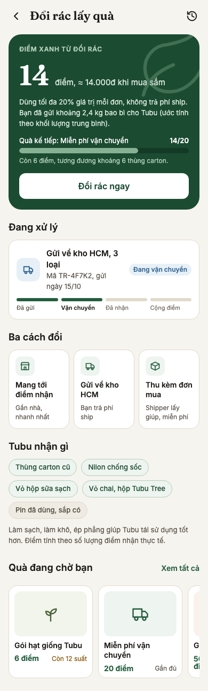

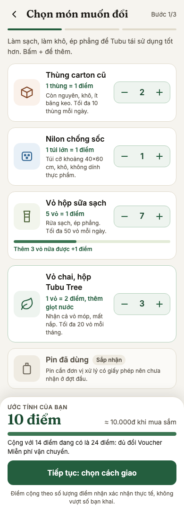

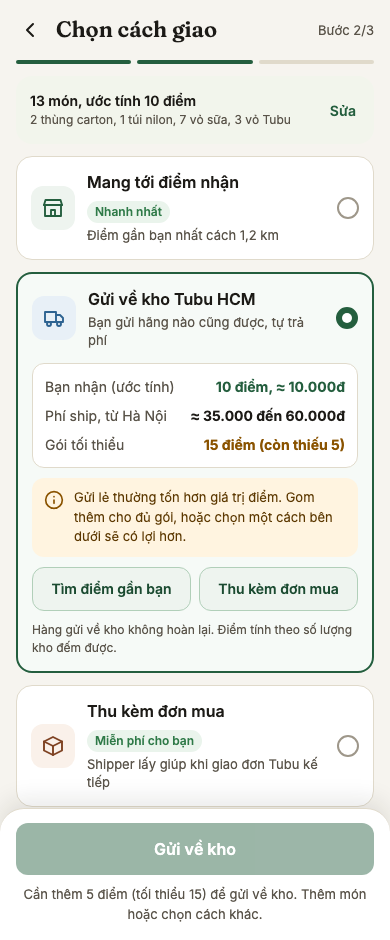

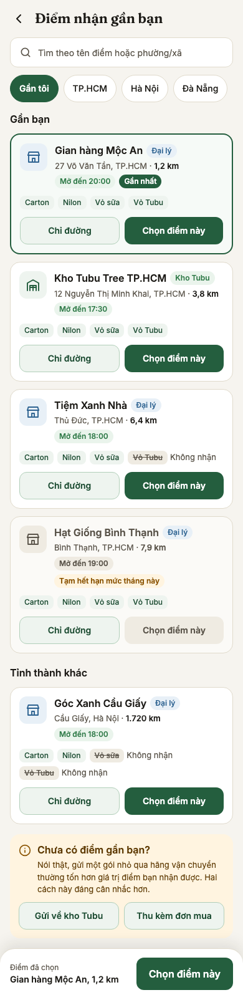

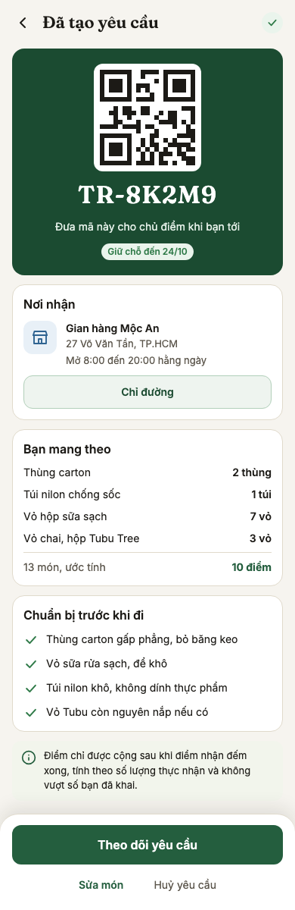

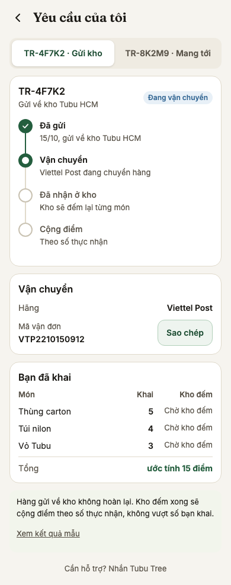

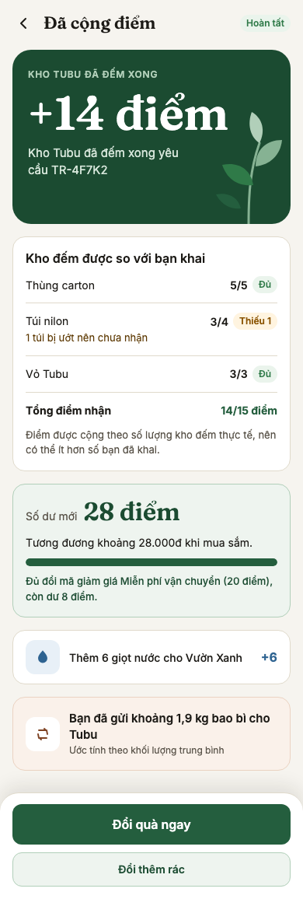

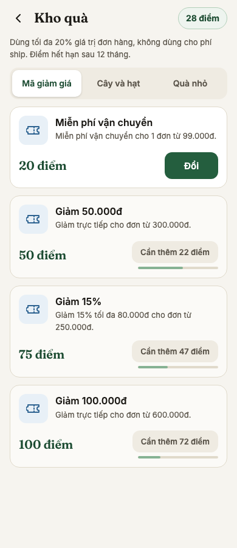

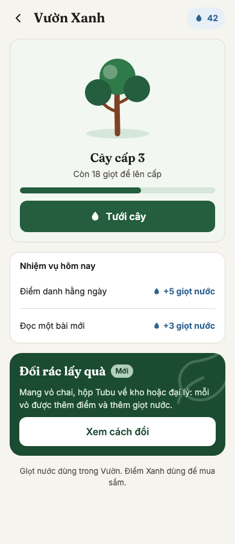

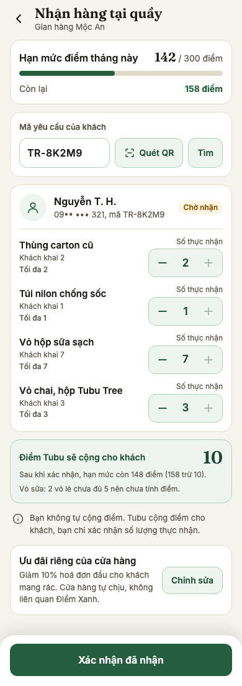

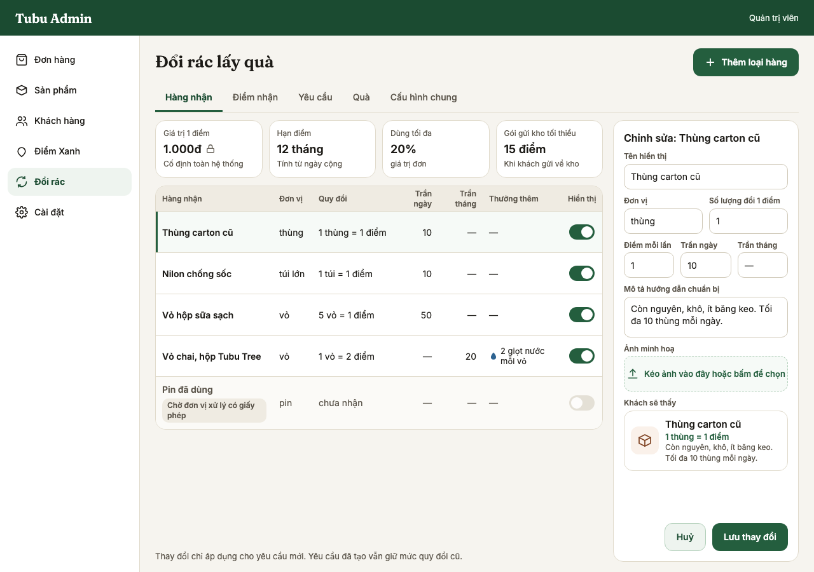

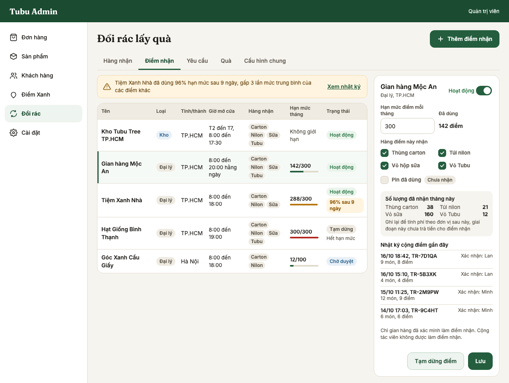

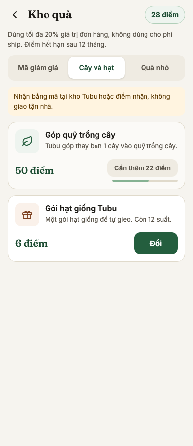

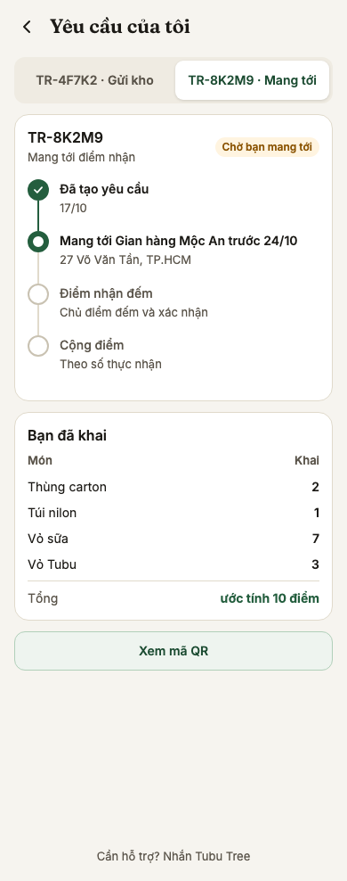

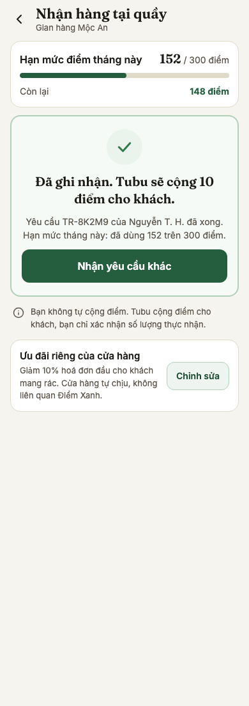

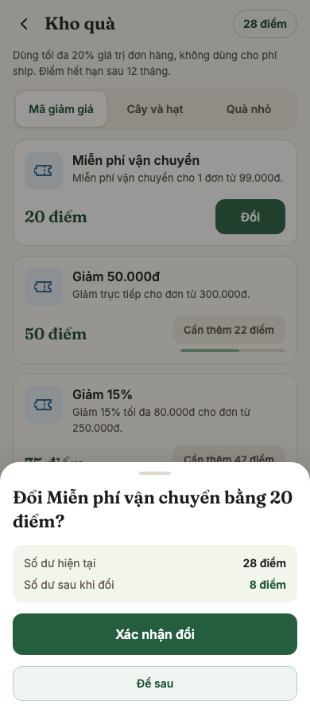
